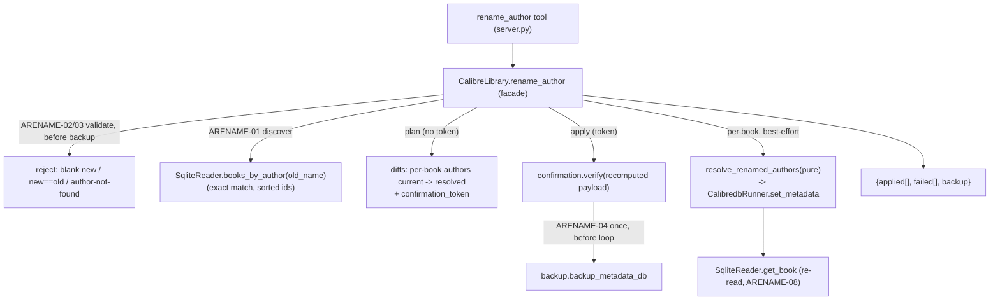

# Rename an Author Across the Library (ORGN-01) Design

**Spec**: `.specs/features/author-rename/spec.md`
**Status**: Implemented (AD-022 recorded); independent Verifier pending

---

## Architecture Overview

`rename_author` is a compound orchestration over primitives already Verified, following the **AD-020
best-effort batch pattern** with the **AD-012 plan→confirm gate** — but it is *not* a `BULK-01`
broadcast. A rename produces a **per-book distinct** author list (swap only `old_name` for
`new_name`, keep every co-author), which `update_metadata_bulk` explicitly cannot express (it
broadcasts one identical `fields` map). So ORGN-01 consumes the lower primitives directly:

1. **Discover** every book credited to `old_name` — a new read-layer method `SqliteReader.
   books_by_author(name)` (exact match, AD-001/AD-017 reader discipline).
2. **Resolve** each book's new author list with a pure function `resolve_renamed_authors` (new pure
   module, mirroring `bulk_edit.py`/`folder_scan.py`) — the single output feeds both the plan diff
   and the write (review == write, the BULK-01 principle).
3. **Gate** the batch with one deterministic `confirmation_token` over `(old_name, new_name, sorted
   discovered ids)` (AD-012 + AD-020 sentinel-id token).
4. **Apply** best-effort: one `metadata.db` backup before the loop (AD-011), then each book in
   `sorted` order via `calibredb set_metadata` → `applied`/`failed` buckets.

**The one blocking correctness finding (see Risks):** `CalibredbRunner.set_metadata` currently
comma-joins list fields, including `authors`. Empirically, `calibredb set_metadata --field
"authors:A,B"` creates a **single** mashed author `"A|B"`, while `--field "authors:A & B"` creates
**two** authors. So authors must be joined with ` & `, not `,`. This is a latent bug in the shared
write primitive (BULK-01's author path never exercised it) and a **prerequisite fix** — ORGN-01 is
unbuildable on top of the current serialization.



---

## Approaches Considered

| Approach | Summary | Verdict |
| --- | --- | --- |
| **A — Per-book resolve + AD-020 loop over `set_metadata`** (chosen) | New reader discovery + pure resolve fn; best-effort per-book `set_metadata` behind one batch token/backup. | ✅ Expresses the per-book distinct list; reuses the proven pattern; co-author-safe; merge falls out of the dedupe. |
| **B — Reuse `update_metadata_bulk` twice (`remove old`, then `add new`)** | Two batch ops via BULK-01 list-modes. | ❌ Two tokens/two backups; a single-author book passes through an **empty-author** intermediate state (illegal in Calibre); ordering/merge dedupe not expressible; review wouldn't show the true final list. |
| **C — Edit the `authors` table entity directly (SQL/calibredb author rename)** | Rename the author record once. | ❌ Violates **AD-001** (writes never via SQLite; reads never mutate). `calibredb` has no first-class author-entity rename subcommand; doing it in SQL skips Calibre's `author_sort`/integrity recompute. |

---

## Code Reuse Analysis

### Existing Components to Leverage

| Component | Location | How to Use |
| --- | --- | --- |
| AD-020 batch skeleton (validate → one backup → `sorted` best-effort loop → buckets) | `update_metadata_bulk` `library.py:334` | Same skeleton; `rename_author` is a sibling batch mutation. |
| AD-012 token (`plan_token`/`verify`, sentinel `_BULK_TOKEN_ID`) | `confirmation.py`, `library.py:76` | Batch token over `{old_name, new_name, book_ids}` — provably the reviewed rename. |
| `backup_metadata_db(db_path, backup_root)` | `backup.py` | One backup before the loop (AD-011), same call the other batch ops make. |
| `CalibredbRunner.set_metadata(book_id, {"authors": [...]})` | `calibredb_runner.py:96` | Write each book's resolved author list — **after the prerequisite serialization fix** (` & ` for authors). |
| `SqliteReader.get_book` / the `_authors` join | `sqlite_reader.py:77,167` | Re-read applied books (ARENAME-08); `books_by_author` reuses the same `authors`/`books_authors_link` join. |
| `_build_diff(book, fields)` | `library.py:757` | Per-book `authors: current → proposed` plan row (proposed = resolved list). |
| `InvalidInputError` / `ConfirmationError` / `_map_errors` / `_jsonify` | `errors.py`, `server.py:54,99` | Validation rejects + token mismatch + tool wrapping, exactly like the siblings. |

### Integration Points

| System | Integration Method |
| --- | --- |
| Tool surface (FastMCP) | New `@mcp.tool() @_map_errors def rename_author(old_name, new_name, confirmation_token=None)` returning `_jsonify(...)`. |
| Facade | New `CalibreLibrary.rename_author`; validation helper; reuses `_build_diff`, token, backup, runner, reader. |
| Read layer | New `SqliteReader.books_by_author(name) -> list[int]` (exact-match, sorted). |
| Pure logic | New pure module `author_rename.py` — `resolve_renamed_authors` (no I/O), mirrors `bulk_edit.py`. |
| Write primitive | **Fix** `CalibredbRunner.set_metadata` author serialization (` & `), a shared correctness fix. |

---

## Components

### `SqliteReader.books_by_author` (new read method)

- **Purpose**: Return the ids of every book credited to an author, by **exact** name — the discovery
  step for ORGN-01 (ARENAME-01/02).
- **Location**: `src/calibre_mcp/sqlite_reader.py`
- **Interface**: `books_by_author(self, name: str) -> list[int]` — ascending-sorted book ids whose
  `authors` include exactly `name`; empty list when no author matches.
- **Mechanism**: `SELECT DISTINCT l.book FROM books_authors_link l JOIN authors a ON a.id = l.author
  WHERE a.name = ? ORDER BY l.book` (parameterized; exact match, same join as `_authors`).
- **Reuses**: the read-only connection pattern + the authors join already in `_authors`.

### `resolve_renamed_authors` (new pure module `author_rename.py`)

- **Purpose**: Compute one book's post-rename author list — replace only `old` with `new`,
  order-preserving, in-book dedupe (ARENAME-07). No I/O; unit-testable without a scratch library
  (mirrors `bulk_edit.resolve_fields`).
- **Location**: `src/calibre_mcp/author_rename.py`
- **Interface**: `resolve_renamed_authors(authors: list[str], old: str, new: str) -> list[str]`
- **Behavior**:
  ```python
  def resolve_renamed_authors(authors, old, new):
      result: list[str] = []
      for a in authors:
          replacement = new if a == old else a
          if replacement not in result:   # order-preserving dedupe / merge
              result.append(replacement)
      return result
  ```
  Cases: `[Old]→[New]`; `[A,Old,B]→[A,New,B]`; `[Old,New]→[New]`; `[New,Old]→[New]`;
  `[Old,Old]→[New]`. A book credited to `old` always yields ≥1 author (never an empty list).
- **Reuses**: nothing — new leaf module.

### `CalibreLibrary.rename_author` (facade method)

- **Purpose**: Orchestrate the rename — validate, discover, plan→confirm, one backup, best-effort
  apply, honest `applied`/`failed`.
- **Location**: `src/calibre_mcp/library.py`
- **Interface**: `rename_author(self, old_name: str, new_name: str, token: str | None = None) -> dict[str, Any]`
- **Behavior (maps 1:1 to ACs)**:
  1. Validate **before** any backup: `new_name` non-blank and `new_name != old_name` else
     `InvalidInputError` (ARENAME-03); `book_ids = self._reader.books_by_author(old_name)`; if empty
     → `InvalidInputError("author not found: …")` (ARENAME-02).
  2. `ordered_ids = book_ids` (already sorted); `payload = {"old_name", "new_name", "book_ids": ordered_ids}`.
  3. **Plan** (`token is None`): return `{"status": "plan", "old_name", "new_name",
     "diffs": [ {book_id, diff: authors current→resolved} … ], "confirmation_token":
     plan_token(_OP_RENAME_AUTHOR, _BULK_TOKEN_ID, payload)}` — writes nothing (ARENAME-01).
  4. **Apply** (`token`): `verify(_OP_RENAME_AUTHOR, _BULK_TOKEN_ID, payload, token)` (ARENAME-05,
     mismatch when the discovered set changed since the plan); `backup = backup_metadata_db(...)`
     once (ARENAME-04); then `for book_id in ordered_ids:` best-effort — `book = get_book(book_id)`;
     `resolved = resolve_renamed_authors(book.authors, old_name, new_name)`;
     `set_metadata(book_id, {"authors": resolved})`; `reread = get_book(book_id)` →
     `applied.append({book_id, authors: reread.authors})`; `except CalibreMcpError` →
     `failed.append({book_id, error})` (ARENAME-06/08).
  5. return `{"status": "renamed", "old_name", "new_name", "applied": …, "failed": …, "backup": str(backup)}`.
- **Reuses**: AD-020 skeleton, token, backup, reader, `_build_diff`, `resolve_renamed_authors`.

### `CalibredbRunner.set_metadata` (behavior-corrected, shared)

- **Change**: join `authors` with `" & "`; keep `,` for the other list fields (`tags`, `languages`).
  Empirically required (Risks); a field-specific separator.
- **Impact**: also fixes BULK-01's latent multi-author bug — a **correctness** change, not a
  regression (see L-006 note in Risks). Existing single-author edits are unaffected (` & `.join of a
  one-element list == the name).

### `rename_author` tool (server)

- **Location**: `src/calibre_mcp/server.py`
- **Interface**: `@mcp.tool() @_map_errors def rename_author(old_name: str, new_name: str,
  confirmation_token: str | None = None) -> dict:` → `_jsonify(_get_library().rename_author(old_name,
  new_name, token=confirmation_token))`.
- **Docstring**: states exact-match, co-author-safe (only the named author changes), merge-onto-existing,
  the plan→confirm handshake, one backup, and honest `applied`/`failed`.

---

## Data Models

No persistent model. New op constant `_OP_RENAME_AUTHOR = "rename_author"` in `library.py` (bound
into the token, alongside `_OP_UPDATE_BULK`). Result shapes (ARENAME-01/04/06):

```python
# plan (no token)
{ "status": "plan", "old_name": str, "new_name": str,
  "diffs": [ {"book_id": int, "diff": {"authors": {"current": [...], "proposed": [...]}}} ],
  "confirmation_token": str }

# apply (token)
{ "status": "renamed", "old_name": str, "new_name": str,
  "applied": [ {"book_id": int, "authors": [...]} ],   # ARENAME-08 (re-read)
  "failed":  [ {"book_id": int, "error": str} ],        # ARENAME-06 (never aborts)
  "backup":  str }
# invariant: len(applied) + len(failed) == len(discovered book_ids)
```

Token: `plan_token("rename_author", 0, {"old_name", "new_name", "book_ids": sorted})`.

---

## Error Handling Strategy

| Error Scenario | Handling | Host sees |
| --- | --- | --- |
| `new_name` blank, or `new_name == old_name` | `InvalidInputError` before discovery/backup (ARENAME-03) | `ToolError`: invalid rename |
| `old_name` matches no author | `InvalidInputError("author not found")` before backup (ARENAME-02) | `ToolError`: author not found — never a silent empty success |
| Token mismatch (set changed since plan, or wrong token) | `ConfirmationError` via `verify`, writes nothing (ARENAME-05) | `ToolError`: re-plan and review |
| One book fails `set_metadata` (or vanished id) | Caught per-book → `failed[]`, batch continues (ARENAME-06) | Truthful `failed` entry; other books still renamed |
| `calibredb` binary missing | `CalibredbNotFoundError` (a `CalibreMcpError`) propagates on the first write | `ToolError` |
| Book credited to both `old_name` and `new_name` | Resolved to a single `new_name` (merge, ARENAME-07) | One deduped author in the re-read |

---

## Risks & Concerns

| Concern | Location | Impact | Mitigation |
| --- | --- | --- | --- |
| **BLOCKING — author serialization bug.** `set_metadata` comma-joins authors; `calibredb --field "authors:A,B"` creates ONE author `"A\|B"`, not two (empirically confirmed against calibredb 8.2). | `calibredb_runner.py:104` | Every co-authored rename would corrupt the book into a single mashed author — the exact failure ORGN-01 exists to prevent | **Prerequisite fix task:** join `authors` with `" & "`, other list fields with `,`. Behavior test: set a 2-author book, assert two distinct author entities read back. |
| Shared write primitive changes ordering/behavior for BULK-01 (**L-006**). | `calibredb_runner.py` `set_metadata`; `tests/**` | An over-strict BULK-01 test could assume the old (buggy) comma join | The change is a **bug fix** (old behavior was wrong; BULK-01's author path was never exercised — its assumption was unconfirmed). Reconcile any assertion against the spec, run the full suite as a regression gate before commit. |
| Backup-before-write order (**L-001**). | `library.py` `rename_author` apply | A post-hoc backup-file check wouldn't catch a wrong order | Add a call-order test (spy/monkeypatch) asserting `backup` runs before the first `set_metadata`. |
| Token recompute must match the plan when nothing changed. | `library.py` apply | Nondeterministic id order → false mismatch | `books_by_author` returns **sorted** ids; payload uses the sorted list; JSON sorted-keys normalization already in `plan_token`. |
| No cap on affected books → N sequential `set_metadata` subprocesses for a prolific author. | facade loop | Slow batch for a very prolific author | Accepted: a correct rename must cover **all** the author's books; a cap would make it silently partial (spec decision). Sequential keeps single-call-site discipline. |
| An author display name legitimately containing `" & "` (e.g. a studio credit) | `set_metadata` ` & ` join | Calibre would split it into two authors | Accepted limitation — Calibre itself uses ` & ` as the author separator; out of scope to escape. |

---

## Tech Decisions (only non-obvious ones)

| Decision | Choice | Rationale |
| --- | --- | --- |
| Reuse mechanism | AD-020 pattern + lower primitives, **not** `update_metadata_bulk` | Rename is a per-book *distinct* list; BULK-01 broadcasts identical fields (its own Out-of-Scope). Approaches B/C rejected above. |
| Author serialization | Field-specific: `authors` → `" & "`, `tags`/`languages` → `","` | Empirically required; comma mashes co-authors into one entity. → candidate **AD-022**. |
| Where discovery lives | New `SqliteReader.books_by_author` | Reads stay in the read layer (AD-001/AD-017); reuses the existing authors join. |
| Where resolve logic lives | New pure module `author_rename.py` | Pure, unit-testable set logic; mirrors `bulk_edit.py`/`folder_scan.py`; one output feeds plan + write (review == write). |
| Merge on rename | Allowed — in-book order-preserving dedupe | User decision (spec); merge is the usual intent of consolidating a variant spelling. |
| `old_name` not found | Reject before backup | User decision (spec); a rename of a non-existent author is almost always a typo. |
| Gate | plan→confirm + one batch token + one backup | Rename overwrites existing metadata across N books → not additive; AD-012/AD-020 apply (unlike additive `import_folder`/`convert_book_bulk`). |

> **Project-level decision to append to `.specs/STATE.md` on approval:** **AD-022** (below).

### Proposed AD-022 (for STATE.md on approval)

> **AD-022 — `calibredb set_metadata` serializes authors with ` & `, other list fields with `,`.**
> Establishes that the author field is separator-sensitive: `calibredb set_metadata --field
> "authors:A,B"` creates a single author `"A|B"`, whereas `"authors:A & B"` creates two. The shared
> write primitive (`CalibredbRunner.set_metadata`) therefore joins `authors` with `" & "` and
> `tags`/`languages` with `","`. Corrects a latent multi-author bug that predated ORGN-01 (BULK-01's
> author path was never exercised with more than one author). Established by ORGN-01 (`author-rename`).

---

## Requirement Coverage (design → spec)

| Requirement | Covered by |
| --- | --- |
| ARENAME-01 (discover + plan diff + token, no write) | `books_by_author` + `rename_author` plan branch + `_build_diff` |
| ARENAME-02 (author-not-found reject before backup) | `rename_author` validation |
| ARENAME-03 (blank / no-op new_name reject before backup) | `rename_author` validation |
| ARENAME-04 (one backup before loop, apply via set_metadata) | `rename_author` apply branch |
| ARENAME-05 (token mismatch → refuse, no write) | `verify` on recomputed payload |
| ARENAME-06 (per-book failure → `failed`, never aborts) | `rename_author` loop `except` |
| ARENAME-07 (co-author-safe replace + in-book dedupe/merge) | `resolve_renamed_authors` (+ ` & ` serialization) |
| ARENAME-08 (applied → re-read real authors) | `rename_author` loop `get_book` re-read |
