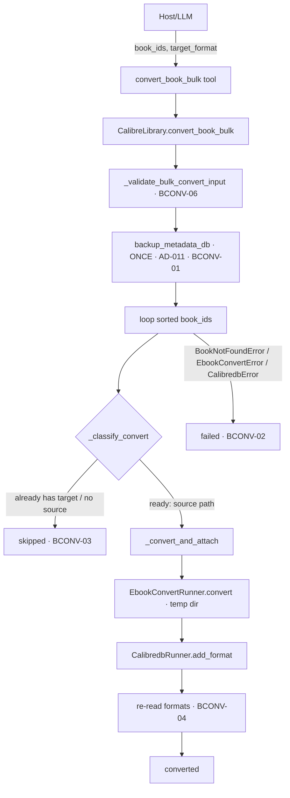

# Bulk Convert (BULK-02) Design

**Spec**: `.specs/features/bulk-convert/spec.md`
**Context**: `.specs/features/bulk-convert/context.md`
**Status**: Draft

---

## Architecture Overview

BULK-02 adds **one new tool** (`convert_book_bulk`) that converts N books to one broadcast
`target_format` through the *same* `EbookConvertRunner` + `CalibredbRunner.add_format` +
`backup_metadata_db` machinery the Verified single-book `convert_book` already uses (CONV-01,
AD-016, AD-011). No confirmation gate (convert is additive), no new subprocess pattern, no network.

The only genuinely new logic is the **three-bucket best-effort loop** (`converted`/`skipped`/
`failed`) plus its input validation. To keep one call site for the convert core, the existing
`convert_book`'s inner steps (resolve source → convert into a temp dir → `add_format`) are
**factored into two private facade helpers** that both the single and bulk tools consume — a
KISS refactor of Verified code (covered by the existing CONV-01 tests), not a new primitive.

Three moving parts:

1. **`_classify_convert` / `_convert_and_attach`** (new private facade helpers) — the shared convert
   core, split so *skip* is a return value and *failure* is an exception. No new I/O surface.
2. **`CalibreLibrary.convert_book_bulk`** (facade) — validate → one backup → best-effort loop over
   `sorted(book_ids)` into three buckets. Owns all side effects.
3. **`convert_book_bulk` tool** (server.py) — boundary narrowing + LLM-facing docstring, mirrors the
   existing `convert_book` tool shape.



---

## Code Reuse Analysis

### Existing Components to Leverage

| Component | Location | How to Use |
| --- | --- | --- |
| `SUPPORTED_CONVERT_FORMATS` | `src/calibre_mcp/library.py:28` | Reuse **unchanged**. The batch `target_format` is lowercased and validated against it once, up front (BCONV-06). |
| `SqliteReader.get_book(id)` | `src/calibre_mcp/sqlite_reader.py` | Reuse **unchanged**. Exists-precheck (vanished id → `BookNotFoundError` → `failed[]`), already-has-format check, and the post-convert re-read for `formats` (BCONV-04). |
| `SqliteReader.format_files(id)` | `src/calibre_mcp/sqlite_reader.py` (AD-017) | Reuse **unchanged**. Resolves the source file; empty → `skipped` no-source (BCONV-03). |
| `EbookConvertRunner.convert(source, target, out_dir)` | `src/calibre_mcp/ebook_convert_runner.py:23` | Reuse **unchanged**. Converts into a temp dir; failure/timeout → `EbookConvertError` → `failed[]` (BCONV-02). Already has a 300 s per-book timeout. |
| `CalibredbRunner.add_format(id, path)` | `src/calibre_mcp/calibredb_runner.py` | Reuse **unchanged**. Attaches the new format additively; error → `CalibredbError` → `failed[]`. |
| `backup_metadata_db` | `src/calibre_mcp/backup.py` | Reuse **unchanged**. Called **once**, before the loop — the single rollback point (AD-011, BCONV-01). Raises `OSError` before any convert if backup fails. |
| Error taxonomy + `_map_errors` | `src/calibre_mcp/errors.py`, `server.py:54` | Reuse **unchanged**. Per-book failures caught as `CalibreMcpError` inside the loop; batch-level validation errors propagate to `ToolError`. |
| `convert_book` inner steps | `src/calibre_mcp/library.py:140` | **Refactored** — its source-resolve/convert/attach body becomes the shared `_convert_and_attach`; `convert_book` keeps its current single-step + backup contract (skip conditions still raise `InvalidInputError` for the single tool). |

### Integration Points

| System | Integration Method |
| --- | --- |
| FastMCP tool surface | New `@mcp.tool()` `convert_book_bulk` next to `convert_book`, wrapped by `_map_errors`. Report values are already plain (ids, format strings) — JSON-friendly. |
| `metadata.db` (read) | Through `SqliteReader` only (AD-001) — no new SQL. |
| `ebook-convert` / `calibredb` (write) | Through `EbookConvertRunner` / `CalibredbRunner` only (AD-001/AD-005/AD-014) — no new subcommand. |

---

## Components

### `_classify_convert` + `_convert_and_attach` (new — private facade helpers)

- **Purpose**: The shared convert core, split so the bulk loop can treat a *skip* as data and a
  *failure* as an exception — the crux of the three-bucket contract without overloading exceptions.
- **Location**: `src/calibre_mcp/library.py`
- **Interfaces**:
  - `_classify_convert(book: Book, target: str) -> tuple[str, str | None]` — returns
    `("skip", reason)` when the book already has `target` (reason mentions the format) or has no
    source file (`format_files` empty), else `("ready", source_path)`. Pure classification over an
    already-read `Book`; **raises nothing** for the skip cases (they are return values).
  - `_convert_and_attach(book_id: int, target: str, source: str) -> None` — converts `source` into a
    `TemporaryDirectory` via `EbookConvertRunner.convert`, then `CalibredbRunner.add_format`. Raises
    `EbookConvertError` / `CalibredbError` on real failure (→ `failed[]`). Does **not** back up
    (the caller owns the one pre-loop backup).
- **Dependencies**: `SqliteReader.format_files`, `EbookConvertRunner`, `CalibredbRunner`.
- **Reuses**: the exact body extracted from today's `convert_book` (temp-dir convert + `add_format`).

### `CalibreLibrary.convert_book_bulk` (facade orchestration)

- **Purpose**: Convert N books to one target, one backup, best-effort three-bucket apply.
- **Location**: `src/calibre_mcp/library.py`
- **Interfaces**:
  - `convert_book_bulk(book_ids: list[int], target_format: str) -> dict`
  - `_validate_bulk_convert_input(book_ids, target_format) -> str` (new private) — BCONV-06 gate;
    returns the normalized (lowercased) target. Runs **before** any backup/convert.
- **Behavior**:
  - **Validate (BCONV-06, before anything):** `target_format.lower() ∈ SUPPORTED_CONVERT_FORMATS`;
    `book_ids` non-empty, every element an `int` (not `bool`), no duplicates, `len ≤ 50`.
  - **Backup (BCONV-01):** `backup_metadata_db` **once**, before the loop — the single rollback point
    (unconditional, even if every book will be skipped; harmless under rolling retention).
  - **Loop `sorted(book_ids)`:** for each id, inside a `try`:
    `book = get_book(id)` (vanished → `BookNotFoundError` → `failed[]`);
    `kind, info = _classify_convert(book, target)`;
    if `kind == "skip"` → `skipped.append({book_id, reason: info})` and continue;
    else `_convert_and_attach(id, target, info)` → re-read → `converted.append({book_id, formats})`.
    Any `CalibreMcpError` → `failed.append({book_id, error: str(exc)})` and continue (BCONV-02).
  - **Return:** `status:"converted"`, `converted[]`, `skipped[]`, `failed[]`, `backup`, `target_format`.
    Invariant `len(converted)+len(skipped)+len(failed) == len(book_ids)` (BCONV-05).
- **Dependencies**: the two helpers, `SqliteReader`, `backup`.
- **Reuses**: `SUPPORTED_CONVERT_FORMATS`, `_classify_convert`, `_convert_and_attach`, `backup_metadata_db`.

### `convert_book` (single tool facade) — refactor only

- **Change**: its inner source-resolve/convert/attach body moves into `_convert_and_attach`; the
  method becomes: validate target → `get_book` → `_classify_convert`; if skip → **raise
  `InvalidInputError(reason)`** (preserves today's single-tool contract: already-has-format /
  no-source are errors for a single call) → else `backup_metadata_db` → `_convert_and_attach` →
  re-read → return the CONV-01 dict. Its public contract and CONV-01 tests are unchanged.

### `convert_book_bulk` tool (server.py)

- **Purpose**: MCP boundary — narrow inputs, delegate to the facade, host guidance.
- **Location**: `src/calibre_mcp/server.py`
- **Interfaces**:
  - `convert_book_bulk(book_ids: list[int], target_format: str) -> dict`
- **Dependencies**: `CalibreLibrary`, `_map_errors`.
- **Reuses**: `_map_errors`, `_get_library`, `_jsonify`. Docstring mirrors `convert_book`: ADDITIVE +
  no token; documents the 50-book cap, the three honest buckets, and that `skipped` (already-has /
  no-source) is a benign no-op, not a failure.

---

## Data Models

No new persistent model. One in-memory result shape:

**Converted result**:
```python
{
  "status": "converted",
  "target_format": "epub",
  "converted": [{"book_id": 3, "formats": ["MOBI", "EPUB"]}],   # re-read, BCONV-04
  "skipped":   [{"book_id": 9, "reason": "already has EPUB"}],   # benign, BCONV-03
  "failed":    [{"book_id": 12, "error": "ebook-convert failed: …"}],  # BCONV-02
  "backup": "/…/backups/metadata-….db",
}
```
No confirmation token exists in this feature — convert is additive and single-step (AD-016). The
`_classify_convert` split is the key model decision: **skip = data, failure = exception**, so the
loop never has to distinguish a benign no-op from a real error by parsing an exception message.

---

## Error Handling Strategy

| Error Scenario | Handling | Host/LLM Impact |
| --- | --- | --- |
| Unsupported `target_format` | `_validate_bulk_convert_input` → `InvalidInputError` **before** backup/convert (BCONV-06) | Clear `ToolError`; nothing written |
| Empty / duplicate / non-int (incl. `bool`) `book_ids` | `_validate_bulk_convert_input` → `InvalidInputError` before backup (BCONV-06) | Clear `ToolError`; fail fast |
| `len(book_ids) > 50` | `_validate_bulk_convert_input` → `InvalidInputError` before backup (BCONV-06) | Clear `ToolError`; host pages |
| Book already has `target_format` | `_classify_convert` → `("skip", reason)` → `skipped[]` (BCONV-03) | Benign; reported as skipped, not failed |
| Book has no source file | `_classify_convert` → `("skip", "no source format")` → `skipped[]` (BCONV-03) | Benign; reported as skipped |
| Vanished id mid-batch | `get_book` raises `BookNotFoundError`, caught in loop → `failed[]` (BCONV-02) | Batch continues; that id reported failed |
| Corrupt/unsupported source, `ebook-convert` non-zero or 300 s timeout | `EbookConvertRunner.convert` raises `EbookConvertError`, caught → `failed[]` (BCONV-02) | Remaining books still convert; honest per-book error |
| `add_format` fails / lock mid-batch | `CalibredbError` / `LibraryLockedError` caught → `failed[]` (BCONV-02) | Batch continues; honest per-book error |
| `metadata.db` backup itself fails | `backup_metadata_db` raises `OSError` **before** the loop | Whole batch aborts before any convert — no un-backed-up mutation |

**Honesty invariant:** the loop never swallows an error into a fake success and never reports a
benign no-op as a failure; every book lands in exactly one of `converted` / `skipped` / `failed`,
and `len(converted)+len(skipped)+len(failed) == len(book_ids)` always holds (BCONV-05).

---

## Risks & Concerns

| Concern | Location | Impact | Mitigation |
| --- | --- | --- | --- |
| **Refactoring Verified `convert_book`.** Extracting `_convert_and_attach` touches CONV-01 code. | `library.py:140` | A regression in the single tool | The existing CONV-01 integration/e2e tests must stay green unchanged; the refactor is behavior-preserving (skip cases still raise `InvalidInputError` for the single path). A dedicated task asserts the CONV-01 suite is untouched and passing. |
| **Long batch latency.** 50 books × up to 300 s each is a large worst-case wall-clock time; conversions are sequential. | facade loop | A big batch can run for many minutes | Accepted for a personal single-user tool: the 50-cap bounds it, the per-book timeout bounds each step, and honesty of the final report matters more than speed. Parallelism is a documented deferred idea. |
| **Unconditional pre-loop backup** produces a `metadata.db` snapshot even for an all-skipped batch. | facade | Occasional no-op backup file | Harmless under AD-011 rolling retention (last 20); consistency with BULK-01's "one rollback point before the batch" is worth more than saving one snapshot. Documented as an accepted assumption. |
| **Calibre may re-normalize the format list** on re-read (case, ordering). | re-read | `converted.formats` ordering not guaranteed | Acceptable: re-read shows demonstrated truth (project principle); tests assert the target format is *present*, not an exact list order. |
| **Skip reason is a human string**, not a machine enum. | `_classify_convert` | Host can't branch precisely on skip reason | Acceptable for BULK-02 (host surfaces text to the user); a `reason_code` enum is a deferrable enhancement if a real need appears. |

---

## Tech Decisions (only non-obvious ones)

| Decision | Choice | Rationale |
| --- | --- | --- |
| Skip vs. failure representation | **Skip = return value** (`_classify_convert` → `("skip", reason)`), **failure = exception** caught in the loop | The bulk loop never has to distinguish a benign no-op from a real error by parsing an exception message — the two are structurally different (spec BCONV-02/03). |
| No confirmation token | Single-step + one backup, like single `convert_book` | AD-016: convert is additive (keeps existing formats), never overwrites; a token would add friction for a non-destructive op. Matches the roadmap's stated BULK-02 contract. |
| Shared convert core | **Refactor** `convert_book`'s body into `_convert_and_attach` rather than duplicate it | One call site for the `ebook-convert` → `add_format` sequence (AD-014 discipline); DRY without a new primitive. |
| Batch-size cap | Reject `len > 50` as invalid input | User decision (context.md); reuses `DEFAULT_LIMIT` sensibility; bounds worst-case wall-clock and accidental "convert everything". |
| Report + processing order | `sorted(book_ids)` ascending for the loop and all three buckets | Deterministic, reproducible reporting (spec assumption + edge case). |
| Per-book failure catch scope | Catch `CalibreMcpError` inside the loop (covers `BookNotFoundError`, `EbookConvertError`, `CalibredbError`, `LibraryLockedError`) | Best-effort contract: any single-book failure — including a mid-batch lock — is reported per book, never aborts the batch (BCONV-02). Input errors are excluded (validated up front). |

> **Reuses AD-020 pattern lineage:** BULK-01 introduced the multi-book best-effort loop (per-item
> `applied`/`failed`). BULK-02 extends it to a **three-bucket** shape (adds `skipped` for benign
> no-ops) and drops the token (additive op). No new AD required — it is consistent with AD-016
> (additive convert, no gate) and AD-011 (one backup before the batch). Note it in `.specs/STATE.md`
> Handoff on completion.

---

## Requirement Coverage (design-level)

| Requirement | Covered by |
| --- | --- |
| BCONV-01 (additive bulk convert, one backup, no token) | facade `convert_book_bulk` + `backup_metadata_db` once |
| BCONV-02 (best-effort partial failure) | loop `try/except CalibreMcpError` → `failed[]` |
| BCONV-03 (benign no-op → skipped) | `_classify_convert` → `("skip", reason)` → `skipped[]` |
| BCONV-04 (re-read resulting formats on success) | apply loop re-read → `converted[]` |
| BCONV-05 (three-bucket invariant) | loop routes each id to exactly one bucket |
| BCONV-06 (invalid input rejected pre-write) | `_validate_bulk_convert_input` (target, ids, cap) |

---

## Tips / Notes for Tasks

- Independent tests derive from the spec's **Independent Test** block — bootstrap a scratch library
  (test-safety rule: never the real library), assert read-back (target format present, existing
  format preserved), not internal calls.
- The CONV-01 refactor gets its own regression assertion: the existing `convert_book` single-tool
  tests must pass unchanged (behavior-preserving extraction).
- `_classify_convert` is pure over a `Book` + `format_files` result — unit-testable for the two skip
  cases and the ready case without running a conversion.
- The three-bucket invariant (`converted+skipped+failed == N`) gets an explicit assertion in the
  mixed-batch integration test (Independent Test scenario 2).
