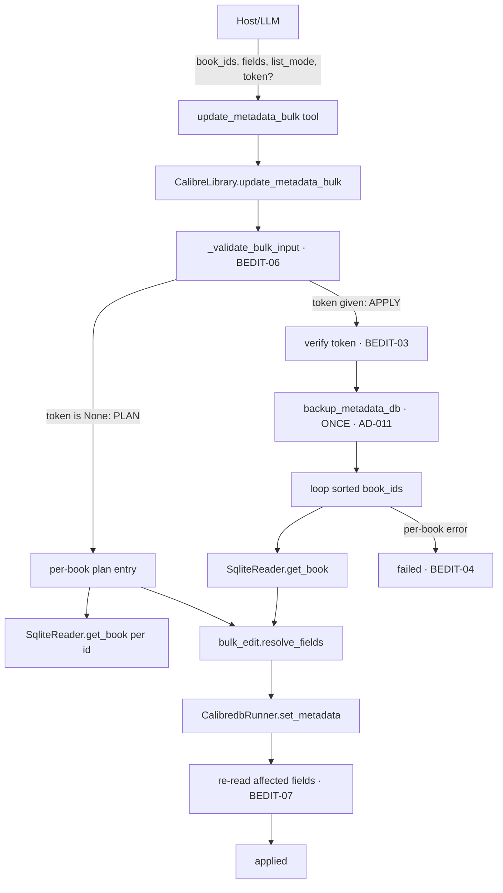

# Bulk Metadata Edit (BULK-01) Design

**Spec**: `.specs/features/bulk-metadata-edit/spec.md`
**Context**: `.specs/features/bulk-metadata-edit/context.md`
**Status**: Draft

---

## Architecture Overview

BULK-01 adds **one new tool** (`update_metadata_bulk`) that broadcasts a single `fields` set to N
books through the *same* plan→confirm / backup / `set_metadata` machinery the Verified single-book
`update_metadata` already uses (AD-012, AD-011). No new subprocess, no network, no new runner method
(context.md). The only genuinely new logic is the **per-book list-mode resolution** (`add`/`remove`/
`replace` for `tags`/`authors`/`languages`), isolated as pure functions in a new `bulk_edit.py`
module so the set algebra is unit-testable and the facade stays thin orchestration (side effects at
the edges).

Three moving parts:

1. **`bulk_edit.py`** (new, pure) — the list-mode set algebra + per-book field resolution. No I/O.
2. **`CalibreLibrary.update_metadata_bulk`** (facade) — validate → (plan | verify→backup→loop).
   Orchestrates existing primitives; owns all side effects.
3. **`update_metadata_bulk` tool** (server.py) — boundary narrowing + LLM-facing docstring, mirrors
   the existing `update_metadata` tool shape.



---

## Code Reuse Analysis

### Existing Components to Leverage

| Component | Location | How to Use |
| --- | --- | --- |
| `plan_token` / `verify` | `src/calibre_mcp/confirmation.py` | Reuse **unchanged**. One batch token over `(op, sentinel_id, payload)` where `payload={book_ids: sorted, fields, list_mode}`. `verify` recomputes it — tampering with any id/field/mode invalidates it (BEDIT-03). |
| `backup_metadata_db` | `src/calibre_mcp/backup.py` | Reuse **unchanged**. Called **once**, before the write loop — the single rollback point for the batch (AD-011, BEDIT-05). Raises `OSError` before any write if backup fails. |
| `CalibredbRunner.set_metadata(id, fields)` | `src/calibre_mcp/calibredb_runner.py:95` | Reuse **unchanged**. Called once per book with the *resolved* fields (list modes already applied). It comma-joins list values as Calibre expects. |
| `SqliteReader.get_book(id)` | `src/calibre_mcp/sqlite_reader.py:76` | Reuse **unchanged**. Reads current values for the diff and list-mode base; raises `BookNotFoundError` for a vanished id (→ `failed[]`, BEDIT-04). |
| `CalibreLibrary._validate_edit_fields` | `src/calibre_mcp/library.py:377` | Reuse **unchanged**. Same field whitelist, `series_index`-needs-`series`, and rating-range checks as single-book edit (BEDIT-06). |
| `_build_diff` shape | `src/calibre_mcp/library.py:421` | Reference the `{current, proposed}` shape; the bulk plan emits the same per field, but `proposed` is the **resolved** set per book (BEDIT-08 AC-4). |
| Error taxonomy + `_map_errors` | `src/calibre_mcp/errors.py`, `server.py:54` | Reuse **unchanged**. Per-book failures are caught as `CalibreMcpError` inside the loop; validation errors propagate to `ToolError`. |

### Integration Points

| System | Integration Method |
| --- | --- |
| FastMCP tool surface | New `@mcp.tool()` `update_metadata_bulk` next to `update_metadata`, wrapped by `_map_errors`, shaping the applied `Book` re-reads via the existing `_jsonify`/`_book_to_dict` helpers. |
| `metadata.db` (read) | Through `SqliteReader` only (AD-001) — no new SQL. |
| `calibredb` (write) | Through `CalibredbRunner.set_metadata` only (AD-001/AD-005) — no new subcommand. |

---

## Components

### `bulk_edit.py` (new — pure functions, no I/O)

- **Purpose**: The list-mode set algebra and per-book field resolution — the only new logic in
  BULK-01, kept pure so BEDIT-08/09 are unit-testable without a library.
- **Location**: `src/calibre_mcp/bulk_edit.py`
- **Interfaces**:
  - `LIST_FIELDS: frozenset` = `{"authors", "tags", "languages"}` — the list-valued editable fields
    a `list_mode` can apply to (the fields `set_metadata` comma-joins).
  - `LIST_MODES: frozenset` = `{"replace", "add", "remove"}`.
  - `apply_list_mode(current: list[str], supplied: list[str], mode: str) -> list[str]` —
    `add` = current + supplied-not-already-present (order-preserving union, idempotent BEDIT-09);
    `remove` = current minus supplied (missing values ignored, BEDIT-09); `replace` = supplied as-is.
  - `resolve_fields(current: Book, fields: dict, mode: str) -> dict` — returns the exact field map to
    write for one book: list fields under a non-`replace` mode are resolved via `apply_list_mode`,
    everything else is passed through. This is the single source the plan diff **and** the write both
    consume, so the review reflects exactly what is written (BEDIT-08 AC-4).
- **Dependencies**: none (duck-typed `Book` via `getattr`).
- **Reuses**: nothing — new leaf module.

### `CalibreLibrary.update_metadata_bulk` (facade orchestration)

- **Purpose**: Broadcast `fields` to N books via plan→confirm, one backup, best-effort per-book apply.
- **Location**: `src/calibre_mcp/library.py`
- **Interfaces**:
  - `update_metadata_bulk(book_ids: list[int], fields: dict, list_mode: str = "replace", token: str | None = None) -> dict`
  - `_validate_bulk_input(book_ids, fields, list_mode) -> None` (new private) — BEDIT-06 gate, runs
    **before** any token/backup/write.
  - `_bulk_plan_entry(book_id, fields, list_mode) -> dict` (new private) — one book's plan row.
- **Behavior**:
  - **Validate (BEDIT-06, before anything):** `list_mode ∈ LIST_MODES`; `book_ids` non-empty, every
    element an `int` (not `bool`), no duplicates; `fields` non-empty and passes `_validate_edit_fields`;
    if `list_mode ∈ {add, remove}` then `fields` must contain at least one `LIST_FIELDS` member
    (a mode with nothing to apply to is a caller error — spec edge case).
  - **Plan (no token):** for each `sorted(book_ids)`, emit `{book_id, found: false}` for a vanished id
    or `{book_id, found: true, diff: {field: {current, proposed}}}` with `proposed` = resolved set.
    Return `status:"plan"`, `list_mode`, `diffs[]`, and `confirmation_token`. Writes nothing (BEDIT-01).
  - **Apply (token):** `verify` the token (BEDIT-03); `backup_metadata_db` **once** (BEDIT-05); then
    iterate `sorted(book_ids)`: `get_book` → `resolve_fields` → `set_metadata` → re-read affected
    fields → `applied[]`; any `CalibreMcpError` (vanished id, calibredb/lock error) → `failed[]` and
    continue (BEDIT-04). Return `status:"applied"`, `applied[]`, `failed[]`, `backup`, `list_mode`.
- **Dependencies**: `bulk_edit`, `SqliteReader`, `CalibredbRunner`, `backup`, `confirmation`.
- **Reuses**: `_validate_edit_fields`, `plan_token`/`verify`, `backup_metadata_db`, `set_metadata`.

### `update_metadata_bulk` tool (server.py)

- **Purpose**: MCP boundary — narrow inputs, delegate to the facade, shape output, host guidance.
- **Location**: `src/calibre_mcp/server.py`
- **Interfaces**:
  - `update_metadata_bulk(book_ids: list[int], fields: dict[str, Any], list_mode: str = "replace", confirmation_token: str | None = None) -> dict`
- **Dependencies**: `CalibreLibrary`, `_map_errors`.
- **Reuses**: `_map_errors`, `_book_to_dict`. Docstring mirrors `update_metadata`: instruct the HOST to
  surface the per-book plan and only re-call with the token after user approval; document `list_mode`
  and the honest `applied`/`failed` partial-failure contract.

---

## Data Models

No new persistent model. Three in-memory shapes:

**Token payload** (hashed, deterministic):
```python
payload = {"book_ids": sorted(book_ids), "fields": fields, "list_mode": list_mode}
token = plan_token("update_metadata_bulk", _BULK_TOKEN_ID, payload)  # _BULK_TOKEN_ID = 0 sentinel
```
`plan_token` JSON-normalizes with `sort_keys=True`, so the token is stable regardless of caller key
order and changes if any id, field, value, or mode changes (BEDIT-03). The positional `book_id` arg is
a fixed sentinel (`0`) because the batch identity lives entirely in `payload.book_ids`.

**Plan result**:
```python
{
  "status": "plan",
  "list_mode": "add",
  "diffs": [
    {"book_id": 3, "found": True,
     "diff": {"tags": {"current": ["a", "b"], "proposed": ["a", "b", "c"]}}},
    {"book_id": 9, "found": False},
  ],
  "confirmation_token": "…16 hex…",
}
```

**Applied result**:
```python
{
  "status": "applied",
  "list_mode": "add",
  "applied": [{"book_id": 3, "fields": {"tags": ["a", "b", "c"]}}],  # re-read, BEDIT-07
  "failed":  [{"book_id": 9, "error": "book 9 not found"}],          # BEDIT-04
  "backup": "/…/backups/metadata-….db",
}
```

---

## Error Handling Strategy

| Error Scenario | Handling | Host/LLM Impact |
| --- | --- | --- |
| Empty `book_ids`, duplicate id, non-int id | `_validate_bulk_input` → `InvalidInputError` **before** token/backup/write (BEDIT-06) | Clear `ToolError`; nothing written, no token issued |
| Empty `fields`, unknown field, `series_index` w/o `series`, rating out of 0–10 | `_validate_edit_fields` reused → `InvalidInputError` before write (BEDIT-06) | Clear `ToolError`; fail fast, no partial state |
| `list_mode` not in `{replace,add,remove}` | `_validate_bulk_input` → `InvalidInputError` (edge case) | Clear `ToolError`; no write |
| `list_mode ∈ {add,remove}` but no list field in `fields` | `_validate_bulk_input` → `InvalidInputError` (edge case) | Clear `ToolError`; no write |
| Token mismatch on apply | `verify` → `ConfirmationError` (BEDIT-03) | "re-plan and review"; nothing written |
| One id vanished between plan and apply | `get_book` raises `BookNotFoundError`, caught in loop → `failed[]` (BEDIT-04, edge case) | Batch continues; that id reported failed, never a fake success |
| One book's `calibredb set_metadata` fails / lock mid-batch | `CalibredbError`/`LibraryLockedError` caught in loop → `failed[]` (BEDIT-04) | Remaining books still applied; honest per-book error string |
| `metadata.db` backup itself fails | `backup_metadata_db` raises `OSError` **before** the loop | Whole apply aborts before any write — no un-backed-up mutation |

**Honesty invariant:** the loop never swallows an error into an empty success; every book lands in
exactly one of `applied` / `failed`, and `len(applied)+len(failed) == len(book_ids)` always holds.

---

## Risks & Concerns

| Concern | Location | Impact | Mitigation |
| --- | --- | --- | --- |
| **Empty-list clear is unverified.** `set_metadata` builds `--field tags:` for an empty list; `calibredb set_metadata --help` does not document that an empty value clears the field. `list_mode=remove` emptying a list (spec edge case) depends on it. | `calibredb_runner.py:103` | A `remove` that empties `tags` might no-op or error instead of writing `[]` | A dedicated task **verifies** the empty-clear behavior against the scratch library; if `--field tags:` does not clear, adjust `set_metadata` accordingly. Flagged, not assumed. |
| **Calibre may re-normalize written list values** (case-folding/dedup of tags, `authors` coerced to "Unknown" when emptied) so a book's re-read `applied.fields` can differ from the plan's `proposed`. | `library.py` re-read | Re-read (BEDIT-07) may not byte-match the diff | Acceptable and *correct*: re-read shows demonstrated truth (project principle). Note it in the tool docstring so the host doesn't treat plan≠result as failure. `apply_list_mode` uses exact-string matching; Calibre's own normalization is downstream. |
| **`languages` under list modes** takes ISO-639 codes (`en`), not names. A caller passing `English` with `add` unions a bad code. | `bulk_edit.LIST_FIELDS` | A malformed language code could be written | Same surface as today's single-book edit (no new risk); `set_metadata`/calibredb reject invalid codes → per-book `failed[]`. Documented in the tool docstring. |
| **Broadcast `replace` on a list field is destructive by design** ("replace tags" overwrites every book's tags). | facade apply | User footgun if they meant `add` | The per-book plan diff shows the true `[…] → […]` result *before* any write (BEDIT-08 AC-4); the two-step gate forces review. Docstring calls out `replace` as overwrite. |
| Facade file growth (`library.py` ~427 lines already). | `library.py` | Readability drift | Pure set logic extracted to `bulk_edit.py`; only thin orchestration + validation added to the facade. |

---

## Tech Decisions (only non-obvious ones)

| Decision | Choice | Rationale |
| --- | --- | --- |
| Batch token identity | Reuse `plan_token` with a **sentinel `book_id=0`** and the batch in `payload={book_ids: sorted, fields, list_mode}` | Zero change to the Verified `confirmation.py`; one hash covers the whole batch and is order-insensitive to caller key order (BEDIT-03). |
| `list_mode` scope | **One batch-level** param over `LIST_FIELDS = {authors, tags, languages}` (all list-valued editable fields), not per-field | KISS + uniform rule (spec assumption "supported uniformly as a list field"); languages included for consistency since `set_metadata` already treats it as a list. Per-field modes deferred (context.md). |
| Where list algebra lives | New pure module `bulk_edit.py`; validation stays on the facade (reuses `_validate_edit_fields`) | Side effects at the edges; the tricky union/difference (BEDIT-08/09) becomes unit-testable in isolation without a scratch library. |
| Re-read scope on success | **Affected fields only** (`{name: getattr(reread, name) for name in fields}`), not the full `Book` | Lean payload for N books while still *demonstrating* success (BEDIT-07, context.md discretion). |
| Processing + report order | `sorted(book_ids)` ascending for token, plan, apply, and reports | Deterministic, reproducible `applied[]`/`failed[]` (spec assumption + edge case). |
| Per-book failure catch scope | Catch `CalibreMcpError` inside the loop (covers `BookNotFoundError`, `CalibredbError`, `LibraryLockedError`) | Best-effort contract: any single-book failure — including a mid-batch lock — is reported per book, never aborts the batch (BEDIT-04). Input errors are already excluded (validated up front). |

> **Project-level decision to record:** the sentinel-id + payload batch-token scheme is the pattern the
> downstream Phase-2 organization features (ORGN-01 author-rename, ORGN-02 tag-rename, BULK-02 convert)
> will reuse for their own multi-book plan→confirm gates. Proposed as **AD-020** in `.specs/STATE.md`
> (added on design approval).

---

## Requirement Coverage (design-level)

| Requirement | Covered by |
| --- | --- |
| BEDIT-01 (plan, no write) | facade plan branch + `_bulk_plan_entry` |
| BEDIT-02 (apply via set_metadata) | facade apply loop + `CalibredbRunner.set_metadata` |
| BEDIT-03 (token mismatch refused) | `confirmation.verify` over sentinel+payload |
| BEDIT-04 (best-effort partial failure) | loop `try/except CalibreMcpError` → `failed[]` |
| BEDIT-05 (one backup before writes) | `backup_metadata_db` once, before loop |
| BEDIT-06 (invalid input rejected pre-write) | `_validate_bulk_input` + `_validate_edit_fields` |
| BEDIT-07 (re-read affected fields) | apply loop re-read into `applied[]` |
| BEDIT-08 (add/remove/replace + true diff) | `bulk_edit.apply_list_mode` + `resolve_fields` (plan & write) |
| BEDIT-09 (idempotent add/remove) | order-preserving union / ignore-missing difference |

---

## Tips / Notes for Tasks

- Independent tests derive from the spec's two **Independent Test** blocks — bootstrap a scratch
  library (test-safety rule: never the real library), assert read-back, not internal calls.
- `bulk_edit.apply_list_mode` gets a focused unit test table (union dedup, ignore-missing, empty
  result, replace pass-through) — pure, no fixture.
- Add the empty-list-clear **verification** as its own task before relying on `remove`-to-empty.
