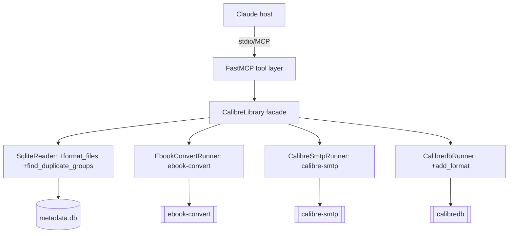

# Calibre Management P2 — Design (Convert, Organize & Email)

**Spec**: `.specs/features/calibre-management-p2/spec.md`
**Builds on**: `calibre-management` (P1) — reuses its facade, runners, reader, backup, confirmation.
**Status**: Draft
**Project decisions**: `.specs/STATE.md` — conforms to AD-001 (layer rule), AD-005 (arg-list
subprocess), AD-007 (env config), AD-011 (backup-before-write), AD-012 (plan→confirm). Adds
AD-013…AD-017.

---

## Architecture Overview

Two new external CLIs join `calibredb`, each behind its own **sibling runner** that mirrors the P1
`_run` discipline (arg-list, `shell=False`, failure→taxonomy). The tool layer still never touches
`subprocess`/`sqlite3` directly (AD-001 preserved). File-path resolution for a book's on-disk format
files is added to the P1 `SqliteReader` so reads stay in the read layer.



**Tool flows:**
- **CONV-01** `convert_book(id, target_format)` — single-step + backup (additive, like P1 `add_book`;
  AD-016). Resolve source file (`SqliteReader.format_files`) → refuse if `target_format` already
  present (stay additive; keep old + new) → `ebook-convert` to a temp file → `backup_metadata_db()`
  → `calibredb add_format id <tmp> --dont-replace` → re-read and return (book now has old + new).
- **ORG-01** `find_duplicates()` — pure read (no subprocess, lock-independent). Group books by a
  normalized `(title, primary author)` key; return groups of size ≥ 2.
- **EMAIL-01** `email_book(id, recipient, format=None)` — plan→confirm (outward-facing; AD-012).
  Plan: resolve the attachment format (explicit `format`, else device order) + show
  recipient/subject/file, return a `confirmation_token` — **nothing sent**. Apply: verify token →
  `calibre-smtp` with env-sourced relay config → report sent.

---

## Code Reuse Analysis

### Existing Components to Leverage (from P1)

| Component | Location | How to Use |
| --------- | -------- | ---------- |
| `SqliteReader` | `src/calibre_mcp/sqlite_reader.py` | Extend with `format_files` + `find_duplicate_groups` (reads stay here, AD-001) |
| `CalibredbRunner._run` pattern | `src/calibre_mcp/calibredb_runner.py:52` | Mirror the arg-list/`shell=False`/taxonomy discipline in the two new runners; add `add_format` here |
| `plan_token` / `verify` | `src/calibre_mcp/confirmation.py` | Reuse verbatim for `email_book` (new op name `email_book`) |
| `backup_metadata_db` | `src/calibre_mcp/backup.py` | Call before `add_format` in `convert_book` (AD-011) |
| `load_config` / `Config` | `src/calibre_mcp/config.py` | Add `SmtpConfig` + `load_smtp_config()` alongside (AD-007) |
| `_map_errors` / `_jsonify` / `_get_library` | `src/calibre_mcp/server.py:53` | Wrap the 3 new tools exactly like the P1 tools |
| Error taxonomy | `src/calibre_mcp/errors.py` | Add `EbookConvertError/NotFound`, `CalibreSmtpError/NotFound`, `SmtpNotConfiguredError` |

### Integration Points

| System | Integration Method |
| ------ | ------------------ |
| `ebook-convert` (Calibre 8.2) | `EbookConvertRunner`: `ebook-convert <src> <tmp>.<ext>`, arg-list |
| `calibre-smtp` (Calibre 8.2) | `CalibreSmtpRunner` compose mode: `-a <file> -s <subject> <from> <to> <body>`, `--relay/--port/-u/-p/-e` from env |
| `calibredb add_format` | `CalibredbRunner.add_format(id, path)` — attach the converted file, `--dont-replace` |
| On-disk book files | `SqliteReader.format_files`: `{library}/{books.path}/{data.name}.{format.lower()}` |

---

## Components

### `sqlite_reader.py` — additions (ORG-01, path resolution)
- **`format_files(book_id: int) -> dict[str, Path]`** — map each format (e.g. `"EPUB"`) to its
  absolute on-disk path, joining `data.name`, `books.path`, and the library root. Verifies the file
  exists; raises `BookNotFoundError` for an unknown id and a clear error for a missing file.
- **`find_duplicate_groups() -> list[list[Book]]`** — groups (size ≥ 2) of books sharing a normalized
  key `(casefold+strip title, casefold+strip primary author)`. Hydrates full `Book`s per group.
- **Constructor change**: gains the library root (`SqliteReader(db_path, library_path)`) — needed to
  build absolute file paths. `CalibreLibrary` construction updated accordingly.

### `calibredb_runner.py` — addition
- **`add_format(book_id: int, path: Path) -> None`** — `calibredb add_format <id> <path>
  --dont-replace`; failure classified by the existing `_raise_for_error`. Additive: never removes an
  existing format.

### `ebook_convert_runner.py` — NEW runner (CONV-01)
- **Purpose**: the single `ebook-convert` subprocess call site.
- **`convert(source: Path, target_ext: str, out_dir: Path) -> Path`** — run
  `ebook-convert <source> <out_dir>/<stem>.<target_ext>`; return the produced path. Arg-list,
  `shell=False`, sane subprocess timeout. Missing binary → `EbookConvertNotFoundError`; non-zero →
  `EbookConvertError` (stderr). Never `shell=True`.

### `calibre_smtp_runner.py` — NEW outward-facing runner (EMAIL-01)
- **Purpose**: the single `calibre-smtp` subprocess call site.
- **`send(cfg: SmtpConfig, sender, recipient, subject, body, attachment: Path) -> None`** —
  compose-mode call with relay options from `cfg`. Password passed as a subprocess arg (unavoidable
  for this CLI) but **never logged, never returned in any output**; any echoed stderr is scrubbed of
  it. Missing binary → `CalibreSmtpNotFoundError`; non-zero → `CalibreSmtpError`.

### `config.py` — addition (AD-007, AD-015)
- **`SmtpConfig`** (frozen dataclass): `relay, port, username, password, encryption, sender`. Custom
  `__repr__` masks `password`.
- **`load_smtp_config() -> SmtpConfig`** — read `CALIBRE_MCP_SMTP_*`; raise `SmtpNotConfiguredError`
  (a `ConfigError`) naming the missing var. Called **lazily inside `email_book`**, not at startup —
  email is optional; the server must boot without SMTP.

### `library.py` — facade additions
- **`convert_book(book_id, target_format) -> dict`** — validate `target_format` against the supported
  set; `get_book` exists-precheck; `format_files` to pick a source; refuse (`InvalidInputError`) if
  `target_format` already present; convert to a temp dir → `backup_metadata_db()` → `add_format` →
  re-read. `tempfile.TemporaryDirectory` cleans up even on failure. Result carries old **and** new
  formats.
- **`find_duplicates() -> dict`** — delegate to `find_duplicate_groups`; shape groups for output.
  Never mutates.
- **`email_book(book_id, recipient, format=None, token=None) -> dict`** — plan→confirm. Plan:
  exists-precheck, resolve attachment format + file, validate recipient shape, return
  recipient/format/subject/file + `plan_token("email_book", id, {"recipient":…, "format":…})`. Apply:
  `verify` → `load_smtp_config()` → `format_files` → `CalibreSmtpRunner.send`. No metadata backup (no
  library mutation). Never echoes the SMTP password.

### `server.py` — 3 new `@mcp.tool()` + `_map_errors`
- **`convert_book(book_id, target_format)`** — docstring: additive (keeps existing formats), refuses
  if target already present.
- **`find_duplicates()`** — read-only advisory report.
- **`email_book(book_id, recipient, format=None, confirmation_token=None)`** — docstring instructs
  the HOST to surface the plan (recipient + file) and only re-call with the token after user
  approval — outward-facing send.

---

## Data Models

```python
@dataclass(frozen=True)
class SmtpConfig:
    relay: str
    port: int
    username: str
    password: str        # env-only; never logged, never in tool output; masked in __repr__
    encryption: str      # TLS | SSL | NONE (default TLS)
    sender: str

# find_duplicates output shape (JSON-friendly)
# {"group_count": N,
#  "groups": [ {"key": {"title":…, "author":…},
#               "books": [ {id,title,authors,formats}, … ] }, … ]}
```

**Supported convert targets / device-preference order**: `epub, azw3, mobi, pdf`
(email default attach order: `epub → azw3 → mobi → pdf`).

---

## Error Handling Strategy

| Error Scenario | Handling | Host/LLM sees |
| -------------- | -------- | ------------- |
| `ebook-convert` not on PATH | `EbookConvertNotFoundError` in runner | "ebook-convert not installed / not on PATH" |
| Convert target already a format of the book | Refuse in facade **before** converting (stay additive) | "book already has format X; nothing to do" (CONV-01 AC-3) |
| Book has no source format to convert from | Refuse before subprocess | "book has no file to convert from" (AC-4) |
| `ebook-convert` non-zero (bad/corrupt source) | `EbookConvertError` carrying stderr; no `add_format` | Failure + stderr (never false success) (AC-5) |
| `calibre-smtp` not on PATH | `CalibreSmtpNotFoundError` | "calibre-smtp not installed / not on PATH" |
| SMTP env not configured | `SmtpNotConfiguredError` (a `ConfigError`) naming the missing var | "SMTP not configured; set CALIBRE_MCP_SMTP_*" (EMAIL-01 AC-6) |
| Email: no attachable format | Refuse before send | "book has no file to attach" (AC-7) |
| Email: send fails (auth/relay) | `CalibreSmtpError`, stderr **password-scrubbed** | Failure + scrubbed stderr; never claims sent |
| Email without confirmation_token | Return plan (recipient + file + subject) + token, send nothing | Review to show the user, then re-call with token (AC-2) |
| Email token mismatch | `ConfirmationError` | "plan changed; re-review" |
| Book file missing on disk (format_files) | Clear error, no bad path passed to a CLI | "format file not found on disk for book <id>" |
| Unknown id in `format_files` | `BookNotFoundError` | "book <id> not found" |

---

## Risks & Concerns

| Concern | Location | Impact | Mitigation |
| ------- | -------- | ------ | ---------- |
| SMTP password leaking into logs / output / stderr | `calibre_smtp_runner.send`, `email_book`, `SmtpConfig` | Credential disclosure | Password env-only; masked `__repr__`; never in plan/result; runner scrubs echoed stderr; test asserts it never appears in output |
| SMTP password visible in process arg list (`ps`) | `calibre_smtp_runner._run` | Local process snooping | Documented limitation (CLI has no stdin-password option); local single-user process; acceptable MVP, noted for a future `--outbox`/stdin path (AD-015) |
| Convert of a huge book blocks the stdio server | `ebook_convert_runner.convert` | Tool call hangs | MVP: synchronous with a subprocess timeout; surface timeout as `EbookConvertError`; async offload deferred |
| `add_format` replaces an existing format silently | `calibredb_runner.add_format` | Loss of a prior format | Facade refuses when target present **and** `--dont-replace` passed (belt-and-suspenders) |
| Duplicate detection false positives (different editions) | `sqlite_reader.find_duplicate_groups` | Host over-merges | Read-only advisory only — never auto-acts; host/user decides |
| Temp converted file left on disk | `library.convert_book` | Disk clutter | `tempfile.TemporaryDirectory` context; cleaned even on failure |
| Path resolution assumes `{path}/{name}.{ext}` layout | `sqlite_reader.format_files` | Wrong/missing file for odd libraries | Verify the file exists before use; raise a clear error if absent |

> None of these blocks the design; each has a mitigation in-scope or an explicit deferral.

---

## Tech Decisions

| Decision | Choice | Rationale |
| -------- | ------ | --------- |
| New external CLIs | Sibling runners (`EbookConvertRunner`, `CalibreSmtpRunner`) | One subprocess call site per binary; preserves AD-001/AD-005; keeps `CalibredbRunner` calibredb-only (AD-014) |
| Convert intent gate | Single-step + backup (like `add_book`) | Additive, low-risk; refuses on existing-format instead of a confirm gate (AD-016) |
| Convert semantics | Additive — keep old format, add new | User requirement; `add_format --dont-replace` never removes the source (CONV-01 AC-2) |
| Email intent gate | plan→confirm (AD-012) | Outward-facing send; reviewed before data leaves the machine (AD-016) |
| SMTP config source | Env `CALIBRE_MCP_SMTP_*`, lazy-loaded | `calibre-smtp` can't read GUI config; follows AD-007; password env-only (AD-015) |
| Duplicate detection | Read-only advisory, normalized (title, author) | Higher-order workflow on P1 reads; never auto-merges (AD-016) |
| File path resolution | `SqliteReader.format_files` | Reads stay in the read layer (AD-001); reused by convert + email (AD-017) |

> **Project-level:** AD-013…AD-017 are recorded in `.specs/STATE.md`.

---

## Testing Approach (feeds Tasks)

- **CONV-01** — on a scratch library, add a real epub, `convert_book(id, "pdf")` → the book has
  **both** EPUB and PDF (assert via `format_files`/`get_book`); converting to an existing format
  refuses; a bogus source surfaces `EbookConvertError` and adds nothing; a `metadata-*.db` backup
  exists before the `add_format`. Real `ebook-convert` (integration).
- **ORG-01** — scratch library with two same-title/same-author books → `find_duplicates` returns one
  group of 2; distinct books → zero groups; library unchanged. Pure read.
- **EMAIL-01** — `CalibreSmtpRunner` exercised with a **stubbed binary** (a temp script recording
  argv) so no real mail is sent; assert: plan step sends nothing + returns a token; apply step
  invokes calibre-smtp with the right relay/attachment args; **password never appears** in any
  returned dict or log; missing SMTP env → `SmtpNotConfiguredError`. Real send is never done in CI.
- Writes/converts follow the P1 **scratch-library** safety rule — the user's real library is never
  mutated.
