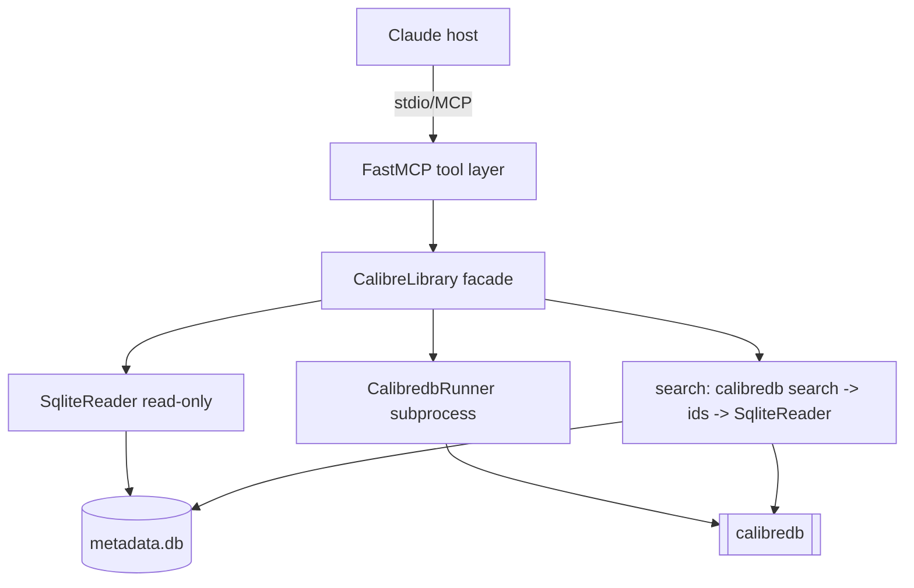

# Calibre Management MCP — Design

**Spec**: `.specs/features/calibre-management/spec.md`
**Status**: Draft

---

## Architecture Overview

A thin, layered Python MCP server. FastMCP owns the tool surface and transport (stdio). Two
backends sit behind a small facade: a **read layer** (Python stdlib `sqlite3`, read-only) and a
**write layer** (`calibredb` subprocess, argument-list, never shell). Search is a hybrid: ids
resolved by `calibredb search`, metadata hydrated from SQLite (AD-010).



**Layer rule (enforces AD-001):** the tool layer never touches `sqlite3` or `subprocess`
directly — it only calls `CalibreLibrary`. Reads go through `SqliteReader`; writes through
`CalibredbRunner`. This is the one invariant a reviewer checks.

---

## Code Reuse Analysis

Greenfield project — nothing internal to reuse yet. External building blocks:

| Component            | Source                    | How to Use                                              |
| -------------------- | ------------------------- | ------------------------------------------------------ |
| FastMCP              | `mcp` (official SDK)      | `FastMCP("calibre")` + `@mcp.tool()` decorators, stdio |
| `sqlite3`            | Python stdlib             | Read-only connection `file:{path}?mode=ro` (uri=True)  |
| `subprocess.run`     | Python stdlib             | Invoke `calibredb` with an **arg list** (no `shell=True`) |
| `calibredb`          | Calibre 8.2 (on PATH)     | `search`, `set_metadata`, `add`, `remove`, `--for-machine` where useful |

### Integration Points

| System                | Integration Method                                                              |
| --------------------- | ------------------------------------------------------------------------------- |
| Calibre library (read)| Direct `sqlite3` on `{CALIBRE_LIBRARY_PATH}/metadata.db`, read-only URI          |
| Calibre library (write)| `calibredb <cmd> --with-library {path}` subprocess, parse stdout/stderr + exit code |

---

## Components

### `config.py` — startup config & validation
- **Purpose**: Resolve and validate the library path once at startup.
- **Location**: `src/calibre_mcp/config.py`
- **Interfaces**:
  - `load_config() -> Config` — reads `CALIBRE_LIBRARY_PATH`; raises `ConfigError` if unset or no `metadata.db` (CFG-01).
  - `Config.library_path: Path`, `Config.db_path: Path`
- **Dependencies**: env, filesystem.
- **Reuses**: stdlib only.

### `errors.py` — error taxonomy
- **Purpose**: One place for the failure types every tool maps to, so failures are explicit and uniform.
- **Location**: `src/calibre_mcp/errors.py`
- **Interfaces** (exceptions): `ConfigError`, `BookNotFoundError(book_id)`, `InvalidInputError(msg)`, `LibraryLockedError(stderr)`, `CalibredbError(cmd, exit_code, stderr)`, `CalibredbNotFoundError`.
- **Dependencies**: none.

### `sqlite_reader.py` — read layer
- **Purpose**: All reads; never writes.
- **Location**: `src/calibre_mcp/sqlite_reader.py`
- **Interfaces**:
  - `get_book(book_id: int) -> Book` — full record; raises `BookNotFoundError` (VIEW-01/02).
  - `hydrate(ids: list[int]) -> list[Book]` — batch fetch for search results (SEARCH-01).
  - `list_books(limit: int, offset: int, sort: str) -> list[Book]` (SEARCH-02).
- **Dependencies**: `sqlite3` read-only connection.
- **Reuses**: the JOIN query verified against the real schema (authors/tags/series/ratings/comments link tables).

### `backup.py` — data-safety net (AD-011, AD-009, SAFE-*)
- **Purpose**: Guarantee every write is preceded by a recoverable snapshot; make delete recoverable.
- **Location**: `src/calibre_mcp/backup.py`
- **Interfaces**:
  - `backup_metadata_db() -> Path` — copy `metadata.db` → `backups/metadata-<ts>.db`; prune to retention cap (default 20); raise if the backup dir isn't writable (SAFE-01/02/04).
  - `trash_book_files(book: Book) -> Path` — copy the book's files from its library `path` to `backups/trash/<id>-<ts>/` before removal (SAFE-03).
  - `backup_root: Path` — `CALIBRE_MCP_BACKUP_DIR` or `<library>/.calibre-mcp-backups/` (SAFE-05).
- **Dependencies**: `shutil`, filesystem.
- **Contract**: the facade calls `backup_metadata_db()` **before** any `CalibredbRunner` write; if it raises, the write never runs (SAFE-04).

### `confirmation.py` — plan→confirm intent gate (AD-012)
- **Purpose**: Turn destructive/edit ops into a reviewed two-step so nothing mutates without explicit intent.
- **Location**: `src/calibre_mcp/confirmation.py`
- **Interfaces**:
  - `plan_token(op: str, book_id: int, payload: dict) -> str` — deterministic hash (`sha256` of normalized `op|book_id|payload`, truncated) so apply can recompute and verify it equals the supplied token (EDIT-01/03, REM-01/05).
  - `verify(op, book_id, payload, token) -> None` — raise `ConfirmationError` if recomputed token ≠ supplied token.
- **Dependencies**: `hashlib`, `json` (sorted keys for stable normalization).
- **Note (honest limitation)**: the server cannot force a human to actually read the plan; the token guarantees *applied op == planned op* and forces a two-call handshake. Combined with tool docstrings + the MCP client's own tool-approval prompt, this is the MVP intent bar. Documented in Risks.

### `calibredb_runner.py` — write layer + search
- **Purpose**: All mutations and `calibredb search`; maps exit codes/stderr to the error taxonomy.
- **Location**: `src/calibre_mcp/calibredb_runner.py`
- **Interfaces**:
  - `search(query: str) -> list[int]` — `calibredb search`; returns ids (SEARCH-01).
  - `set_metadata(book_id: int, fields: dict) -> None` — one `--field` per pair (EDIT-02).
  - `add(path: Path) -> int` — `calibredb add`; parse the new id from stdout (ADD-01).
  - `remove(book_id: int) -> None` — `calibredb remove` **without** `--permanent` → recycle bin (REM-02, AD-009).
  - internal `_run(args: list[str]) -> CompletedProcess` — the only subprocess call site; classifies failures (lock → `LibraryLockedError`, missing binary → `CalibredbNotFoundError`, other non-zero → `CalibredbError`).
- **Dependencies**: `subprocess`, `calibredb` on PATH.

### `library.py` — `CalibreLibrary` facade
- **Purpose**: The single entrypoint the tools use; composes reader + runner + backup + confirmation and enforces cross-cutting rules.
- **Location**: `src/calibre_mcp/library.py`
- **Interfaces**: `search_books`, `list_books`, `get_book`, `update_metadata(id, fields, token=None)`, `add_book`, `remove_book(id, token=None)` — return plain dicts/dataclasses ready for JSON.
- **Mutation flow (edit/remove)**: (1) validate book exists (reader) → (2) if no token: build plan + `plan_token`, return plan (no write); (3) if token: `verify` it → `backup_metadata_db()` (+ `trash_book_files` for remove) → `CalibredbRunner` write → re-read and return. Backup failure aborts before the write (SAFE-04).
- **Dependencies**: `SqliteReader`, `CalibredbRunner`, `backup`, `confirmation`.

### `server.py` — FastMCP tool surface
- **Purpose**: Declare the 5 P1 tools, validate inputs, delegate to `CalibreLibrary`, shape LLM-friendly output; map exceptions to explicit tool errors.
- **Location**: `src/calibre_mcp/server.py`
- **Interfaces** (`@mcp.tool()`): `search_books`, `list_books`, `get_book`, `update_metadata`, `add_book`, `remove_book`. `remove_book`'s docstring states the deletion is **permanent** (REM-04).
- **Dependencies**: FastMCP, `CalibreLibrary`, `config`.

---

## Data Models

```python
@dataclass
class Book:
    id: int
    title: str
    authors: list[str]        # books_authors_link -> authors.name
    tags: list[str]           # books_tags_link -> tags.name
    series: str | None        # books_series_link -> series.name
    series_index: float | None
    rating: int | None        # books_ratings_link -> ratings.rating (0-10)
    publisher: str | None
    pubdate: str | None        # ISO date
    languages: list[str]
    comments: str | None       # comments.text
    identifiers: dict[str, str]  # identifiers table (isbn, etc.)
    formats: list[str]         # data table (format column)
    path: str

ALLOWED_EDIT_FIELDS = {
    "title", "authors", "tags", "series", "series_index",
    "rating", "comments", "publisher", "pubdate", "languages",
}
```

**Field mapping for `set_metadata`** (verified via `--list-fields`): `authors`/`tags`/`languages`
are comma-joined (`tag1,tag2`); `rating` is 0–10; `languages` uses ISO-639 codes.

---

## Error Handling Strategy

| Error Scenario                          | Handling                                                        | Host/LLM sees                                             |
| --------------------------------------- | -------------------------------------------------------------- | -------------------------------------------------------- |
| `CALIBRE_LIBRARY_PATH` unset / no db    | `ConfigError` at startup (fail fast)                           | Clear message naming the missing path (CFG-01)           |
| Book id not found (read)                | `BookNotFoundError` from reader                                | "book <id> not found" (VIEW-02)                          |
| Book id not found (write)               | Pre-check in facade before running calibredb                   | "book <id> not found", no write attempted (EDIT-04, REM-02) |
| Non-int / out-of-range input            | `InvalidInputError` before DB/subprocess                       | Specific validation message (VIEW-03, EDIT-05)           |
| Field outside allowed set               | Reject listing allowed fields, no partial write                | "field X not allowed; allowed: …" (EDIT-02)              |
| `calibredb` not on PATH                 | `CalibredbNotFoundError` (writes/search only; reads still work)| Explicit "calibredb not installed / not on PATH"         |
| Library locked (GUI open)               | Detect in `_run`, raise `LibraryLockedError`                   | "library is locked by another process; close Calibre"    |
| `calibredb` non-zero (bad value/corrupt)| `CalibredbError` carrying stderr; never report success         | Failure + calibredb stderr (EDIT-03, ADD-04, REM-03)     |
| Add: path missing / not a file          | Validate before subprocess                                     | Input error (ADD-02)                                     |
| Add: duplicate                          | Surface Calibre's duplicate outcome, don't hide it             | added-as-duplicate / skipped note (ADD-03)               |
| Mutation without confirmation_token     | Return plan + token, apply nothing                             | Diff/review to show the user, then re-call w/ token (AD-012) |
| confirmation_token mismatch             | `ConfirmationError`; refuse to apply                           | "plan changed; re-review" (EDIT-03, REM-05)              |
| Backup dir not writable                 | Abort in `backup_metadata_db()` before any calibredb write     | "cannot back up metadata.db; write aborted" (SAFE-04)    |

---

## Perspective Sweep (Complex)

- **Structure** — 6 small modules, one responsibility each; tools never touch sqlite/subprocess (the enforced invariant).
- **Integration** — Two contracts: SQLite read (stable schema) and `calibredb` CLI (stable, versioned). `_run` is the single failure-classification choke point.
- **Data** — Read-only on `metadata.db`; all mutation delegated to Calibre so its integrity/triggers run. No schema of our own.
- **Security** — No network, no auth surface (AD-002/003). Main risk is **command injection** → mitigated by arg-list subprocess (never `shell=True`) and validating/whitelisting fields. Path inputs for `add_book` validated as existing files.
- **Infra & ops** — Single stdio process launched by host; logging to **stderr** (stdout is the MCP channel — must stay clean). No deploy infra.
- **Domain** — Vocabulary mirrors Calibre's (book, tags, series, series_index, rating 0–10) so the host and the user share terms.

**Tension surfaced (AD-010 vs lock guarantee):** `search_books` depends on `calibredb`, so the
"reads always work when GUI-locked" guarantee is scoped to `get_book`/`list_books`. Resolved in
spec (edge case + assumption) — search surfaces the lock error explicitly and `list_books` is the
lock-independent fallback. Recorded in Risks.

---

## Risks & Concerns

| Concern | Location | Impact | Mitigation |
| ------- | -------- | ------ | ---------- |
| stdout pollution breaks MCP framing | `server.py` / any `print` | Corrupted protocol messages | Logging configured to stderr only; no stray prints; test asserts clean stdout |
| Command injection via metadata values | `calibredb_runner._run` | Arbitrary command execution | Arg-list subprocess, `shell=False`; field whitelist; values passed as args not interpolated |
| `calibredb search` fails under GUI lock | `calibredb_runner.search` | Search unavailable while GUI open | Explicit error surfaced; `list_books` (SQLite) is the fallback path — documented in spec |
| Parsing the new id from `calibredb add` stdout | `calibredb_runner.add` | Wrong/missing id after add | Parse "Added book ids: N"; if unparseable, re-resolve via `calibredb search` on the file's title, else raise `CalibredbError` (never guess) |
| Read/write consistency (SQLite lag) | `library.update_metadata` | Stale record returned after write | Re-read via SqliteReader after the write completes; single-user window is negligible (AD noted) |
| Server can't force a human to read the plan | `confirmation.py` | LLM could plan then apply without real review | Token guarantees applied==planned + two-call handshake; rely also on MCP client tool-approval prompt; documented limitation (AD-012) |
| Book files not found at library `path` during trash copy | `backup.trash_book_files` | Delete proceeds without a file copy | If files missing, still back up metadata.db and use recycle bin; report that no files were copied — never block the recycle-bin path, never claim a trash copy that didn't happen |
| SQL correctness vs real schema | `sqlite_reader` | Wrong joins → wrong data | JOIN queries verified against the real test library during design; covered by tests on that library |

---

## Tech Decisions

| Decision                         | Choice                                        | Rationale                                                        |
| -------------------------------- | --------------------------------------------- | --------------------------------------------------------------- |
| Search implementation            | `calibredb search` → SQLite hydrate           | Correct Calibre grammar over reimplementing SQL subset (AD-010) |
| Logging destination              | stderr only                                   | stdout is the stdio MCP transport channel                       |
| `remove` recoverability          | Recycle bin (no `--permanent`) + trash copy   | User's irreplaceable data; double safety net (AD-009 revised)    |
| Mutation intent gate             | Plan→confirm token (edit + remove)            | Server-enforced explicit intent/review (AD-012)                 |
| Backup before every write        | Copy metadata.db, rolling retention 20        | Rollback point; abort write if backup fails (AD-011, SAFE-04)   |
| Subprocess safety                | arg-list, `shell=False`                        | Kills command injection from metadata/path values               |
| Package manager / layout         | `src/` layout, `pyproject.toml`, `uv`          | Standard modern Python; `uv` fast + reproducible                |
| Tests                            | `pytest` against the real test library (read) + a scratch temp library (write) | Writes must not mutate the user's real library                  |

> **Project-level:** AD-010 (search implementation) is appended to `.specs/STATE.md`.

---

## Testing Approach (feeds Tasks)

- **Reads** — run against a **copy** of the real library (or the real one read-only) to assert real joins.
- **Writes** — create a **scratch library** in a temp dir (`calibredb add --with-library /tmp/...` on an empty dir bootstraps it) so `add`/`edit`/`remove` never touch the user's real library. This is the safety rule for the whole write test suite.
- Each AC maps to at least one test asserting the spec-defined outcome (not implementation shape).

---

## P2 and beyond

P2 (CONV-01 convert, ORG-01 organize/deduplicate, EMAIL-01 email) is designed as a **separate
feature**: `.specs/features/calibre-management-p2/` (spec + design + tasks). It reuses this
feature's facade, runners, reader, backup, and confirmation, and conforms to the same invariants.
Project decisions AD-013…AD-017 (in `.specs/STATE.md`) govern it.

