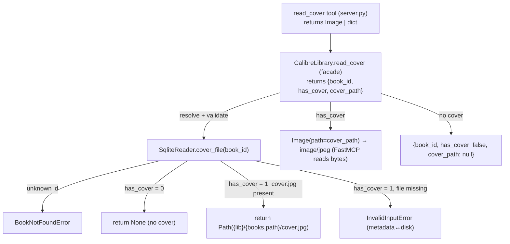

# Read a Book's Cover (COVER-01) Design

**Spec**: `.specs/features/cover-read/spec.md`
**Status**: Proposed — ready for Tasks/Execute
**Precedent**: `SqliteReader.format_files` (AD-017, Verified) — this is its **cover-scoped** sibling:
resolve and validate a book-folder file path in the read layer, then hand it upward. The one genuinely
new surface is the tool **returning image content** (first non-text result in the project).

---

## Architecture Overview

`read_cover` is a thin, read-only path: the read layer resolves+validates the cover file, the facade
reports presence + path as a plain dict, and the tool turns that into MCP image content. No backup,
no `calibredb`, no network — none of AD-011/AD-012 applies (those govern *mutations*).

1. **Resolve** the cover file — a new read-layer method `SqliteReader.cover_file(book_id) -> Path |
   None`. Keyed on `books.has_cover`: `0` → `None` (no cover, a normal state); `1` → the resolved
   `{library}/{books.path}/cover.jpg`, validated with `is_file()` (missing file →
   `InvalidInputError`, exactly like `format_files`). Unknown id → `BookNotFoundError`.
2. **Report** — `CalibreLibrary.read_cover(book_id)` returns a plain dict `{book_id, has_cover,
   cover_path}` (`cover_path` is `str(path)` or `None`). The facade stays dict-typed and fully
   testable without any MCP types.
3. **Present** — the `read_cover` tool returns `FastMCP.Image(path=cover_path)` when `has_cover` is
   true (FastMCP reads the bytes and infers `image/jpeg` from the `.jpg` suffix), else returns the
   facade's structured no-cover dict.

**Key property — our code never reads the image bytes.** The reader resolves and validates a *path*
(the same `is_file()` discipline `format_files` already uses); FastMCP's `Image(path=...)` performs
the byte read and base64 encoding. So no new I/O kind enters the facade or tool layer — the project
invariant (tool/facade never touch `sqlite3`/`subprocess`/`os.walk` directly) is preserved, and the
"reads go through the read layer" rule holds (the read layer owns the path resolution).



---

## Approaches Considered

| Approach | Summary | Verdict |
| --- | --- | --- |
| **A — Reader resolves path, facade returns dict, tool wraps as `Image`** (chosen) | `cover_file` mirrors `format_files`; facade dict-typed; tool builds image content; FastMCP reads bytes from the validated path. | ✅ Preserves every invariant (reads in the read layer; facade dict-typed and MCP-free; tool thin); no raw byte I/O in our code; `cover_file` is directly reused by COVER-02. |
| **B — Facade reads the bytes and returns them (base64/bytes) in the dict** | Facade does `path.read_bytes()`, returns encoded image in the result. | ❌ Puts raw file-byte I/O into the facade (a fourth I/O kind not covered by the invariant) and couples the facade to an encoding concern; heavier result dict; harder to keep the facade MCP-agnostic. FastMCP already does the byte read from a path — no reason to duplicate it. |
| **C — Tool calls `SqliteReader` directly (skip the facade)** | `read_cover` tool reads the path from the reader without going through `CalibreLibrary`. | ❌ Violates the project invariant that every tool goes through the `CalibreLibrary` facade; breaks uniformity and testability. |
| **D — Return the cover *path* only (no image bytes)** | Mirror `format_files` exactly: return `{cover_path}`. | ❌ Rejected at Specify time — the confirmed contract returns the *viewable* image (the point of reading a cover). Kept internally as the facade's `cover_path` field, but the tool hands the host the image. |

---

## The one new surface: a tool that returns image content

Every existing tool returns a JSON-shaped `dict` (wrapped by `_map_errors` + `_jsonify`).
`read_cover` is the **first** tool that returns **non-text content**: `FastMCP.Image` on the
has-cover path, a `dict` on the no-cover path. Two small, contained consequences:

- **`_map_errors` must preserve the return type.** Today it is typed `Callable[..., dict]`. It only
  ever `return fn(...)` (re-raising `CalibreMcpError` as `ToolError`) — behaviorally it already
  passes any return through untouched. Re-type it generically (a `TypeVar`: `Callable[..., T] ->
  Callable[..., T]`) so `read_cover`'s `Image | dict` return typechecks under `mypy --strict`. This
  is a **pure typing change**; every existing dict-returning tool is unaffected. `read_cover` does
  **not** use `_jsonify` (there is no embedded `Book` to convert).
- **Heterogeneous return is intentional.** `read_cover(book_id) -> Image | dict[str, Any]`. FastMCP
  serializes an `Image` to `ImageContent` (base64 + MIME) and a `dict` to structured/text content —
  both valid MCP tool results. This is the deliberate shape confirmed at Specify time, not an
  accident to smooth over.

> **Proposed AD-024 (record at Execute closeout, not now):** *"A tool may return MCP image content.
> The read layer resolves and validates the file path (same `is_file()` discipline as `format_files`,
> AD-017); FastMCP performs the byte read from that path (`Image(path=...)`) — our code never reads
> image bytes, so no new I/O kind enters the facade/tool and the reads-in-the-read-layer invariant
> holds. `_map_errors` is generic so non-`dict` tool results are supported."* Drafted here; the T3
> closeout task adds it to `.specs/STATE.md` if it survives Execute/Verify.

---

## Code Reuse Analysis

### Existing Components to Leverage

| Component | Location | How to Use |
| --- | --- | --- |
| `SqliteReader.format_files` (path resolution + `is_file()` validation + `BookNotFoundError`) | `sqlite_reader.py:302` | Structural template for `cover_file` — same "read `books.path`, build a book-folder file path, validate on disk, raise on inconsistency" shape. |
| Read-only connection pattern (`_connect`, `mode=ro`) | `sqlite_reader.py:72` | `cover_file` opens the same read-only connection to read `path` + `has_cover`. |
| `BookNotFoundError` / `InvalidInputError` | `errors.py` | Unknown id / metadata↔disk mismatch — the same taxonomy `format_files` uses. |
| `_map_errors` decorator | `server.py:54` | Reused (re-typed generic) to map `CalibreMcpError → ToolError` for `read_cover`. |
| `_get_library()` accessor | `server.py:42` | The tool obtains the facade the same way every other tool does. |
| `FastMCP.Image` | `mcp.server.fastmcp` (mcp 1.28.1, satisfies the AD-023 `<2` pin) | `Image(path=cover_path)` — reads the JPEG and infers `image/jpeg`; the tool's only new import. |

### Integration Points

| System | Integration Method |
| --- | --- |
| Read layer | New `SqliteReader.cover_file(book_id) -> Path \| None` (exact-file resolution, `has_cover`-keyed). |
| Facade | New `CalibreLibrary.read_cover(book_id) -> dict[str, Any]` returning `{book_id, has_cover, cover_path}`. |
| Tool surface (FastMCP) | New `@mcp.tool() @_map_errors def read_cover(book_id) -> Image \| dict`; imports `Image`. |
| Write primitive | **None** — read-only feature, no `calibredb`, no backup. |
| Pure logic | **None.** |

---

## Components

### `SqliteReader.cover_file` (new read method)

- **Purpose**: Resolve a book's on-disk cover path, or report that the book has no cover — the read
  primitive for COVER-01 (and reused by COVER-02).
- **Location**: `src/calibre_mcp/sqlite_reader.py`
- **Interface**: `cover_file(self, book_id: int) -> Path | None` — the absolute path to the book's
  `cover.jpg` when it has a cover; `None` when `has_cover = 0`.
- **Mechanism**:
  1. `SELECT path, has_cover FROM books WHERE id = ?` (read-only connection). No row →
     `BookNotFoundError(book_id)`.
  2. `has_cover` falsy → return `None` (RCOVER-02).
  3. Else `cover = self._library_path / row["path"] / "cover.jpg"`; if `cover.is_file()` return
     `cover` (RCOVER-01), else raise `InvalidInputError` naming the book and expected path (RCOVER-04
     — the exact `format_files` discipline).
- **Reuses**: `_connect`; the `books.path` → book-folder resolution pattern from `format_files`
  (`sqlite_reader.py:302`).

### `CalibreLibrary.read_cover` (facade method)

- **Purpose**: Report cover presence + resolved path as a plain, MCP-agnostic dict.
- **Location**: `src/calibre_mcp/library.py`
- **Interface**: `read_cover(self, book_id: int) -> dict[str, Any]`
- **Behavior**: `cover = self._reader.cover_file(book_id)` (propagates `BookNotFoundError` /
  `InvalidInputError`); return `{"book_id": book_id, "has_cover": cover is not None, "cover_path":
  str(cover) if cover is not None else None}`. No backup, no runner, no network (RCOVER-05).
- **Reuses**: the reader; nothing else.

### `read_cover` tool (server)

- **Location**: `src/calibre_mcp/server.py`
- **Interface**: `@mcp.tool() @_map_errors def read_cover(book_id: int) -> Image | dict:`
- **Body**: `result = _get_library().read_cover(book_id); return Image(path=result["cover_path"]) if
  result["has_cover"] else result`.
- **Docstring**: states it returns the cover as viewable image content (`image/jpeg`) when present;
  a `{has_cover: false}` result when the book has none; not-found for a bad id; invalid-input when
  metadata claims a cover but the file is missing; and that it is a pure read (no write, no network).
- **Supporting change**: re-type `_map_errors` generically (`TypeVar`) so `Image | dict` typechecks;
  behavior unchanged for all existing tools.

---

## Data Models

No persistent model, no token (read-only — AD-012 does not apply). Result shapes:

```python
# facade (always a dict)
{ "book_id": int, "has_cover": bool, "cover_path": str | None }

# tool
#   has_cover == True  -> FastMCP Image (image/jpeg, base64) — viewable content
#   has_cover == False -> { "book_id": int, "has_cover": False, "cover_path": None }
```

No op constant (nothing is gated). `cover_file` returns `Path | None`.

---

## Error Handling Strategy

| Error Scenario | Handling | Host sees |
| --- | --- | --- |
| Unknown `book_id` | `BookNotFoundError` in `cover_file`, before any filesystem access (RCOVER-03) | `ToolError`: book not found (names the id) |
| `has_cover = 1` but `cover.jpg` missing on disk | `InvalidInputError` in `cover_file` (RCOVER-04) | `ToolError`: cover file not found on disk (metadata↔disk mismatch) — never a broken image |
| `has_cover = 0` | Not an error — facade returns `{has_cover: false}` (RCOVER-02) | Structured "no cover" result |
| Cover present | `Image(image/jpeg)` returned (RCOVER-01) | Viewable cover image |
| (No mutation path exists) | — | No backup, no `calibredb`, no network (RCOVER-05) |

---

## Risks & Concerns

| Concern | Location | Impact | Mitigation |
| --- | --- | --- | --- |
| **Silent degrade** of a `has_cover=1` book whose file is missing to "no cover". | `cover_file` | Would hide a real data-quality inconsistency (STATS-01's exact concern) and mislead the host. | Raise `InvalidInputError` (RCOVER-04), mirroring `format_files`; test it by deleting `cover.jpg` while leaving `has_cover=1`. |
| **A write sneaks in** (accidentally calling `calibredb`, or FastMCP mutating the file). | facade / tool | Breaks the read-only guarantee; could touch the user's library. | Facade uses only the reader; `Image(path=...)` only reads. Test asserts **no `metadata.db` backup file** is created by any `read_cover` call (RCOVER-05). |
| **Return-type churn** from re-typing `_map_errors`. | `server.py:54` | A careless change could alter existing tools' behavior. | Generic `TypeVar` is a pure typing change (`return fn(...)` is untouched); the full existing suite is the regression gate. |
| **MIME assumption** (`image/jpeg`). | tool | A non-JPEG `cover.jpg` would mislabel. | Calibre always stores `cover.jpg` as JPEG (re-encodes input — verified 2026-07-31). FastMCP infers MIME from the `.jpg` suffix; accepted. |
| **Heterogeneous tool return** (`Image \| dict`) confusing FastMCP structured-output. | tool | FastMCP might skip a structured-output schema for the union. | Accepted and intended: both `Image` and `dict` are valid MCP tool results; the e2e test asserts the actual content type for each branch. |

---

## Tech Decisions (only non-obvious ones)

| Decision | Choice | Rationale |
| --- | --- | --- |
| Return shape | Image content on has-cover, structured dict on no-cover | Confirmed at Specify time — reading a cover is for viewing it; no-cover must stay answerable without an exception. |
| Who reads the bytes | FastMCP, from a reader-validated path | Keeps raw byte I/O out of the facade/tool; no new I/O kind; reuses `format_files`-style path discipline. |
| Truth source for "has cover" | `books.has_cover` column | Calibre's authoritative flag; catches no-cover and inconsistent-metadata cleanly when combined with `is_file()`. |
| Missing file despite `has_cover=1` | `InvalidInputError` (not a silent "no cover") | Mirrors `format_files`; surfaces a real inconsistency. |
| `_map_errors` typing | Make generic (`TypeVar`) | Lets a tool return non-`dict` (image content) under `mypy --strict`; behavior unchanged. |
| New AD? | **Yes — proposed AD-024** (image-content return + byte-read-by-FastMCP), recorded at Execute closeout | This *is* a new tool-surface capability (first non-text result); worth an explicit invariant so future non-text tools follow the same "read layer resolves the path, FastMCP reads the bytes" rule. |

---

## Requirement Coverage (design → spec)

| Requirement | Covered by |
| --- | --- |
| RCOVER-01 (cover present → viewable image) | `cover_file` (path) + `read_cover` facade + tool `Image(path=...)` |
| RCOVER-02 (no cover → structured, not error) | `cover_file` returns `None` + facade `has_cover: false` |
| RCOVER-03 (unknown id → not found) | `cover_file` `BookNotFoundError` |
| RCOVER-04 (has_cover but file missing → invalid input) | `cover_file` `is_file()` guard → `InvalidInputError` |
| RCOVER-05 (pure read, no mutation) | facade uses reader only; tool `Image` only reads; no backup/`calibredb`/network anywhere in the path |
