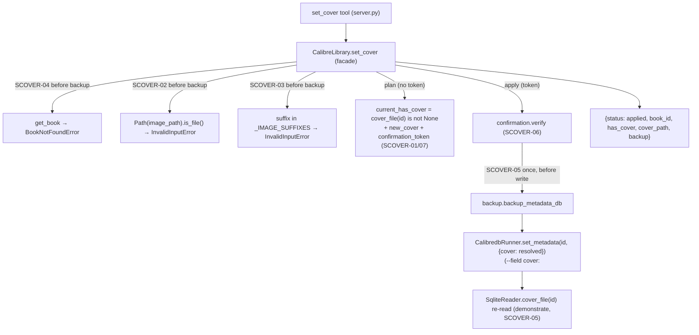

# Set a Book's Cover From a Local File (COVER-02) Design

**Spec**: `.specs/features/cover-set/spec.md`
**Status**: Proposed — ready for Tasks/Execute
**Precedent**: `CalibreLibrary.update_metadata` (AD-012, Verified) — the single-book plan→confirm +
one-backup mutation. COVER-02 is the cover-typed twin: same handshake shape, cover-specific
validation and plan. **Prerequisite**: `SqliteReader.cover_file` (COVER-01) — reused for the
current-cover state and the post-apply demonstration.

---

## Architecture Overview

`set_cover` is a single-book mutation over primitives already proven, following the **AD-012
plan→confirm gate** with **one AD-011 backup** — the exact shape of `update_metadata`, with three
cover-specific deltas: (1) the input is a **filesystem image path** validated with `is_file()` +
extension, not a metadata string; (2) the plan surfaces **replace-vs-add** (`current_has_cover`) via
`cover_file`; (3) the apply **re-reads** the cover state to demonstrate the change, because
`calibredb` silently no-ops on a bad path (verified — so a post-write read is the only honest proof).

1. **Validate** (before any backup): book exists (`get_book` → `BookNotFoundError`); `image_path` is
   an existing file (`Path.is_file()` → `InvalidInputError`) with an image extension
   (`_IMAGE_SUFFIXES` → `InvalidInputError`). Fail-fast is mandatory: `calibredb` will *not* error on
   a bad cover path.
2. **Plan** (no token): `current_has_cover = self._reader.cover_file(book_id) is not None` (reuses
   COVER-01); return `{status: plan, book_id, current_has_cover, new_cover, confirmation_token}` over
   `(book_id, resolved image_path)`. Nothing written.
3. **Gate** — `plan_token(_OP_SET_COVER, book_id, {"image_path": resolved})` / `verify` (AD-012),
   real `book_id` as the subject (single-book, not the `_BULK_TOKEN_ID` sentinel).
4. **Apply** (token): `verify` → one `metadata.db` backup (AD-011) → `set_metadata(book_id, {"cover":
   resolved})` (reuses the runner unchanged: scalar value → `--field cover:<path>`) → **re-read**
   `cover_file(book_id)` → return `{status: applied, book_id, has_cover, cover_path, backup}`.



---

## Approaches Considered

| Approach | Summary | Verdict |
| --- | --- | --- |
| **A — Dedicated `set_cover` facade + tool, reuse `set_metadata({"cover": path})`** (chosen) | New single-book plan→confirm method with cover-specific validation; write via the existing runner's `--field cover:<path>`; re-read to demonstrate. | ✅ Clean separation (cover is path-typed, not a metadata string); symmetric with `read_cover`; no runner/reader change beyond COVER-01's `cover_file`; the silent-no-op footgun is handled by pre-validation + post-read. |
| **B — Add `cover` to `update_metadata`'s field whitelist** | Let `update_metadata(id, {"cover": path})` set the cover through the existing text-field editor. | ❌ Rejected at Specify time: cover is a filesystem path needing `is_file()`/extension validation and a replace-vs-add plan, not the string-diff `update_metadata` does. Folding it in complicates `_validate_edit_fields`/`_build_diff` and muddies a tool that should stay about metadata strings. |
| **C — New runner method / new reader query for cover presence** | A `CalibredbRunner.set_cover` and/or a dedicated `has_cover` query. | ❌ Unnecessary: `set_metadata` already emits `--field cover:<path>` for a scalar value (verified); `cover_file` (COVER-01) already answers cover-presence. Adding methods would duplicate proven primitives (AD-014 says add a runner only for a *new external CLI*, not a new subcommand shape). |
| **D — Skip the pre-write `is_file()` guard, rely on `calibredb`** | Let `calibredb` reject a bad path. | ❌ **Empirically impossible**: `calibredb set_metadata --field cover:<missing>` does **not** error — it silently no-ops (verified 2026-07-31). This would report a false "cover set." Pre-validation is mandatory, not optional. |

---

## The two cover-specific rules the sibling mutations never faced

1. **Validate the file before writing — `calibredb` won't.** Unlike `update_metadata` (where
   `calibredb` rejects a bad field), a missing/unreadable cover path is *silently ignored* by
   `calibredb set_metadata --field cover:` (verified). So `set_cover` MUST `is_file()`-guard (and
   extension-guard) **before** the backup/write. A test points `set_cover` at a missing path and
   asserts `InvalidInputError` **and that no backup file was created**.
2. **Re-read to demonstrate, don't assert.** Because a subtly-bad image can also no-op inside
   `calibredb` (e.g. an undecodable file — the degenerate-PNG case), the apply re-reads
   `cover_file(book_id)` and reports the real `has_cover`/`cover_path`. A silent no-op then surfaces
   as `has_cover: false` in the result, never a fake success.

---

## Code Reuse Analysis

### Existing Components to Leverage

| Component | Location | How to Use |
| --- | --- | --- |
| `update_metadata` plan→confirm shape (single-book, one backup) | `library.py:319` | Structural template — validate → plan(token) → verify → backup → write → re-read. |
| `plan_token` / `verify` (real `book_id` subject) | `confirmation.py`, `library.py:23` | Token over `{"image_path": resolved}`; new op constant `_OP_SET_COVER`. Single-book → real id (not `_BULK_TOKEN_ID`). |
| `backup_metadata_db(db_path, backup_root)` | `backup.py` | Exactly one backup before the write (AD-011), same call `update_metadata` makes. |
| `CalibredbRunner.set_metadata(book_id, {"cover": path})` | `calibredb_runner.py:96` | Scalar value → `--field cover:<path>`. **Unchanged** — verified this sets the cover + flips `has_cover`. |
| `SqliteReader.cover_file` (COVER-01) | `sqlite_reader.py` (new in COVER-01) | Current-cover state for the plan (`current_has_cover`) and the post-apply re-read (demonstrate). |
| `SqliteReader.get_book` | `sqlite_reader.py:77` | Existence precheck (`BookNotFoundError`) before any write (SCOVER-04). |
| `InvalidInputError` / `BookNotFoundError` / `ConfirmationError` | `errors.py` | Path/extension rejects, unknown id, token mismatch — the taxonomy the siblings use. |
| `_map_errors` / `_jsonify` / `_get_library()` | `server.py` | Tool wrapping, exactly like `update_metadata`. |

### Integration Points

| System | Integration Method |
| --- | --- |
| Tool surface (FastMCP) | New `@mcp.tool() @_map_errors def set_cover(book_id, image_path, confirmation_token=None) -> dict` returning `_jsonify(...)`. |
| Facade | New `CalibreLibrary.set_cover`; `_OP_SET_COVER` constant; `_IMAGE_SUFFIXES` constant; reuses token/backup/runner/`cover_file`. |
| Read layer | **No new method** — reuses `cover_file` (COVER-01) + `get_book`. |
| Write primitive | **No change** — `set_metadata` writes `--field cover:<path>`. |
| Pure logic | **None.** |

---

## Components

### `CalibreLibrary.set_cover` (facade method)

- **Purpose**: Orchestrate the cover set — validate (before backup) → plan→confirm (one backup) →
  write → re-read to demonstrate. Single-book twin of `update_metadata`, cover-typed.
- **Location**: `src/calibre_mcp/library.py`
- **Interface**: `set_cover(self, book_id: int, image_path: str | Path, token: str | None = None) ->
  dict[str, Any]`
- **Behavior (maps 1:1 to ACs)**:
  1. Validate **before** any backup: `self._reader.get_book(book_id)` (SCOVER-04); `path =
     Path(image_path)`; `if not path.is_file(): raise InvalidInputError(...)` (SCOVER-02);
     `if path.suffix.lower() not in _IMAGE_SUFFIXES: raise InvalidInputError(...)` (SCOVER-03).
  2. `resolved = str(path)`; `payload = {"image_path": resolved}`.
  3. **Plan** (`token is None`): `current = self._reader.cover_file(book_id) is not None`; return
     `{"status": "plan", "book_id": book_id, "current_has_cover": current, "new_cover": resolved,
     "confirmation_token": plan_token(_OP_SET_COVER, book_id, payload)}` — writes nothing
     (SCOVER-01/07).
  4. **Apply** (`token`): `verify(_OP_SET_COVER, book_id, payload, token)` (SCOVER-06); `backup =
     backup_metadata_db(...)` once, **before** the write (SCOVER-05); `self._runner.set_metadata(
     book_id, {"cover": resolved})`; `new = self._reader.cover_file(book_id)` (re-read); return
     `{"status": "applied", "book_id": book_id, "has_cover": new is not None, "cover_path": str(new)
     if new else None, "backup": str(backup)}` (SCOVER-05 — demonstrated, not asserted).
- **Reuses**: `get_book`, `cover_file`, `set_metadata`, `plan_token`/`verify`, `backup_metadata_db`.

### `set_cover` tool (server)

- **Location**: `src/calibre_mcp/server.py`
- **Interface**: `@mcp.tool() @_map_errors def set_cover(book_id: int, image_path: str,
  confirmation_token: str | None = None) -> dict:` →
  `_jsonify(_get_library().set_cover(book_id, image_path, token=confirmation_token))`.
- **Docstring**: states plan→confirm handshake (surface the plan, apply only after approval); a
  **local** image file path; one backup; replace-vs-add (`current_has_cover`); re-reads to confirm
  the cover actually changed (never a fake success).

---

## Data Models

No persistent model. New op constant `_OP_SET_COVER = "set_cover"` and image-extension whitelist
`_IMAGE_SUFFIXES = {".jpg", ".jpeg", ".png", ".webp", ".gif", ".bmp"}` in `library.py`. Result
shapes:

```python
# plan (no token)
{ "status": "plan", "book_id": int,
  "current_has_cover": bool,      # replace (true) vs add (false) — from cover_file (COVER-01)
  "new_cover": str,               # resolved image_path
  "confirmation_token": str }

# apply (token)
{ "status": "applied", "book_id": int,
  "has_cover": bool,              # RE-READ after write (SCOVER-05, demonstrated) — false ⇒ calibredb no-op
  "cover_path": str | None,       # the library's {book}/cover.jpg after the set
  "backup": str }
```

Token: `plan_token("set_cover", book_id, {"image_path": resolved})` — single-book, real `book_id`.

---

## Error Handling Strategy

| Error Scenario | Handling | Host sees |
| --- | --- | --- |
| Unknown `book_id` | `BookNotFoundError` before backup (SCOVER-04) | `ToolError`: book not found |
| `image_path` missing / not a file | `InvalidInputError` before backup (SCOVER-02) — never rely on `calibredb` to error | `ToolError`: image file not found — no side effects |
| `image_path` non-image extension | `InvalidInputError` before backup (SCOVER-03) | `ToolError`: unsupported image type |
| Token mismatch / wrong token | `ConfirmationError` via `verify`, writes nothing (SCOVER-06) | `ToolError`: re-plan and review |
| `calibredb` binary missing | `CalibredbNotFoundError` (a `CalibreMcpError`) on the write | `ToolError` |
| `calibredb` accepts path but cover not set (undecodable image) | Re-read returns `has_cover: false` (SCOVER-05) | Truthful `has_cover: false` result — never a fake "applied" success |
| Book already has a cover | Plan `current_has_cover: true`; apply replaces (SCOVER-07) | Cover overwritten |

---

## Risks & Concerns

| Concern | Location | Impact | Mitigation |
| --- | --- | --- | --- |
| **`calibredb` silently no-ops on a bad cover path** (the defining footgun). | `set_cover` apply | A missing/unreadable path would be reported as "cover set" while nothing changed. | (1) `is_file()` + extension guard **before** backup/write (SCOVER-02/03); (2) **re-read** `cover_file` after apply and report the real `has_cover` (SCOVER-05). Tests: missing path → `InvalidInputError` + **no backup created**; undecodable image → `has_cover: false` in the result. |
| Backup-before-write order (**L-001**). | `library.py` `set_cover` apply | A post-hoc backup-file check wouldn't catch a wrong order. | Call-order test (spy/monkeypatch) asserting `backup_metadata_db` runs before `set_metadata` — mirrors the sibling mutations' test. |
| Token recompute must match the plan. | `library.py` apply | Path normalization drift → false mismatch. | Use `str(Path(image_path))` identically in plan and apply payload; `plan_token` normalizes JSON keys. |
| Cover-set depends on COVER-01. | cross-feature | If COVER-02 executes before `cover_file` exists, it cannot compute cover-presence. | Sequencing constraint recorded in spec/tasks: **COVER-01 ships first**; T1 `Depends on` names `cover_file`. |
| Colon in the cover path breaking `--field cover:<path>` parsing. | `set_metadata` | A path with `:` could confuse `field:value` splitting. | `calibredb` splits `--field` on the **first** `:` only, so `cover:/abs/path` parses field=`cover`, value=the rest — safe for POSIX paths (single-user Linux, AD-007). Accepted; not a list field (no comma concern). |
| Replacing a cover is destructive to the old `cover.jpg`. | apply | The previous cover is overwritten. | Intended (SCOVER-07); the one `metadata.db` backup + Calibre's own book-folder handling make metadata recoverable; the plan shows `current_has_cover: true` so replace is a conscious, reviewed choice. |

---

## Tech Decisions (only non-obvious ones)

| Decision | Choice | Rationale |
| --- | --- | --- |
| Tool vs field | **Dedicated `set_cover` tool** | Cover is a path-typed input with its own validation/plan; symmetric with `read_cover`; keeps `update_metadata` about metadata strings. |
| Apply primitive | Reuse `set_metadata({"cover": path})` **unchanged** | Verified: `--field cover:<path>` sets the cover + flips `has_cover`. No new runner method (AD-014: new runner only for a new CLI). |
| Pre-write validation | `is_file()` + extension guard, **mandatory** | `calibredb` silently no-ops on a bad path (verified) — the only way to avoid a false success. |
| Post-apply re-read | Re-read `cover_file`, report real `has_cover` | "Demonstrated, not asserted" — a `calibredb` no-op surfaces truthfully. |
| Cover-presence source | Reuse `cover_file` (COVER-01) | No duplicate query; establishes the intended COVER-01 → COVER-02 dependency. |
| Token subject | Real `book_id` (single-book), payload `{image_path}` | Mirrors `update_metadata`/`remove_book`; not a batch (`_BULK_TOKEN_ID` is for AD-020 batches). |
| Gate | plan→confirm + one backup | Cover set mutates existing library state → reviewed, single rollback point (AD-012/AD-011). |
| New AD? | **Proposed AD-025** (record at Execute closeout) | Records the dedicated-`set_cover` decision **and** the durable lesson: *`calibredb set_metadata --field cover:` silently no-ops on a bad path → cover-setting must pre-validate the file and re-read to demonstrate.* Worth an invariant so a future cover/enrichment write doesn't re-learn it. |

---

## Requirement Coverage (design → spec)

| Requirement | Covered by |
| --- | --- |
| SCOVER-01 (plan: current_has_cover + new_cover + token, no write) | `set_cover` plan branch + `cover_file` + `plan_token` |
| SCOVER-02 (missing/non-file path → invalid input before backup) | `set_cover` `is_file()` guard |
| SCOVER-03 (non-image extension → invalid input before backup) | `set_cover` `_IMAGE_SUFFIXES` guard |
| SCOVER-04 (unknown id → not found before backup) | `set_cover` `get_book` precheck |
| SCOVER-05 (one backup before write, apply via set_metadata, re-read to demonstrate) | `set_cover` apply branch + `backup_metadata_db` + `set_metadata` + `cover_file` re-read |
| SCOVER-06 (token mismatch → refuse, no write) | `verify` on recomputed payload |
| SCOVER-07 (already has cover → replace, not reject) | plan `current_has_cover`; apply proceeds (overwrite) |
