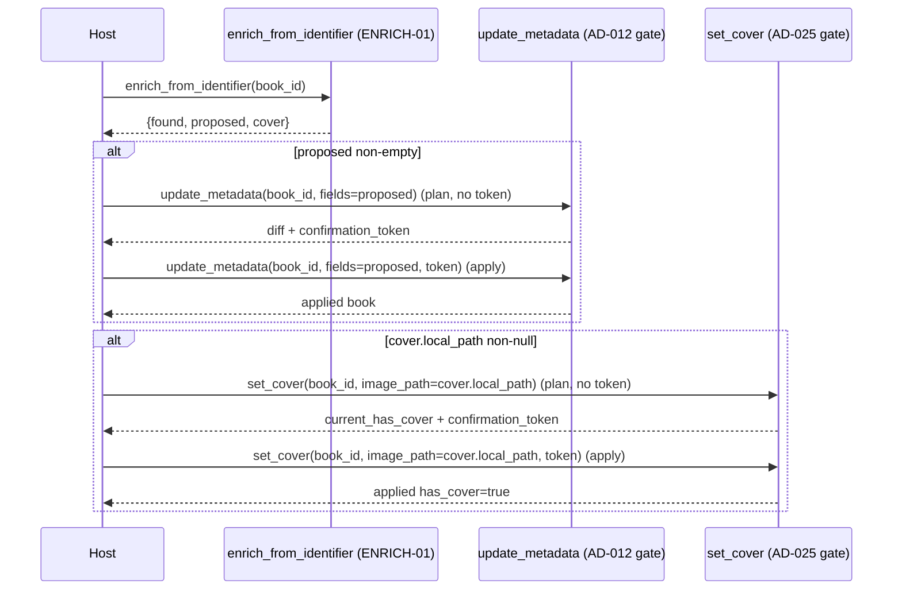

# Enrichment Apply (ENRICH-02) Design

**Spec**: `.specs/features/enrichment-apply/spec.md`
**Status**: Draft

---

## Architecture Overview

No new architecture. ENRICH-02 wires two already-Shipped primitives together at the *host* level;
the server adds zero new mutation paths. The diagram shows the call sequence a host (Claude) makes
across three already-existing tools — nothing here is new code, it's the flow this feature proves
and documents.

**Why no new component:** `_ENRICH_FIELDS` (library.py:74-78) already maps to exactly
`{comments, publisher, pubdate}` ⊂ `ALLOWED_EDIT_FIELDS` (library.py:58-67). `proposed`'s shape
(`dict[str, str]`) is already `update_metadata`'s `fields` parameter shape. No adapter, no
translation layer, no new tool is structurally needed — verified by reading both call sites, not
assumed.

---

## Code Reuse Analysis

### Existing Components to Leverage

| Component | Location | How to Use |
| --- | --- | --- |
| `CalibreLibrary.enrich_from_identifier` | `src/calibre_mcp/library.py:186` | Unchanged — source of `proposed`/`cover`. Docstring gains a cross-reference to the apply flow. |
| `CalibreLibrary.update_metadata` | `src/calibre_mcp/library.py:464` | Unchanged — `proposed` passed verbatim as `fields`. |
| `CalibreLibrary.set_cover` | `src/calibre_mcp/library.py:501` | Unchanged — `cover.local_path` passed verbatim as `image_path`. |
| `_FakeEnricher` test double | `tests/integration/test_library_enrich.py:88` | Reused as-is to drive `enrich_from_identifier` deterministically in the new integration test (no real network). |
| `scratch_library` fixture | `tests/conftest.py` (used by every write-test file) | Reused as-is — the non-negotiable "writes never touch the real library" rule. |

### Integration Points

| System | Integration Method |
| --- | --- |
| `update_metadata` plan→confirm (AD-012) | Called with `fields=proposed` — no change to its contract. |
| `set_cover` plan→confirm (AD-025) | Called with `image_path=cover["local_path"]` — no change to its contract. |
| MCP tool layer (`server.py`) | No new tool registered — `enrich_from_identifier`, `update_metadata`, `set_cover` are already all registered; the host composes them. |

---

## Components

No new production components. This feature's only "component" is a new integration test module
plus docstring cross-references — listed here for traceability, not as new architecture.

### `test_enrichment_apply.py` (new test module)

- **Purpose**: Prove `proposed`/`cover.local_path` from `enrich_from_identifier` round-trip through
  `update_metadata`/`set_cover` unchanged (ENRICH2-01..07).
- **Location**: `tests/integration/test_enrichment_apply.py`
- **Interfaces**: pytest test functions only, no public API.
- **Dependencies**: `CalibreLibrary`, `_FakeEnricher`-equivalent double, `scratch_library` fixture.
- **Reuses**: the seeding helpers (`_seed_empty_book`, `_valid_cover_png`) already in
  `test_library_enrich.py` / `test_library_set_cover.py` — imported or duplicated locally per the
  smallest-change rule (see Tech Decisions).

### `enrich_from_identifier` docstring (amended, not restructured)

- **Purpose**: Point the host at the two-step apply flow and the empty/null skip rules
  (ENRICH2-03/07), so the documented contract matches this spec.
- **Location**: `src/calibre_mcp/library.py:186-197`
- **Change**: append 2-3 lines to the existing docstring; no signature/behavior change.

---

## Data Models

None — no new data shapes. `proposed: dict[str, str]` and `cover: dict[str, Any] | None` are
ENRICH-01's existing return shapes (unchanged); `fields: dict[str, Any]` and `image_path: str | Path`
are `update_metadata`'s/`set_cover`'s existing parameter shapes (unchanged).

---

## Error Handling Strategy

| Error Scenario | Handling | User Impact |
| --- | --- | --- |
| Host calls `update_metadata` with `proposed == {}` | Not a new error path — `_validate_edit_fields` accepts an empty dict at the *plan* step (`unknown = set() - ALLOWED = set()`), but the *apply* step's `calibredb set_metadata` call with zero `--field` args exits non-zero (`"You must specify either a field or an OPF file"`), so `CalibredbError` propagates. **SPEC_DEVIATION from this design's original assumption** (corrected empirically, see spec.md's Assumptions table): expected "harmless no-op," found "guaranteed failure at apply." This is a *usage* rule (ENRICH2-03), not new server validation — no code change, test documents the real failure instead of an assumed no-op. | A failed apply (raised `CalibredbError`, no partial write since `calibredb` itself rejects the call before touching `metadata.db`) if the host ignores the rule — worse DX than a silent no-op, but no data corruption. |
| Host calls `set_cover` with `local_path=None` | `Path(None)` raises `TypeError` before `set_cover`'s own validation — pre-existing behavior, out of scope to change. ENRICH2-07 documents "don't do this" rather than hardening `set_cover` against a caller bug. | Host-side programming error, not a library-data risk (fails before any backup/write). |
| Token replay / mismatch after either plan step | Unchanged `EDIT-03`/`SCOVER-06` behavior (`verify()` raises). | Existing error surfaces identically; ENRICH-02 adds no new failure mode. |

---

## Risks & Concerns

| Concern | Location (file:line) | Impact | Mitigation |
| --- | --- | --- | --- |
| `set_cover(image_path=None)` raises a raw `TypeError` (from `Path(None)`), not a `CalibreMcpError` | `src/calibre_mcp/library.py:524` (`path = Path(image_path)`) | If a host ever passes `cover.local_path` without checking for `None` first, the error is an unmapped `TypeError` instead of a clean `ToolError` — worse DX than every other validation failure in the tool. | Out of scope to fix in `set_cover` itself (would touch a Shipped & Verified feature for a caller-discipline issue). Mitigated at the *documentation* layer only: `enrich_from_identifier`'s docstring and this spec's ENRICH2-07 explicitly tell the host never to call `set_cover` with a null path. Flagging here so it's not silently missed if a future feature revisits `set_cover`'s validation. |
| No test currently proves the *combined* two-tool sequence (lookup → edit → cover) end to end | `tests/integration/test_library_enrich.py` (fields), `tests/integration/test_library_set_cover.py` (cover) each test their own tool in isolation | Without ENRICH-02, "the loop closes" was an assumption, not evidence — exactly the gap this feature closes. | Addressed by this feature directly: the new `test_enrichment_apply.py` module is the mitigation, not a follow-up. |

> No fragile-code, security, or performance concerns found — the touched code paths are all
> Shipped & Verified, unmodified by this feature.

---

## Tech Decisions

| Decision | Choice | Rationale |
| --- | --- | --- |
| New test module vs. adding cases to `test_library_enrich.py` | New file `test_enrichment_apply.py` | The existing file's `class`less structure is already ISBN/enrich-focused (LOOKUP-\* only); a cross-tool integration proof (enrich + edit + cover) is a distinct concern (ENRICH2-\*) and earns its own file per the "one reason to change per file" rule. |
| Duplicate small seeding helpers vs. extract a shared `conftest.py` fixture | Duplicate the ~10-line `_seed_empty_book`/`_valid_cover_png` helpers locally | Both already exist, near-identically, in two different test files (`test_library_enrich.py`, `test_library_set_cover.py`) without having been extracted — matches the codebase's existing convention (incidental duplication tolerated per AGENTS.md) rather than introducing a new shared-fixture abstraction this feature doesn't otherwise need. |
| Docstring-only change to `enrich_from_identifier`, no new return field | Keep ENRICH-01's contract frozen | Confirmed with user: reopening a Shipped & Verified spec for a non-functional change is out of scope (see spec.md Out of Scope). |

No new `AD-NNN` entries — this feature introduces no project-level convention, pattern, or
constraint; it only adds test evidence for an existing one (AD-012/AD-025 already cover this).

---

## Open Question Before Tasks

Given the thin surface (one new test file + a docstring amendment), Tasks would be ≤3 obvious
steps: (1) write `test_enrichment_apply.py` covering ENRICH2-01..07, (2) amend
`enrich_from_identifier`'s docstring, (3) run the full gate + one atomic commit. Per the sizing
rubric this stays **implicit in Execute** — recommend skipping a formal `tasks.md` unless you want
one broken out explicitly.
