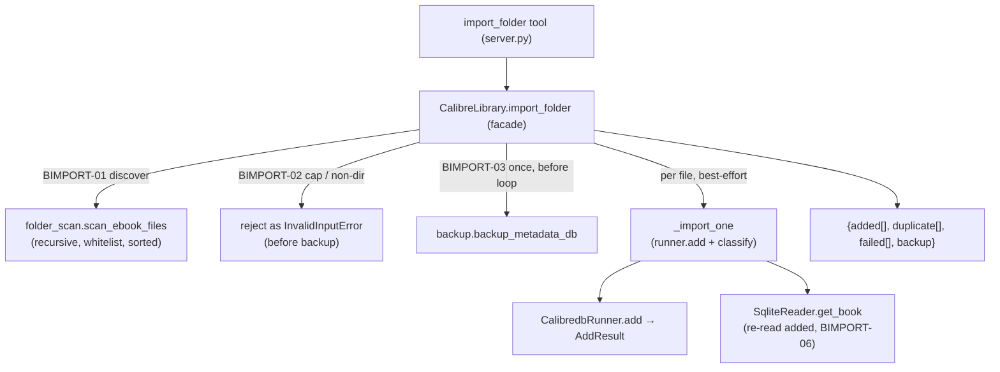

# Folder Import (BULK-03) Design

**Spec**: `.specs/features/folder-import/spec.md`
**Status**: Done — Verifier PASS

---

## Architecture Overview

`import_folder` is a thin orchestration over primitives already Verified: it **discovers** ebook
files under a directory (new pure filesystem module), then **imports** each one through the exact
`calibredb add` classification `add_book` already uses, wrapped in the AD-020 best-effort batch
shape (validate → one backup → sorted best-effort loop → honest buckets). No new subprocess pattern,
no network, no token (AD-016).

The one genuinely new thing is **filesystem discovery** — a kind of I/O the current invariant
(tool layer never touches `sqlite3`/`subprocess`; reads via `SqliteReader`, writes via
`CalibredbRunner`) does not cover. It gets its own pure module and a new decision (AD-021), keeping
`library.py` orchestrating and the tool layer free of any direct filesystem walk.



---

## Code Reuse Analysis

### Existing Components to Leverage

| Component | Location | How to Use |
| --- | --- | --- |
| `CalibredbRunner.add(path) -> AddResult` | `src/calibre_mcp/calibredb_runner.py:` | Import each file — reused as-is; already parses `Added book ids` / duplicate (ADD-01/03). |
| `add_book` classification (add vs duplicate vs unreachable-None guard) | `src/calibre_mcp/library.py:393` | **Extract** the post-`add` classification into `_import_one` so `add_book` and `import_folder` share one code path (DRY the "surface duplicate, never fake id" rule). |
| `backup_metadata_db(db_path, backup_root)` | `src/calibre_mcp/backup.py` | One backup before the loop (AD-011/AD-020), same call `add_book`/`convert_book_bulk` make. |
| `SqliteReader.get_book(id)` | `src/calibre_mcp/sqlite_reader.py` | Re-read each added book to return real metadata (BIMPORT-06), same as `add_book`. |
| AD-020 best-effort batch shape | `convert_book_bulk` `library.py:208` | Same skeleton: validate → one backup → `for … in <sorted candidates>` best-effort → buckets summing to the candidate count. |
| `InvalidInputError` / `CalibreMcpError` | `src/calibre_mcp/errors.py` | Reject non-dir / over-cap / unreadable-dir before backup; `_map_errors` turns it into a `ToolError`. |
| `_map_errors` + `_jsonify` | `src/calibre_mcp/server.py:54,99` | Wrap the new tool exactly like `add_book`. |

### Integration Points

| System | Integration Method |
| --- | --- |
| Tool surface (FastMCP) | New `@mcp.tool() @_map_errors def import_folder(path: str)` returning `_jsonify(...)`. |
| Facade | New `CalibreLibrary.import_folder`; new private `_import_one`; `add_book` refactored to call `_import_one`. |
| Filesystem | New pure module `folder_scan.py` — the only place that walks directories (AD-021). |

---

## Components

### `folder_scan` (new module)

- **Purpose**: Pure filesystem discovery — return the sorted list of ebook-candidate files under a
  directory, recursively, applying the whitelist and the hidden/symlink exclusions. No side effects
  beyond reading the filesystem; no `calibredb`, no `sqlite3`.
- **Location**: `src/calibre_mcp/folder_scan.py`
- **Interfaces**:
  - `scan_ebook_files(root: Path) -> list[Path]` — recursive walk of `root`; keeps regular files
    whose lowercased suffix ∈ `EBOOK_EXTENSIONS`; skips dotfiles/hidden entries and does **not**
    follow symlinks; returns the matches **sorted by path string** (BIMPORT-01, deterministic order
    for BIMPORT-07 reporting).
  - `EBOOK_EXTENSIONS: frozenset[str]` — the curated unambiguous-ebook whitelist (spec Assumptions):
    `{.epub, .mobi, .azw, .azw3, .azw4, .kfx, .fb2, .fbz, .pdf, .djvu, .cbz, .cbr, .cbc, .lit,
    .lrf, .pdb, .prc, .snb, .tcr}`. Ambiguous document/metadata formats deliberately excluded.
- **Dependencies**: `pathlib`/`os` only.
- **Reuses**: nothing — new leaf module (mirrors `bulk_edit.py`'s "pure module" role).
- **Discovery mechanism**: `os.walk(root, followlinks=False)` (prunes hidden dirs in-place so an
  entire `.git`/hidden subtree is skipped, not just its files); each entry filtered by
  `not name.startswith(".")` and suffix membership. `os.walk` yields nothing on a plain file and
  raises nothing on an empty tree — the empty/degenerate edge cases fall out naturally.

### `CalibreLibrary.import_folder` (facade method)

- **Purpose**: Orchestrate the folder import — validate, back up once, best-effort import each
  candidate, return the honest three-bucket result.
- **Location**: `src/calibre_mcp/library.py`
- **Interface**:
  - `import_folder(self, path: str | Path) -> dict[str, Any]`
- **Behavior (maps 1:1 to ACs)**:
  1. `folder = Path(path)`; if `not folder.is_dir()` → `InvalidInputError` (BIMPORT-02, before scan/backup).
  2. `candidates = _safe_scan(folder)` — calls `scan_ebook_files`; an `OSError` (e.g. unreadable
     dir) is converted to `InvalidInputError` so it surfaces cleanly (BIMPORT-02 / spec assumption).
  3. if `len(candidates) > FOLDER_IMPORT_MAX` → `InvalidInputError` (BIMPORT-02, before backup).
  4. `backup = backup_metadata_db(...)` once (BIMPORT-03), unconditional even if `candidates == []`.
  5. `for file_path in candidates:` (already sorted) — `try: _import_one(file_path)` → route to
     `added`/`duplicate`; `except CalibreMcpError as exc:` → `failed.append({path, error})`
     (BIMPORT-04, never aborts).
  6. return `{"status": "imported", "added": …, "duplicate": …, "failed": …, "backup": str(backup)}`.
- **Dependencies**: `folder_scan`, `backup`, `_import_one`.
- **Reuses**: AD-020 skeleton from `convert_book_bulk`; backup + reader; `_import_one`.

### `CalibreLibrary._import_one` (new private, extracted)

- **Purpose**: The single classification of one `calibredb add` result — shared by `add_book` and
  `import_folder` so the "surface duplicate, never a fake id" rule lives in exactly one place.
- **Location**: `src/calibre_mcp/library.py`
- **Interface**: `_import_one(self, file_path: Path) -> dict[str, Any]`
- **Behavior**: `result = self._runner.add(file_path)`; if `result.duplicate` →
  `{"duplicate": True, "book_id": None}`; elif `result.book_id is None` → `InvalidInputError`
  (the existing unreachable-guard, kept); else →
  `{"duplicate": False, "book_id": result.book_id, "book": self._reader.get_book(result.book_id)}`.
  **Contains no backup** — the backup stays in each caller *before* calling `_import_one`, so no new
  side-effect ordering is introduced (see Risks, lesson L-006).

### `add_book` (refactored, behavior-preserving)

- Keeps: `is_file` precheck (ADD-02) → `backup_metadata_db` → then `_import_one` → wrap its dict
  with `status: added|duplicate` + `duplicate` flag + `backup`. Identical observable behavior;
  existing ADD-01..04 tests must stay green (regression gate).

### `import_folder` tool (server)

- **Location**: `src/calibre_mcp/server.py`
- **Interface**: `@mcp.tool() @_map_errors def import_folder(path: str) -> dict:` →
  `return _jsonify(_get_library().import_folder(path))`.
- **Docstring**: states recursive scan, additive/no-token, one backup, honest three buckets, and
  that non-ebook files are silently ignored.

---

## Data Models

No persistent model. Result dict shape (BIMPORT-03..07):

```python
{
  "status": "imported",
  "added":     [{"path": str, "book_id": int, "book": {...}}],   # BIMPORT-06 (real id + metadata)
  "duplicate": [{"path": str}],                                  # BIMPORT-05 (surfaced, no fake id)
  "failed":    [{"path": str, "error": str}],                    # BIMPORT-04 (never aborts)
  "backup":    str,                                              # BIMPORT-03 (one, before the loop)
}
# invariant: len(added)+len(duplicate)+len(failed) == len(candidates)   # BIMPORT-07
```

New constant: `FOLDER_IMPORT_MAX = 500` in `library.py` (alongside `BULK_CONVERT_MAX`).

---

## Error Handling Strategy

| Error Scenario | Handling | Host sees |
| --- | --- | --- |
| Path missing / is a file | `InvalidInputError` before scan/backup (BIMPORT-02) | `ToolError`: "not a directory" |
| Ebook-candidate count > 500 | `InvalidInputError` before backup (BIMPORT-02) | `ToolError`: over the 500-file cap |
| Unreadable directory (`OSError`/`PermissionError` during walk) | `_safe_scan` converts to `InvalidInputError` before backup | `ToolError` with the OS reason — never a silent empty result |
| One file fails `calibredb add` | Caught per-file, lands in `failed[]`, batch continues (BIMPORT-04) | Truthful `failed` entry; other files still imported |
| File already in library | `duplicate[]`, never re-added, no fake id (BIMPORT-05) | Truthful `duplicate` entry |
| `calibredb` binary missing | `CalibredbNotFoundError` (a `CalibreMcpError`) propagates on the first `add` | `ToolError` |
| Zero ebook candidates | Valid result, empty buckets + backup path (spec edge case) | Empty three buckets, no error |

---

## Risks & Concerns

| Concern | Location | Impact | Mitigation |
| --- | --- | --- | --- |
| Extracting `_import_one` shared side-effecting core (lesson **L-006**) — a shared core can force a new side-effect order and break an over-strict existing test | `library.py:393` `add_book`; `tests/**` add tests | A hidden "no backup before X" assertion could break | `_import_one` deliberately holds **no backup**; each caller backs up *before* calling it, so `add_book`'s existing order (backup → add) is unchanged. Tasks include running the full ADD-01..04 suite as a regression gate before commit. |
| Filesystem walk is a new I/O kind outside the sqlite/subprocess invariant | new `folder_scan.py` | Could erode "tool layer touches no I/O directly" discipline if scattered | Confine all walking to one pure module; facade orchestrates; tool never walks. Codified as **AD-021**. |
| `_map_errors` only catches `CalibreMcpError`; a raw `OSError` from the walk would escape unmapped | `server.py:54` | Unreadable dir would surface as an opaque framework error | `_safe_scan` in the facade converts `OSError` → `InvalidInputError` (a `CalibreMcpError`) so mapping holds. |
| Symlink loops / escaping the tree | `folder_scan.py` | Infinite walk or importing files outside the target | `os.walk(..., followlinks=False)`. |
| A very wide but legal folder (≤500 ebooks) is N sequential `calibredb add` subprocesses | facade loop | Slow batch | Accepted for MVP (sequential = single-call-site discipline, deterministic order); the 500 cap bounds worst case; parallelism is explicitly out of scope. |

---

## Tech Decisions (only non-obvious ones)

| Decision | Choice | Rationale |
| --- | --- | --- |
| Where folder scanning lives | New pure module `folder_scan.py` (not `SqliteReader`, not facade-inline, not the tool) | `SqliteReader` is metadata.db-only (AD-001/AD-017); inlining in the facade would bury a reusable, unit-testable pure function; the tool layer must stay I/O-free. Mirrors `bulk_edit.py`. → **AD-021**. |
| Whether to extract `_import_one` | Yes — one classification path for `add_book` + `import_folder` | The "surface duplicate, never a fake id, re-read on success" rule is a business rule; duplicating it would let the two callers drift. Backup deliberately excluded from the core (L-006). |
| Cap counts candidates, not all files | `len(candidates) > 500` after the whitelist filter | Spec decision: a folder of 490 ebooks + 1000 covers must not be rejected; the cap guards import workload. |
| Non-dir/over-cap/unreadable all reject **before** backup | Validate-before-side-effect | Mirrors ADD-02 and AD-020 "bad batch input has no valid interpretation → fail fast, no partial state / no stray backup". |
| No `skipped` bucket | Only `added`/`duplicate`/`failed` | User decision: non-ebooks are silently ignored, not audited. Keeps the report to real import outcomes. |

> **Project-level decision to append to `.specs/STATE.md`:** **AD-021** (below) — filesystem
> discovery lives in a dedicated pure module; the sqlite/subprocess invariant is extended to name
> filesystem-walk as a third I/O kind confined to its own module.

### Proposed AD-021 (for STATE.md on approval)

> **AD-021 — Filesystem discovery is its own pure module.** Directory scanning (folder import, and
> any future tree-walk) lives in a dedicated pure module (`folder_scan.py`), never in `SqliteReader`
> (metadata.db-only, AD-001/AD-017), never in the `CalibreLibrary` facade inline, and never in the
> tool layer. Extends the existing invariant (tool layer touches no `sqlite3`/`subprocess` directly)
> to name **filesystem-walk** as a third I/O kind that the facade *orchestrates* but does not
> *perform*. The scan module has no `calibredb`/`sqlite3` dependency; the facade converts a scan-time
> `OSError` into an `InvalidInputError` so the tool-layer error mapping (`_map_errors`) stays whole.

---

## Requirement Coverage (design → spec)

| Requirement | Covered by |
| --- | --- |
| BIMPORT-01 (recursive discover, whitelist, ignore non-ebook/hidden, no symlink) | `folder_scan.scan_ebook_files` |
| BIMPORT-02 (reject non-dir / >500 / unreadable before backup) | `import_folder` guards + `_safe_scan` |
| BIMPORT-03 (one backup before loop, no token, three buckets + backup path) | `import_folder` |
| BIMPORT-04 (per-file failure → `failed`, never aborts) | `import_folder` loop `except` |
| BIMPORT-05 (duplicate surfaced, never re-added/fake id) | `_import_one` |
| BIMPORT-06 (added → real id + metadata) | `_import_one` (`get_book` re-read) |
| BIMPORT-07 (buckets sum to candidate count) | `import_folder` return shape + sorted candidates |
