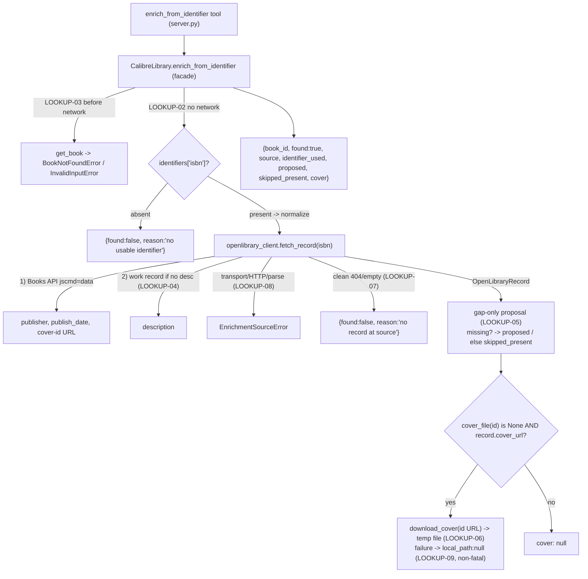

# Identifier-Based Metadata Lookup (ENRICH-01) Design

**Spec**: `.specs/features/identifier-lookup/spec.md`
**Status**: Proposed — ready for Tasks/Execute
**Precedent**: `CalibreLibrary.find_duplicates` (AD-016 — a read-only *advisory* report that never
mutates) for the read-only, no-write shape; `AD-014`/`AD-021` for the "one dedicated module per new
I/O kind" pattern this feature extends to **outbound HTTP**. **Prerequisite**: `SqliteReader.cover_file`
(COVER-01) — reused to decide whether a cover is even missing.

---

## Architecture Overview

`enrich_from_identifier` is a **read-only lookup** that adds exactly one new capability to the stack:
an outbound HTTP call, confined to a single new sibling module (`openlibrary_client.py`) the way
`CalibredbRunner`/`EbookConvertRunner`/`CalibreSmtpRunner` confine each external CLI (AD-014) and
`folder_scan.py` confines the filesystem walk (AD-021). The facade **orchestrates** the network I/O
but never **performs** it — the same invariant, now naming HTTP as a fourth I/O kind (**proposed
AD-026**).

Flow (all before-any-write; nothing is written, ever):

1. **Resolve the book & identifier** (no network): `get_book(book_id)` (`BookNotFoundError` /
   non-int → `InvalidInputError`); pull `identifiers["isbn"]`, normalize (strip non-alphanumerics,
   upper-case). No ISBN → return `{found: false, reason: "no usable identifier (ISBN)"}` **without
   any network call** (LOOKUP-02).
2. **Fetch the record** (network, bounded): `openlibrary_client.fetch_record(isbn)` — one GET to the
   Books API (`jscmd=data`) for publisher / publish_date / cover-id URL; if it carries no
   description, **one follow-up GET** to the work record for `description` (LOOKUP-04). Transport
   failure/timeout/HTTP≥400/parse → `EnrichmentSourceError` (LOOKUP-08); a clean 404/empty → `None` →
   `{found: false, reason: "no record at source"}` (LOOKUP-07).
3. **Compute the gap-only proposal** (no network): for `comments`, `publisher`, `pubdate`, include the
   fetched value in `proposed` **only if the book's field is missing** (`None`/empty; pubdate also
   `0101-01-01%`, reusing `library_stats`' rule); otherwise list the field in `skipped_present`
   (LOOKUP-05).
4. **Cover** (network, best-effort): only if `cover_file(book_id) is None` (COVER-01) **and** the
   record has a cover — download the cover-**id** image (not rate-limited) to a temp file; return
   `cover: {url, local_path}` (LOOKUP-06). A download failure is **non-fatal**: `cover: {url,
   local_path: null, error}` and the metadata proposal still returns (LOOKUP-09).
5. **Return** the advisory result. ENRICH-02 later feeds `proposed` into `update_metadata`'s
   plan→confirm gate; COVER-02 later sets the cover from `cover.local_path`.



---

## Approaches Considered

| Approach | Summary | Verdict |
| --- | --- | --- |
| **A — Read-only lookup facade + dedicated `openlibrary_client.py` sibling (stdlib urllib), injectable HTTP seam** (chosen) | New `enrich_from_identifier` facade orchestrates; all HTTP + cover-download I/O lives in one new module with a monkeypatchable fetch seam; returns advisory `proposed`. | ✅ Confines the new I/O kind to one module (consistent with AD-014/AD-021); read-only isolates network hardening from mutation (roadmap sequencing); no new dependency; testable fully offline. |
| **B — Fold lookup + apply into one plan→confirm tool** | `enrich_from_identifier` fetches *and* writes via a token gate (ENRICH-01+02 in one). | ❌ Rejected at Specify time: couples the first outbound-network surface to a mutation in one feature — more to harden/verify at once, and the roadmap deliberately splits lookup from apply. |
| **C — HTTP inside the facade / a runner** | Put `urllib` calls directly in `CalibreLibrary`, or bolt onto `CalibredbRunner`. | ❌ Breaks the "facade orchestrates, dedicated module performs I/O" invariant (AD-001/014/021). Network is a distinct I/O kind and gets its own module, like the filesystem walk did. |
| **D — Add `httpx`/`requests` dependency** | Use a full HTTP client library. | ❌ Two simple GETs don't justify a new dependency; AD-023 wants a frictionless single-dep `uvx` install. Stdlib `urllib.request` suffices. |
| **E — Skip the description follow-up call** | Only use the one structured call (no description). | ❌ Rejected at Specify time: `comments` is the 71% gap — the phase's main motivation. The clean endpoint omits description (verified); the work-record follow-up is worth the second call. |
| **F — Return the cover URL only (no download)** | Don't download; hand back the URL. | ❌ User chose download-to-temp: COVER-02 consumes a **local** path, so downloading here closes the net-fetch→local-path gap COVER-02 left open, while ENRICH-01 stays library-read-only. |

---

## Research notes — Open Library API (verified live 2026-07-31)

Grounded via the live API, not memory (Knowledge Verification Chain). **No API key required.**

- **Books API (structured, primary call):**
  `https://openlibrary.org/api/books?bibkeys=ISBN:<isbn>&format=json&jscmd=data`
  → keyed by `"ISBN:<isbn>"`; nested fields observed: `title`, `subtitle`, `authors`,
  `number_of_pages`, `publish_date`, `publishers:[{name}]`, `subjects:[{name,url}]`,
  `identifiers:{isbn_10,isbn_13,openlibrary,...}`, and `cover:{small,medium,large}` where each is a
  `.../b/id/<id>-<S|M|L>.jpg` URL. **`description` is NOT present here** — it lives on the work.
- **Work record (description follow-up):** the edition (`https://openlibrary.org/isbn/<isbn>.json`)
  carries `works:[{key:"/works/OL…W"}]`; `https://openlibrary.org<work-key>.json` returns
  `description` as **either a string or `{"type":..., "value": "..."}`** (both forms handled).
  *(Implementation may reach the work directly from the Books API `cover`/`url` links; the
  edition→work hop is the contract that matters.)*
- **Covers:** `https://covers.openlibrary.org/b/<key>/<value>-<size>.jpg`, `key ∈ {id, isbn, oclc,
  lccn, olid}`, `size ∈ {S,M,L}`. **Rate limit: 100 req / 5 min / IP for keys *other than* id/OLID**
  → prefer the **id** URL from the Books API `cover` object to avoid the limit. `?default=false`
  makes a missing cover return **404** instead of a blank placeholder image — used so a "no cover"
  reads as a clean negative, not a bogus blank JPEG.
- **Resolvable identifier types:** ISBN, OCLC, LCCN, OLID — **not** Google Books id or ASIN.

---

## Code Reuse Analysis

### Existing Components to Leverage

| Component | Location | How to Use |
| --- | --- | --- |
| `find_duplicates` read-only advisory shape | `library.py:165` | Structural template — a facade method that reads, shapes a dict, and **never mutates / never gates**. |
| `SqliteReader.get_book` (+ `_require_int`) | `sqlite_reader.py:77` | Load `identifiers`/current field values; unknown id → `BookNotFoundError`, non-int → `InvalidInputError`, **before any network** (LOOKUP-03). |
| `SqliteReader.cover_file` (COVER-01) | `sqlite_reader.py:343` | `cover_file(id) is None` ⇒ the book has no cover ⇒ propose one (LOOKUP-06). No second cover query. |
| Placeholder-pubdate rule `pubdate LIKE '0101-01-01%'` | `sqlite_reader.py:531` | The **same** rule decides "pubdate missing" here — one business rule, no drift. |
| Sibling-runner discipline (AD-014) | `calibredb_runner.py`, `ebook_convert_runner.py`, `calibre_smtp_runner.py` | Pattern to mirror for the **new** `openlibrary_client.py` — one module owns one external dependency, with a single call site and failure→taxonomy mapping. |
| Pure-I/O-module discipline (AD-021) | `folder_scan.py` | Precedent that a **new I/O kind** (there: filesystem walk) gets its own dependency-free module the facade orchestrates. HTTP is the next such kind. |
| `_map_errors` / `_jsonify` / `_get_library` | `server.py:54/102` | Tool wrapping identical to every other read tool; `EnrichmentSourceError` (a `CalibreMcpError`) maps to a clean `ToolError`. |
| Failure taxonomy | `errors.py` | Add `EnrichmentSourceError(CalibreMcpError)`; reuse `BookNotFoundError`/`InvalidInputError`. |

### Integration Points

| System | Integration Method |
| --- | --- |
| Tool surface (FastMCP) | New `@mcp.tool() @_map_errors def enrich_from_identifier(book_id: int) -> dict:` → `_jsonify(_get_library().enrich_from_identifier(book_id))`. Read-only (no `confirmation_token`). |
| Facade | New `CalibreLibrary.enrich_from_identifier`; constructs/holds an `OpenLibraryClient`; reuses `get_book`/`cover_file`; **no** token/backup (nothing is written). |
| Read layer | **No new method** — reuses `get_book` + `cover_file` (COVER-01). |
| Write layer | **Untouched** — ENRICH-01 never writes. |
| New I/O module | `openlibrary_client.py` — the only place `urllib`/network + cover-file download live. |

---

## Components

### `openlibrary_client.py` (new sibling module — the only outbound-I/O site)

- **Purpose**: Perform (and confine) all Open Library HTTP + cover-download I/O, mapping every
  transport failure into the taxonomy. The HTTP analog of `CalibredbRunner`/`folder_scan.py`.
- **Location**: `src/calibre_mcp/openlibrary_client.py`
- **No dependency on** `calibredb`/`sqlite3`/the facade — it takes an ISBN string in and returns a
  plain dataclass (or raises `EnrichmentSourceError`).
- **Data**:
  ```python
  @dataclass(frozen=True)
  class OpenLibraryRecord:
      publisher: str | None
      pubdate: str | None        # raw Open Library publish_date (no coercion)
      description: str | None     # from the work record (LOOKUP-04); {value} form flattened
      cover_url: str | None       # the cover-id URL (not rate-limited), largest available
  ```
- **Interfaces**:
  - `class OpenLibraryClient` with an injectable transport seam so tests never hit the network:
    - `__init__(self, *, http_get: HttpGet = _urllib_get, timeout: float = 10.0, retries: int = 1,
      user_agent: str = _DEFAULT_UA)` — `HttpGet = Callable[[str, float], bytes]` (LOOKUP-10).
    - `fetch_record(self, isbn: str) -> OpenLibraryRecord | None` — Books API GET (+ work follow-up
      for description when absent, LOOKUP-04); `None` on a clean not-found (LOOKUP-07);
      `EnrichmentSourceError` on transport/HTTP≥400/parse (LOOKUP-08).
    - `download_cover(self, cover_url: str, dest_dir: Path | None = None) -> Path` — GET the image,
      write to a uniquely-named temp file (prefix `calibre-mcp-enrich-`), return the path; raises
      `EnrichmentSourceError` on failure (the **facade** decides that a cover failure is non-fatal,
      LOOKUP-09).
  - Private `_urllib_get(url, timeout) -> bytes` — the single real `urllib.request.urlopen` call
    site (arg is a full URL string; sets `User-Agent`; wraps `URLError`/`HTTPError`/`socket.timeout`
    → `EnrichmentSourceError`); the ≤1 retry loop wraps this.
- **Reuses**: stdlib `urllib.request`, `json`, `tempfile`; `errors.EnrichmentSourceError`.

### `CalibreLibrary.enrich_from_identifier` (facade method)

- **Purpose**: Orchestrate the read-only lookup — resolve identifier → fetch → gap-only proposal →
  best-effort cover — returning an advisory dict. Never writes, never gates.
- **Location**: `src/calibre_mcp/library.py`
- **Interface**: `enrich_from_identifier(self, book_id: int) -> dict[str, Any]`
- **Behavior (maps 1:1 to ACs)**:
  1. `book = self._reader.get_book(book_id)` (LOOKUP-03; non-int → `InvalidInputError`).
  2. `isbn = _normalize_isbn(book.identifiers.get("isbn"))`; if falsy →
     `{"book_id": book_id, "found": False, "reason": "no usable identifier (ISBN)"}` — **no network**
     (LOOKUP-02).
  3. `record = self._enricher.fetch_record(isbn)` (LOOKUP-08 propagates); if `None` →
     `{"book_id": book_id, "found": False, "identifier_used": {"type": "isbn", "value": isbn},
     "reason": "no record at source"}` (LOOKUP-07).
  4. `proposed, skipped = self._gap_proposal(book, record)` (LOOKUP-04/05 — comments←description,
     publisher, pubdate; `_field_missing` uses the `0101-01-01%` rule for pubdate).
  5. `cover = self._propose_cover(book_id, record)` — `None` if the book already has a cover
     (`cover_file` not None) or the record has no cover; else best-effort download (LOOKUP-06/09).
  6. Return `{"book_id": book_id, "found": True, "source": "openlibrary", "identifier_used":
     {"type": "isbn", "value": isbn}, "proposed": proposed, "skipped_present": skipped, "cover":
     cover}`.
- **Helpers (pure/small)**: `_normalize_isbn`, `_field_missing(book, field)`, `_gap_proposal`,
  `_propose_cover` (wraps the download in a try/except → non-fatal per LOOKUP-09).
- **Reuses**: `get_book`, `cover_file` (COVER-01), the `OpenLibraryClient` seam.

### `enrich_from_identifier` tool (server)

- **Location**: `src/calibre_mcp/server.py`
- **Interface**: `@mcp.tool() @_map_errors def enrich_from_identifier(book_id: int) -> dict:` →
  `_jsonify(_get_library().enrich_from_identifier(book_id))`.
- **Docstring** (host-facing): read-only — **proposes** values, writes nothing; makes an outbound
  call to Open Library keyed on the book's ISBN; returns `proposed` (gap-only) + a downloaded cover
  `local_path`; to **apply**, feed `proposed` into `update_metadata` (ENRICH-02) and the cover into
  `set_cover` (COVER-02); fails with a clear error when offline/unreachable.

---

## Data Models

No persistent model. New constants/types:

- `errors.EnrichmentSourceError(CalibreMcpError)` — external source unreachable/timeout/HTTP/parse
  failure; carries a short reason (and optionally the URL, never secrets — there are none here).
- `openlibrary_client.OpenLibraryRecord` (above).
- Result shapes:

```python
# has ISBN + source has a record (LOOKUP-01)
{ "book_id": int, "found": True, "source": "openlibrary",
  "identifier_used": {"type": "isbn", "value": str},   # normalized
  "proposed": { "comments": str, "publisher": str, "pubdate": str },  # ONLY missing fields
  "skipped_present": [str],                              # target fields already populated
  "cover": { "url": str, "local_path": str }            # downloaded, ready for COVER-02
            | { "url": str, "local_path": None, "error": str }  # LOOKUP-09 non-fatal
            | None }                                     # book already has a cover / no cover found

# no usable identifier — NO network call (LOOKUP-02)
{ "book_id": int, "found": False, "reason": "no usable identifier (ISBN)" }

# source has no record for the ISBN (LOOKUP-07)
{ "book_id": int, "found": False,
  "identifier_used": {"type": "isbn", "value": str},
  "reason": "no record at source" }
```

No confirmation token, no backup — ENRICH-01 writes nothing.

---

## Error Handling Strategy

| Error Scenario | Handling | Host sees |
| --- | --- | --- |
| Unknown `book_id` | `BookNotFoundError` before any network (LOOKUP-03) | `ToolError`: book not found |
| Non-int `book_id` | `InvalidInputError` via `get_book._require_int`, before network | `ToolError`: invalid id |
| No `isbn` on the book | Normal result `{found: false, reason}`, **no network** (LOOKUP-02) | Clear "nothing to look up" JSON, not an error |
| Source has no record for the ISBN | Normal result `{found: false, reason: "no record at source"}` (LOOKUP-07) | Clean negative JSON |
| Offline / timeout / HTTP ≥400 / unparseable body (metadata fetch) | `EnrichmentSourceError` (LOOKUP-08) — mapped, never a crash/partial | `ToolError`: source unavailable — try again / check connection |
| Cover download fails (network/HTTP/403 rate limit) | **Non-fatal** (LOOKUP-09): `cover.local_path = None` + `error`; metadata still returned | Metadata `proposed` intact; `cover` reports the failure |
| Work-record follow-up fails but the Books API call succeeded | Treat as metadata-fetch failure → `EnrichmentSourceError` **only if** we chose to require it; else `description` simply absent from `proposed`. **Decision:** a failed *description* follow-up is non-fatal (like the cover) — publisher/pubdate still returned; `comments` just isn't proposed. | Partial metadata proposal; no crash |

> Slow/hung network is bounded by the 10s timeout + ≤1 retry (LOOKUP-10), so the stdio server can
> never hang on a lookup.

---

## Risks & Concerns

| Concern | Location | Impact | Mitigation |
| --- | --- | --- | --- |
| **First outbound network call** — could hang the stdio server or crash on any transport error. | `openlibrary_client.py`, facade | A hung/errored lookup degrades or kills the server. | Bounded timeout (10s) + ≤1 retry + all failures → `EnrichmentSourceError` mapped to `ToolError` (LOOKUP-08/10). Recorded as **AD-026**. |
| **Tests could hit the live network** — flaky, slow, and violates offline-CI. | tests | Non-deterministic tests; the never-touch-reality rule broken for network. | Injectable `http_get` seam on `OpenLibraryClient`; every test feeds canned bytes. Stated as a **test-safety rule** in the spec (network analog of the write rule). |
| **Rate limit on cover-by-ISBN** (100/5min/IP). | `download_cover` | 403s on covers under any volume. | Use the cover-**id** URL from the Books API `cover` object (id/OLID are *not* rate-limited — verified); a 403 is still non-fatal (LOOKUP-09). |
| **Description shape varies** (string vs `{value}`). | `openlibrary_client.fetch_record` | A naive read yields a dict as the description. | Flatten `{value}` → its string in the client; unit-test both shapes (LOOKUP-04). |
| **Temp-file lifecycle** — the cover must outlive the call. | `download_cover` | A context-managed temp dir would delete the file before COVER-02 uses it. | Write to a uniquely-named file under the system temp dir (not an auto-cleaned dir); the OS/user reaps it. Documented; the path is returned so the consumer owns it. |
| **Sending ISBNs to a third party** (privacy). | facade → client | An identifier leaves the machine. | Inherent to any external lookup and **per-call, user-initiated** (the tool call is the opt-in); no personal data beyond the ISBN; single source, no telemetry. Noted, accepted for a personal tool (AD-007). |
| **Cross-feature dependency on COVER-01.** | facade | If ENRICH-01 ran before `cover_file` existed it couldn't decide cover-presence. | Sequencing recorded (COVER-01 ships first); the Tasks step's first task `Depends on` names `cover_file`. |
| **Colon/encoding in the ISBN → URL.** | client | A malformed identifier could build a bad URL. | Normalize to `[0-9X]` before building the URL; `bibkeys=ISBN:<isbn>` with a clean value; no user free-text reaches the URL. |

> No fabricated API behavior — every endpoint/field/rate-limit above was verified against the live
> API on 2026-07-31 (see Research notes). Anything the docs did not confirm is handled defensively
> (e.g. missing fields → simply absent from `proposed`).

---

## Tech Decisions (only non-obvious ones)

| Decision | Choice | Rationale |
| --- | --- | --- |
| New I/O module vs. inline | **Dedicated `openlibrary_client.py`** | Confines the new I/O kind (HTTP) to one module — the AD-014/AD-021 pattern applied to the network. |
| HTTP client | **stdlib `urllib.request`** (no new dep) | Two simple GETs; keeps the single-dep `uvx` install (AD-023). |
| Test seam | Injectable `http_get: Callable[[str,float],bytes]` | Deterministic, offline tests — the network analog of the never-touch-the-real-library rule. |
| Read-only, no gate | **No plan→confirm, no backup** | ENRICH-01 writes nothing; a gate/backup would be ceremony. Applying is ENRICH-02 (which *does* gate). Mirrors `find_duplicates` (AD-016 advisory). |
| Gap-only proposal | Propose **only missing** fields; report present ones in `skipped_present` | The phase exists to fill gaps; never silently propose overwriting existing metadata. |
| pubdate value | Return the **raw** `publish_date` string | Lookup ≠ coercion; date parsing belongs to the apply step (ENRICH-02). |
| Description via 2nd call | Follow edition→work for `description` | The 71% gap field the clean endpoint omits (verified); non-fatal if the follow-up fails. |
| Cover: download + id URL | Download to temp via the cover-**id** URL | Produces the local path COVER-02 needs; id URL sidesteps the ISBN rate limit. |
| Cover/description failures | **Non-fatal** (best-effort) | A failed image or description follow-up must not lose the core metadata proposal (LOOKUP-09). |
| New AD? | **Proposed AD-026 — outbound-network policy** (record at Execute closeout) | The project's first HTTP client: names HTTP as a fourth I/O kind confined to a dedicated module (extends AD-001/014/021), fixes the bounded-timeout + ≤1-retry + graceful-`EnrichmentSourceError` contract, mandates the injectable-seam network test-safety rule, and prefers non-rate-limited cover-id URLs. **Numbering:** COVER-02's design proposes AD-025; if it lands first this is AD-026, else it takes the next free number at closeout. |

> **Project-level decision:** AD-026 above is appended to `.specs/STATE.md` `## Decisions` at Execute
> closeout (per the skill's memory flow), not now.

---

## Perspective sweep (Complex feature)

- **Structure** — one new module (`openlibrary_client.py`), one facade method, one tool; the facade
  orchestrates, the module performs I/O. No new read/write-layer methods.
- **Integration** — outbound HTTP to Open Library; failure-tolerant (bounded timeout, ≤1 retry,
  best-effort cover/description); read-only, so no compatibility impact on existing mutations.
- **Data** — no persistence; an advisory dict + a transient temp cover file. Raw pubdate (no schema
  coercion). Feeds ENRICH-02/COVER-02 downstream.
- **Security** — only an ISBN leaves the machine (no secrets, no PII); per-call user-initiated; URL
  built from a normalized `[0-9X]` value (no injection surface); untrusted response bodies parsed
  defensively (missing/oddly-shaped fields degrade, never crash).
- **Infra & ops** — no new dependency; no config required to *run* (the tool just needs network at
  call time); tests fully offline via the seam; bounded timeout guarantees the stdio server can't
  hang. (A future `CALIBRE_MCP_ENRICH_TIMEOUT` env override is possible but not needed for the MVP.)
- **Domain** — introduces "enrichment source" and "proposal (gap-only, advisory)" to the vocabulary;
  reinforces the safe-writes brand by keeping the first internet read strictly non-mutating.

Tension surfaced: *description value vs. call count* — a second call per book to get the 71%-gap
field. Resolved: the follow-up is worth it (confirmed) and made **non-fatal**, so the cost is
bounded and never blocks the core proposal.

---

## Requirement Coverage (design → spec)

| Requirement | Covered by |
| --- | --- |
| LOOKUP-01 (has ISBN + record → advisory proposal, no write) | `enrich_from_identifier` happy path + `_gap_proposal` + result shape |
| LOOKUP-02 (no ISBN → `found:false`, no network) | facade step 2 early-return before `fetch_record` |
| LOOKUP-03 (unknown/non-int id → error before network) | `get_book` precheck (`BookNotFoundError`/`InvalidInputError`) |
| LOOKUP-04 (description via work-record follow-up, `{value}` flattened) | `OpenLibraryClient.fetch_record` second GET + shape-flatten |
| LOOKUP-05 (propose only missing; present → `skipped_present`) | `_field_missing` (incl. `0101-01-01%` pubdate rule) + `_gap_proposal` |
| LOOKUP-06 (no cover + source cover → download id-URL to temp, return local_path) | `_propose_cover` + `cover_file` (COVER-01) + `download_cover` |
| LOOKUP-07 (ISBN but no source record → `found:false`, not error) | `fetch_record` returns `None` → facade negative result |
| LOOKUP-08 (transport/HTTP/parse → `EnrichmentSourceError`, no partial) | `_urllib_get` failure wrap → taxonomy → `_map_errors` |
| LOOKUP-09 (cover download failure non-fatal) | `_propose_cover` try/except → `local_path:null, error`; metadata still returned |
| LOOKUP-10 (bounded timeout + ≤1 retry + User-Agent) | `OpenLibraryClient.__init__` params + retry loop around `_urllib_get` |
