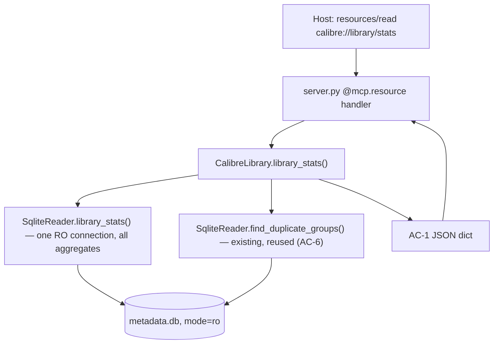

# Library Baseline Stats (STATS-01) Design

**Spec**: `.specs/features/library-stats/spec.md`
**Status**: Draft

---

## Architecture Overview

STATS-01 adds one **read-only MCP resource** (`calibre://library/stats`) that returns an aggregate
profile of the library as a single JSON object. It threads through the existing three layers with
zero new invariants:

- **`SqliteReader.library_stats()`** — one new read method that opens **one** read-only connection
  and runs all aggregate `GROUP BY`/`COUNT` queries, returning a typed `LibraryStats` snapshot. All
  new SQL lives here (AD-001, AC-6).
- **`CalibreLibrary.library_stats()`** — facade method that calls the reader's `library_stats()`
  and its existing `find_duplicate_groups()` (AC-6 reuse), then composes the AC-1 JSON dict. Touches
  no `sqlite3`/`subprocess` (the enforced invariant).
- **`server.py` resource handler** — `@mcp.resource("calibre://library/stats", ...)` calls the
  facade and returns the dict (FastMCP serializes to JSON). A dedicated `_map_resource_errors`
  surfaces read failures as `ResourceError` (AC-4), mirroring `_map_errors` for tools.



**Why a resource, not a tool:** locked by AD-018/STATE and spec (Option A) — a resource is
auto-loadable on connect, matching "known without a tool call". No URI params → parameter-free,
stateless, read-only.

---

## Code Reuse Analysis

### Existing Components to Leverage

| Component | Location | How to Use |
| --- | --- | --- |
| `SqliteReader._connect()` | `src/calibre_mcp/sqlite_reader.py:57` | Reuse the `mode=ro` URI connection for the new aggregate method — same lock-independent guarantee (AC-3). |
| `SqliteReader.count_books()` | `sqlite_reader.py:91` | Pattern reference for a single-connection aggregate; `totals.books` must equal this (Independent Test). |
| `SqliteReader.find_duplicate_groups()` | `sqlite_reader.py:268` | Called as-is for `data_quality_flags.duplicate_title_groups` — no second dedupe implementation (AC-6). |
| `CalibreLibrary._shape_duplicate_group()` | `library.py:387` | Reuse the exact shaping for each duplicate group so `duplicate_title_groups` matches `find_duplicates` output. |
| `_map_errors` pattern | `server.py:53` | Mirror it as `_map_resource_errors` (raises `ResourceError` instead of `ToolError`). |
| `_get_library()` | `server.py:41` | Resource handler reuses the same lazy singleton facade. |

### Integration Points

| System | Integration Method |
| --- | --- |
| FastMCP resource registry | `@mcp.resource("calibre://library/stats", name="library_stats", mime_type="application/json")` on a zero-arg function → registered as a static (non-template) resource. Verified against installed `mcp` SDK: `FastMCP.resource(uri, *, name, title, description, mime_type, ...)`; a dict return is JSON-serialized. |
| `metadata.db` | Same read-only SQLite path as every other read; new aggregate SQL only, no schema touched. |

---

## Components

### `SqliteReader.library_stats()`

- **Purpose**: Compute the full aggregate profile (everything except duplicate groups) from one
  read-only snapshot.
- **Location**: `src/calibre_mcp/sqlite_reader.py`
- **Interfaces**:
  - `library_stats() -> LibraryStats` — opens one `mode=ro` connection, runs the query set below,
    returns a typed snapshot. Never raises for an empty library (returns zeroed `LibraryStats`).
- **Dependencies**: `_connect()`, the `metadata.db` schema (books, data, languages link,
  identifiers, authors/tags links, comments/publishers/series/ratings links).
- **Reuses**: `_connect()`. All aggregate SQL is new and lives **only** here.

### `CalibreLibrary.library_stats()`

- **Purpose**: Compose the reader snapshot + duplicate groups into the AC-1 JSON dict.
- **Location**: `src/calibre_mcp/library.py`
- **Interfaces**:
  - `library_stats() -> dict` — calls `self._reader.library_stats()` and
    `self._reader.find_duplicate_groups()`; returns the AC-1 shape.
- **Dependencies**: `SqliteReader`.
- **Reuses**: `find_duplicate_groups()`, `_shape_duplicate_group()`. No `sqlite3`/`subprocess`.

### `server.py` resource handler

- **Purpose**: Expose the profile at `calibre://library/stats`.
- **Location**: `src/calibre_mcp/server.py`
- **Interfaces**:
  - `library_stats_resource() -> dict` (decorated) — `_get_library().library_stats()`, wrapped by
    `_map_resource_errors`.
  - `_map_resource_errors(fn)` — catches `CalibreMcpError` **and** `sqlite3.Error`/`OSError`, raises
    `ResourceError(str(exc))` naming the failure (AC-4). Catching (not querying) sqlite exceptions
    does not violate the "tool layer never issues SQL" invariant.
- **Dependencies**: `_get_library()`, `ResourceError` from `mcp.server.fastmcp.exceptions`.
- **Reuses**: `_get_library()`, the `_map_errors` shape.

---

## Data Models

### `LibraryStats` (new dataclass, `sqlite_reader.py`)

Typed snapshot returned by the reader; the facade serializes it (via `dataclasses.asdict`) and adds
`data_quality_flags.duplicate_title_groups`. Fields are already JSON-friendly primitives.

```python
@dataclass
class LibraryStats:
    totals: dict          # {books, min_id, max_id, gapped_ids, next_id_hint}
    formats: dict         # {"EPUB": 120, "PDF": 30, ...}
    languages: dict       # {"eng": 90, "por": 60, "unset": 20}
    metadata_completeness: dict  # {field: {"filled": int, "pct": float}}
    identifier_types: dict       # {"isbn": 88, "google": 12, ...}
    authors: dict         # {"distinct": int, "top": [{"name": str, "count": int}, ...]}
    tags: dict            # {"distinct": int, "top": [{"name": str, "count": int}, ...]}
    data_quality: dict    # {unknown_author_books, placeholder_pubdate_0101,
                          #  series_unused, rating_unused}  (duplicate groups added by facade)
```

Completeness fields (AC-1): `{comments, publisher, tags, identifiers, languages, real_pubdate,
series, rating}`. `pct` = `round(100 * filled / books, 1)`, `0.0` when `books == 0` (no ZeroDivision).

### Query set (all in `SqliteReader.library_stats()`, one connection)

| Stat | Query (essence) | Grounded fact (real lib, 170 books) |
| --- | --- | --- |
| totals | `SELECT COUNT(*), MIN(id), MAX(id) FROM books`; `gapped_ids = (max-min+1)-count`; `next_id_hint = max+1` | 170 books, ids 1–185, gapped=15, next=186 |
| formats | `SELECT format, COUNT(*) FROM data GROUP BY format` | — |
| languages | `SELECT lg.lang_code, COUNT(*) FROM books_languages_link l JOIN languages lg ON lg.id=l.lang_code GROUP BY lg.lang_code`; `unset = COUNT(books with no language link)` | unset bucket per edge case |
| completeness (per field) | `COUNT(DISTINCT book)` on the link/child table; `real_pubdate = COUNT(*) FROM books WHERE pubdate IS NOT NULL AND pubdate NOT LIKE '0101-01-01%'` | placeholder confirmed as `0101-01-01…` prefix (64 books) |
| identifier_types | `SELECT type, COUNT(*) FROM identifiers GROUP BY type` | — |
| authors | distinct: `COUNT(DISTINCT author) FROM books_authors_link`; top: `… GROUP BY a.id ORDER BY COUNT(*) DESC, a.name ASC LIMIT 10` | top-N=10 (prototype) |
| tags | analogous with `books_tags_link`/`tags` | top-N=10 |
| unknown_author_books | `COUNT(DISTINCT l.book) … JOIN authors a … WHERE a.name='Unknown'` | 14 books (literal `Unknown` confirmed) |
| placeholder_pubdate_0101 | `COUNT(*) FROM books WHERE pubdate LIKE '0101-01-01%'` | 64 |
| series_unused / rating_unused | `(COUNT of books with a series/rating link) == 0` → bool | — |

**Determinism (AC-5):** every `top`/list query carries an explicit tie-breaker
(`ORDER BY COUNT(*) DESC, name ASC`); dict insertion order is stable; no wall-clock/random input.
Two reads with no DB change → byte-identical output. `find_duplicate_groups()` is already
deterministic (dict of normalized keys).

---

## Error Handling Strategy

| Error Scenario | Handling | Host sees |
| --- | --- | --- |
| Empty library (0 books) — AC-2 | Reader returns zeroed `LibraryStats`; `pct` guarded to `0.0`; all lists empty. Not an error. | Valid object, all counts 0. |
| GUI holds the lock — AC-3 | `mode=ro` SQLite read; unaffected, like `get_book`/`list_books`. | Normal profile. |
| `metadata.db` missing/corrupt — AC-4 | `sqlite3.OperationalError`/`OSError` caught by `_map_resource_errors` → `ResourceError` naming the failure. | Clear resource-read error, never a silent/empty profile. |
| Config invalid (`CALIBRE_LIBRARY_PATH`) | `ConfigError` (a `CalibreMcpError`) caught by `_map_resource_errors` → `ResourceError`. | Clear error naming the bad path. |

---

## Risks & Concerns

| Concern | Location | Impact | Mitigation |
| --- | --- | --- | --- |
| Two connections per profile (`library_stats()` + `find_duplicate_groups()`), so a concurrent write between them could make the snapshot internally inconsistent. | `library.py` (facade compose) | Negligible: single-user, local, tiny DB; AC-5 determinism is about *no change between reads*, which still holds. | Accept for MVP scope. If it ever matters, refactor `find_duplicate_groups()` to accept an optional open connection and share one snapshot. Documented in Tech Decisions. |
| `find_duplicate_groups()` fetches every book fully (`_fetch_book` per row) — O(N) sub-queries. | `sqlite_reader.py:274` | On 170 books it's already used by `find_duplicates` with no issue; not a new regression. | No change; STATS reuses the existing method per AC-6. Flag only if the library grows orders of magnitude. |
| `metadata_completeness` semantics for `comments` (empty-text row vs. absent). | new SQL | Wrong "filled" count if empty-text rows exist. | Grounded: real lib has 49 comment rows, 0 empty. Define filled = row exists AND `trim(text) != ''` to be correct regardless; test asserts it. |

> Otherwise: none found — the change is additive and read-only.

---

## Tech Decisions (only non-obvious ones)

| Decision | Choice | Rationale |
| --- | --- | --- |
| Where aggregate SQL lives | One new `SqliteReader.library_stats()`, single connection | Keeps AC-6 (no SQL outside read layer), gives an internally-consistent snapshot, one round of open/close. |
| Duplicate groups source | Reuse existing `find_duplicate_groups()` (second connection) | AC-6 literal reuse; avoids a second dedupe impl; accepted 2-connection trade-off (see Risks). |
| Reader return type | Typed `LibraryStats` dataclass, facade shapes to dict | Matches codebase convention (`Book` dataclass + `_book_to_dict`/`_shape_*` shaping in the outer layers). |
| Resource error mapping | New `_map_resource_errors` raising `ResourceError`; catches `CalibreMcpError` + `sqlite3.Error`/`OSError` | Resources need `ResourceError`, not `ToolError`; AC-4 requires the raw sqlite failure to surface named, so it must be caught here (catching ≠ issuing SQL, invariant intact). |
| `comments` completeness rule | filled = row exists AND non-empty text | Correct even if Calibre ever writes empty-text comment rows. |

> No new project-level AD needed: this design conforms to AD-001, AD-006, AD-010, AD-017, AD-018 and
> the stderr-only / arg-list / read-layer invariants without superseding any. The resource URI and
> Option-A choice are already recorded (STATS-01 backlog + AD-018).

---

## Coverage → Requirements

| Requirement | Covered by |
| --- | --- |
| STATS-01-01 (full AC-1 shape) | `LibraryStats` + query set + facade compose |
| STATS-01-02 (empty library) | Reader zeroed snapshot + `pct` guard |
| STATS-01-03 (lock-independent) | `_connect()` `mode=ro` reuse |
| STATS-01-04 (unreadable db error) | `_map_resource_errors` → `ResourceError` |
| STATS-01-05 (deterministic) | Explicit tie-breakers + pure reads, no cache |
| STATS-01-06 (read layer only, no subprocess) | SQL only in `SqliteReader`; facade/server touch no `sqlite3`/`subprocess` |
