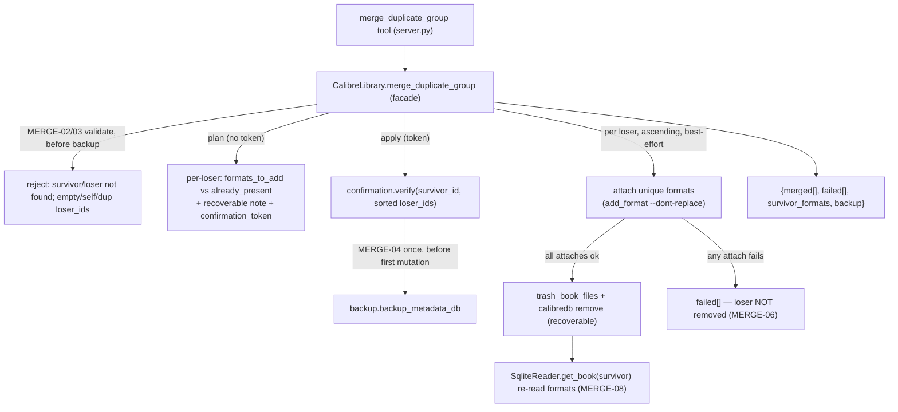

# Merge a Duplicate Group (ORGN-03) Design

**Spec**: `.specs/features/merge-duplicate-group/spec.md`
**Status**: Proposed — ready for Tasks/Execute
**Precedent**: `remove_book` (REM-01..05, Verified) for the recoverable-delete gate; ORGN-01/02 for
the AD-020 batch + AD-012 token shape.

---

## Architecture Overview

`merge_duplicate_group` is a compound orchestration over primitives already Verified — it introduces
**no new mutation primitive**. It combines three proven pieces behind one batch gate:

1. **Discover formats** per member — `SqliteReader.format_files(book_id)` (AD-017), already used by
   convert/email, resolves each format to its on-disk path.
2. **Attach** a loser's unique formats onto the survivor — `CalibredbRunner.add_format(survivor_id,
   path)` which already runs `add_format --dont-replace` (survivor's copy wins on conflict, MERGE-07).
3. **Recoverably remove** each emptied loser — the exact `remove_book` apply sequence
   (`trash_book_files` → one shared `backup_metadata_db` → `calibredb remove`), reused as-is.

Gated with the AD-012 token + AD-020 best-effort per-loser buckets, like ORGN-01/02 — but the
apply's unit of work is a *loser* (attach-then-remove), not a metadata field.

**The one non-obvious invariant — attach before delete, per loser (MERGE-06).** A loser is removed
only after **all** of its formats are provably on the survivor. If any `add_format` fails, that loser
is left in place and recorded in `failed[]`. This makes the merge data-safe: no file is orphaned by a
premature delete.



---

## Approaches Considered

| Approach | Summary | Verdict |
| --- | --- | --- |
| **A — Orchestrate `format_files` + `add_format` + `remove_book` flow, attach-before-delete per loser** (chosen) | Reuse all three Verified primitives; one batch token/backup; per-loser buckets. | ✅ No new primitive; data-safe ordering; recoverability + survivor-wins fall out of the existing primitives. |
| **B — `calibredb` native merge** | Use a single calibredb "merge" subcommand. | ❌ `calibredb` has no first-class merge subcommand; the GUI's merge is not exposed on the CLI. Would need SQL (violates AD-001). |
| **C — Delete losers first, then re-add their files to the survivor** | Remove records, then add_format from trash. | ❌ Deletes before the data is safe on the survivor (loses a file if the re-add fails); inverts the safety invariant. |

---

## Code Reuse Analysis

### Existing Components to Leverage

| Component | Location | How to Use |
| --- | --- | --- |
| `SqliteReader.format_files(book_id) -> {FMT: Path}` | `sqlite_reader.py:282` | Resolve each loser's format→path (attach source) and the survivor's current formats (conflict check). AD-017 reader discipline. |
| `SqliteReader.get_book` (`.formats`) | `sqlite_reader.py:77` | Survivor/loser existence precheck (MERGE-02) + survivor re-read (MERGE-08). |
| `CalibredbRunner.add_format(book_id, path)` (`--dont-replace`) | `calibredb_runner.py:141` | Attach a loser's format onto the survivor; survivor-wins on conflict (MERGE-07). |
| `remove_book` apply sequence: `trash_book_files` → `backup_metadata_db` → `runner.remove` | `library.py:727-733`, `backup.py:93` | Recoverable per-loser delete; the **one** shared backup runs before the first mutation, not per loser. |
| AD-012 token (`plan_token`/`verify`, `_BULK_TOKEN_ID`) | `confirmation.py`, `library.py:79` | Batch token over `{survivor_id, loser_ids}`. New op `_OP_MERGE_GROUP`. |
| AD-020 best-effort bucket skeleton | `rename_tag`/`rename_author` (`library.py`) | `merged[]`/`failed[]`, `sorted` order, invariant `len(merged)+len(failed)==len(loser_ids)`. |
| `InvalidInputError`/`BookNotFoundError`/`_map_errors`/`_jsonify` | `errors.py`, `server.py` | Validation + tool wrapping. |

### Integration Points

| System | Integration Method |
| --- | --- |
| Tool surface (FastMCP) | New `@mcp.tool() @_map_errors def merge_duplicate_group(survivor_id, loser_ids, confirmation_token=None)`. |
| Facade | New `CalibreLibrary.merge_duplicate_group`; validation helper; reuses format_files, add_format, the remove_book trash/backup/remove sequence, token. |
| Read layer | **No new method** — `format_files` + `get_book` already suffice. |
| Pure logic | A tiny pure helper `plan_loser_formats(loser_formats, survivor_formats) -> (to_add, already_present)` (unit-testable set split); optional, may live inline if trivial. |
| Write primitives | **No change** — `add_format` and `remove` are unchanged. |

---

## Components

### `CalibreLibrary.merge_duplicate_group` (facade method)

- **Location**: `src/calibre_mcp/library.py`
- **Interface**: `merge_duplicate_group(self, survivor_id: int, loser_ids: list[int], token: str | None = None) -> dict[str, Any]`
- **Behavior (maps 1:1 to ACs)**:
  1. Validate **before** any backup (MERGE-02/03): `loser_ids` non-empty; no duplicates; `survivor_id
     not in loser_ids`; `get_book(survivor_id)` and `get_book(each loser)` (BookNotFoundError → reject).
  2. `ordered_losers = sorted(loser_ids)`; `payload = {"survivor_id", "loser_ids": ordered_losers}`.
  3. **Plan** (`token is None`): for each loser, `to_add, already = plan_loser_formats(
     format_files(loser).keys(), survivor.formats)`; return `{"status":"plan","survivor_id",
     "survivor_title", "losers":[{book_id, title, formats_to_add, formats_already_present}],
     "recoverable": True, "note": "…recycle bin + trash copy…", "confirmation_token":
     plan_token(_OP_MERGE_GROUP, _BULK_TOKEN_ID, payload)}` — writes nothing (MERGE-01).
  4. **Apply** (`token`): `verify(_OP_MERGE_GROUP, _BULK_TOKEN_ID, payload, token)` (MERGE-05);
     `backup = backup_metadata_db(...)` once, before the loop (MERGE-04). Then for `loser_id in
     ordered_losers` best-effort:
     ```
     try:
         loser = get_book(loser_id)                     # vanished -> failed
         files = format_files(loser_id)
         survivor_fmts = get_book(survivor_id).formats  # refresh each iter (grows)
         added = []
         for fmt, path in sorted(files.items()):
             if fmt not in survivor_fmts:
                 add_format(survivor_id, path)           # --dont-replace
                 added.append(fmt)
         trash = trash_book_files(loser, library_path, backup_root)  # only after attaches ok
         runner.remove(loser_id)                         # recycle bin
         merged.append({loser_id, formats_added: added, trash_location: str(trash.dest)})
     except CalibreMcpError as exc:
         failed.append({loser_id, error: str(exc)})      # loser NOT removed (MERGE-06)
     ```
  5. `survivor_formats = get_book(survivor_id).formats` (MERGE-08 re-read); return
     `{"status":"merged","survivor_id","merged","failed","survivor_formats","backup": str(backup)}`.
- **Reuses**: token, backup, `trash_book_files`, `runner.remove`, `add_format`, `format_files`,
  `get_book`, AD-020 bucket discipline.
- **Note**: the shared `backup` runs **once** before the loop (not the per-call backup that
  `remove_book` does inline) — so the loser-remove here uses the runner/trash directly, not the
  `remove_book` facade (which would back up per loser). Same primitive sequence, batch-level backup.

### `plan_loser_formats` (tiny pure helper)

- **Location**: `src/calibre_mcp/library.py` (module-level) or a leaf module if it grows.
- **Interface**: `plan_loser_formats(loser_formats: Iterable[str], survivor_formats: Iterable[str]) -> tuple[list[str], list[str]]`
- **Behavior**: returns `(to_add, already_present)` — `to_add` = loser formats not on the survivor
  (sorted); `already_present` = the overlap (sorted). Pure, unit-testable (MERGE-07 split).

### `merge_duplicate_group` tool (server)

- **Location**: `src/calibre_mcp/server.py`
- **Interface**: `@mcp.tool() @_map_errors def merge_duplicate_group(survivor_id: int, loser_ids:
  list[int], confirmation_token: str | None = None) -> dict:` → `_jsonify(_get_library()...)`.
- **Docstring**: caller-chosen survivor, formats-only merge (survivor-wins on conflict),
  recoverable delete, attach-before-delete data-safety, plan→confirm handshake, one backup, honest
  `merged`/`failed`.

---

## Data Models

No persistent model. New op `_OP_MERGE_GROUP = "merge_duplicate_group"` in `library.py`. Shapes:

```python
# plan (no token)
{ "status": "plan", "survivor_id": int, "survivor_title": str,
  "losers": [ {"book_id": int, "title": str,
               "formats_to_add": [str], "formats_already_present": [str]} ],
  "recoverable": True, "note": str, "confirmation_token": str }

# apply (token)
{ "status": "merged", "survivor_id": int,
  "merged": [ {"loser_id": int, "formats_added": [str], "trash_location": str} ],
  "failed": [ {"loser_id": int, "error": str} ],
  "survivor_formats": [str],   # MERGE-08 re-read union
  "backup": str }
# invariant: len(merged) + len(failed) == len(loser_ids)
```

Token: `plan_token("merge_duplicate_group", 0, {"survivor_id", "loser_ids": sorted})`.

---

## Error Handling Strategy

| Error Scenario | Handling | Host sees |
| --- | --- | --- |
| Survivor or a loser id not found | `BookNotFoundError` before backup (MERGE-02) | `ToolError`: id not found — never a silent skip |
| Empty `loser_ids`, `survivor_id` in `loser_ids`, or duplicate ids | `InvalidInputError` before backup (MERGE-03) | `ToolError`: invalid merge |
| Token mismatch (group changed / wrong token) | `ConfirmationError` via `verify`, nothing written (MERGE-05) | `ToolError`: re-plan |
| A loser's `add_format` fails | Caught per-loser → `failed[]`, loser **not** removed, batch continues (MERGE-06) | Truthful `failed`; loser still present |
| A loser's `remove` fails after attaches succeeded | Caught per-loser → `failed[]` (formats already on survivor; loser survives, recoverable next run) | Truthful `failed` |
| `calibredb` binary missing | `CalibredbNotFoundError` propagates on the first mutation | `ToolError` |

---

## Risks & Concerns

| Concern | Location | Impact | Mitigation |
| --- | --- | --- | --- |
| Attach-before-delete ordering (data-safety core). | facade loop | A wrong order (remove then attach) would lose a file on any failure. | Attach all of a loser's formats **first**; only then trash+remove; `except` skips removal. Behavior test: monkeypatch `add_format` to fail → assert loser still present, in `failed[]`, survivor unchanged. |
| Backup-before-first-mutation order (L-001). | facade apply | A post-hoc check misses a wrong order. | One `backup_metadata_db` before the loop; call-order test (monkeypatch backup to raise → assert no `add_format`/`remove` ran). |
| Survivor format list is stale within the loop as it grows. | facade loop | Two losers each holding the same unique format → the second would try to re-add. | Re-read `survivor.formats` each iteration (or accumulate `added` into the set); `--dont-replace` is a backstop anyway. |
| `remove_book` facade backs up per call. | reuse choice | Reusing `remove_book` per loser would take N backups + N tokens. | Use the **primitive sequence** (`trash_book_files`+`runner.remove`) directly with one batch backup — documented in Components. |
| Token recompute must match when nothing changed. | facade apply | Nondeterministic id order → false mismatch. | Payload uses `sorted(loser_ids)`; `plan_token` normalizes JSON. |
| A loser whose files are missing on disk. | `format_files` | `format_files` raises `InvalidInputError` for a referenced-but-absent file. | Caught per-loser → `failed[]` (loser not removed); honest partial failure. |

---

## Tech Decisions (only non-obvious ones)

| Decision | Choice | Rationale |
| --- | --- | --- |
| No new mutation primitive | Orchestrate `format_files`+`add_format`+`remove` | ROADMAP intent; approaches B/C rejected. |
| Delete unit | Primitive sequence with **one batch backup**, not the `remove_book` facade | Avoid N backups/N tokens; keep one rollback point (AD-011/AD-020). |
| Data-safety | Attach all formats, then remove; skip removal on any attach failure | A record-deleting op must never orphan a file (MERGE-06). |
| Survivor / scope | Caller-chosen survivor; formats-only | User decisions (spec Assumptions). |
| Gate | plan→confirm + one batch token + one backup + recoverable trash | Deletes records → gated like `remove_book` (AD-012), batch-honest (AD-020). |
| Group membership | Not enforced (ids-exist only) | Review is the safety; enforcing grouping blocks legitimate merges (spec Out of Scope). |

> **No new project-level AD required.** ORGN-03 reuses AD-011/012/017/020 and REM-01..05's
> recoverable-delete pattern unchanged. (A one-line note that ORGN-03 established the "batch
> recoverable-delete = one backup + per-item trash" shape could be added to STATE.md, but it does
> not rise to an AD.)

---

## Requirement Coverage (design → spec)

| Requirement | Covered by |
| --- | --- |
| MERGE-01 (plan: per-loser format split + token, no write) | `merge_duplicate_group` plan branch + `plan_loser_formats` |
| MERGE-02 (survivor/loser not found → reject before backup) | facade validation (`get_book` prechecks) |
| MERGE-03 (empty/self/dup loser_ids → reject before backup) | facade validation |
| MERGE-04 (one backup before first mutation, attach then recoverable-remove) | facade apply branch |
| MERGE-05 (token mismatch → refuse) | `verify` on recomputed payload |
| MERGE-06 (attach fails → loser not removed, failed[], batch continues) | facade loop `try/except`, attach-before-remove |
| MERGE-07 (format already on survivor not duplicated, reported) | `add_format --dont-replace` + `plan_loser_formats` split |
| MERGE-08 (re-read survivor formats; loser trash location returned) | facade apply re-read + `trash_book_files` dest |
