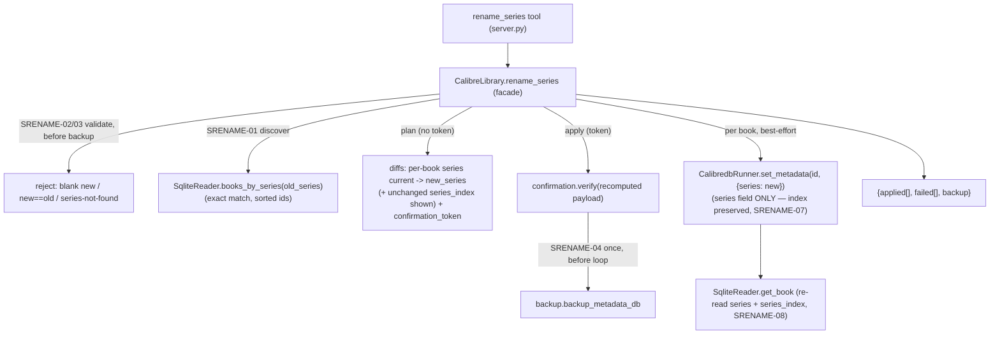

# Rename/Merge a Series Across the Library (ORGN-04) Design

**Spec**: `.specs/features/series-rename/spec.md`
**Status**: Proposed — ready for Tasks/Execute
**Precedent**: ORGN-01 (`author-rename`) and ORGN-02 (`tag-rename`), both Verified — this is their
**series-scoped** sibling, with one field-specific divergence (single-valued field + `series_index`).

---

## Architecture Overview

`rename_series` is a compound orchestration over primitives already Verified, following the **AD-020
best-effort batch pattern** with the **AD-012 plan→confirm gate** — the exact shape of ORGN-01/02.
The single divergence: **series is a single-valued field** (a book has at most one series via
`books_series_link`, plus a scalar `series_index`), so there is **no per-book list to resolve** — the
proposed value is simply `new_series` — and the write must set the **series field only** so each
book's `series_index` is preserved.

1. **Discover** every book whose series is `old_series` — a new read-layer method
   `SqliteReader.books_by_series(name)` (exact match, AD-001/AD-017 reader discipline), mirroring
   `books_by_author`/`books_by_tag`.
2. **Propose** `new_series` for each (trivial — no resolver; every discovered book has series ==
   `old_series` by construction).
3. **Gate** the batch with one deterministic `confirmation_token` over `(old_series, new_series,
   sorted discovered ids)` (AD-012 + AD-020 sentinel-id token).
4. **Apply** best-effort: one `metadata.db` backup before the loop (AD-011), then each book in
   `sorted` order via `calibredb set_metadata <id> --field series:<new>` (**series field only —
   `series_index` untouched**) → `applied`/`failed` buckets.

**Key delta from ORGN-01/02 — no resolver, no serialization concern, one new invariant.** ORGN-02
generalized a list resolver (`resolve_renamed_values`); ORGN-04 needs **none** — the value is scalar.
There is no separator concern either (`series` is set as `--field series:<name>`; AD-022 was about
joining list fields). The one thing ORGN-04 must get right that the siblings never faced:
**`series_index` preservation** — guaranteed by writing only the `series` field (empirically verified:
`calibredb set_metadata <id> --field series:"New"` leaves the index intact — `Old #7.5` → `New #7.5`).



---

## Approaches Considered

| Approach | Summary | Verdict |
| --- | --- | --- |
| **A — Discovery + AD-020 loop over `set_metadata` (series field only)** (chosen) | New `books_by_series` reader; best-effort per-book `set_metadata(id, {"series": new})` behind one batch token/backup. Same skeleton as ORGN-01/02, minus the resolver. | ✅ Keeps the ORGN family uniform (discover → plan `current→proposed` → confirm → one backup → honest buckets); index preserved by writing series only; not-found + validation live in one place. |
| **B — Reuse `update_metadata_bulk` with `{"series": new_series}`** | Series rename *is* a true broadcast of one identical field (unlike tags/authors, which are per-book distinct), so BULK-01 could technically express the write. | ❌ Still needs `books_by_series` discovery + not-found rejection first (BULK-01 takes caller-supplied ids, does not discover), so it becomes a facade calling another tool method — double-layered, and the plan/token would key on raw ids instead of `(old_series, new_series)`, breaking family consistency and the human-readable `old→new` review. Reuse the *pattern*, not this tool. |
| **C — Edit the `series` table entity directly (SQL)** | Rename the series record once. | ❌ Violates **AD-001** (writes never via SQLite). `calibredb` has no first-class series-entity rename subcommand; SQL skips Calibre's integrity/prune recompute. |

> Note the honest asymmetry with ORGN-02: for tags, Approach B was rejected because a rename needs a
> per-book *distinct* list. For series that reason evaporates (the field is scalar, so it *is* a
> broadcast) — but B is still rejected, now on discovery-layering + family-consistency grounds, not
> on expressibility. Approach A wins for uniformity, not necessity.

---

## The one field-specific decision: write the series field only (preserve the index)

A book's series has two parts: the **name** (`series`) and the **position** (`series_index`). ORGN-04
changes only the name. The apply MUST pass `{"series": new_series}` and **never** include
`series_index` — because:

- Including a stale/guessed index would clobber each book's real position (reading order).
- `calibredb set_metadata --field series:<name>` (no index field) preserves the existing index —
  **empirically verified 2026-07-31** (`Old #7.5` → `New #7.5`), and consistent with the facade's
  existing `series_index requires series` guard (`library.py:1036`), which only constrains the
  reverse direction.

There is deliberately **no** `resolve_renamed_values` call: the field is single-valued, so the
proposed value is the literal `new_series` with nothing to dedupe or merge within a book. (Reusing
the list resolver here would be degenerate — `resolve_renamed_values([old], old, new) == [new]` — and
misleading to the next reader.)

---

## Code Reuse Analysis

### Existing Components to Leverage

| Component | Location | How to Use |
| --- | --- | --- |
| AD-020 batch skeleton (validate → one backup → `sorted` best-effort loop → buckets) | `rename_tag` `library.py:507`; `rename_author` `library.py:420` | Same skeleton; `rename_series` is the series-scoped twin, minus the resolver. |
| AD-012 token (`plan_token`/`verify`, sentinel `_BULK_TOKEN_ID`) | `confirmation.py`, `library.py:78` | Batch token over `{old_series, new_series, book_ids}`. New op constant `_OP_RENAME_SERIES`. |
| `backup_metadata_db(db_path, backup_root)` | `backup.py` | One backup before the loop (AD-011), same call the siblings make. |
| `CalibredbRunner.set_metadata(book_id, {"series": new})` | `calibredb_runner.py:96` | Write the series field **only** — scalar → `--field series:<new>`; **index preserved**. No change to the runner. |
| `SqliteReader.get_book` / `_series` join / `series_index` column | `sqlite_reader.py:195,225,184` | Re-read applied books' `series` + `series_index` (SRENAME-08); `books_by_series` reuses the `series`/`books_series_link` join. |
| `_build_diff(book, fields)` | `library.py:846` | Per-book `series: current → proposed` plan row (proposed = `new_series`). |
| `_tag_rename_plan_entry` shape | `library.py:583` | Mirror for `_series_rename_plan_entry` (adds the unchanged `series_index` for transparency). |
| `InvalidInputError` / `ConfirmationError` / `_map_errors` / `_jsonify` | `errors.py`, `server.py` | Validation rejects + token mismatch + tool wrapping, exactly like the siblings. |

### Integration Points

| System | Integration Method |
| --- | --- |
| Tool surface (FastMCP) | New `@mcp.tool() @_map_errors def rename_series(old_series, new_series, confirmation_token=None)` returning `_jsonify(...)`. |
| Facade | New `CalibreLibrary.rename_series`; validation helper; reuses `_build_diff`, token, backup, runner, reader. |
| Read layer | New `SqliteReader.books_by_series(name) -> list[int]` (exact-match, sorted). |
| Pure logic | **None** — no resolver (single-valued field). |
| Write primitive | **No change** — `set_metadata` writes the scalar `series` field; index preserved. |

---

## Components

### `SqliteReader.books_by_series` (new read method)

- **Purpose**: Return the ids of every book whose series is `name`, by **exact** name — the discovery
  step for ORGN-04 (SRENAME-01/02).
- **Location**: `src/calibre_mcp/sqlite_reader.py`
- **Interface**: `books_by_series(self, name: str) -> list[int]` — ascending-sorted book ids in
  series `name`; empty list when no series matches.
- **Mechanism**: `SELECT DISTINCT l.book FROM books_series_link l JOIN series s ON s.id = l.series
  WHERE s.name = ? ORDER BY l.book` (parameterized; exact match, same join as `_series`).
- **Reuses**: the read-only connection pattern + the series join already in `_series`
  (`sqlite_reader.py:225`); structural clone of `books_by_tag` (`sqlite_reader.py:157`).

### `CalibreLibrary.rename_series` (facade method)

- **Purpose**: Orchestrate the rename — validate, discover, plan→confirm, one backup, best-effort
  apply (series field only), honest `applied`/`failed`.
- **Location**: `src/calibre_mcp/library.py`
- **Interface**: `rename_series(self, old_series: str, new_series: str, token: str | None = None) -> dict[str, Any]`
- **Behavior (maps 1:1 to ACs, structural twin of `rename_tag` `library.py:507`)**:
  1. Validate **before** any backup: `new_series` non-blank and `new_series != old_series` else
     `InvalidInputError` (SRENAME-03); `book_ids = self._reader.books_by_series(old_series)`; if empty
     → `InvalidInputError("series not found: …")` (SRENAME-02).
  2. `payload = {"old_series", "new_series", "book_ids": book_ids}` (already sorted).
  3. **Plan** (`token is None`): return `{"status": "plan", "old_series", "new_series", "diffs":
     [ _series_rename_plan_entry(book_id, old_series, new_series) … ], "confirmation_token":
     plan_token(_OP_RENAME_SERIES, _BULK_TOKEN_ID, payload)}` — writes nothing (SRENAME-01).
  4. **Apply** (`token`): `verify(_OP_RENAME_SERIES, _BULK_TOKEN_ID, payload, token)` (SRENAME-05);
     `backup = backup_metadata_db(...)` once (SRENAME-04); then `for book_id in book_ids:`
     best-effort — `book = get_book(book_id)` (guards a vanished id); `set_metadata(book_id,
     {"series": new_series})` (**series only**, SRENAME-07); `reread = get_book(book_id)` →
     `applied.append({book_id, series: reread.series, series_index: reread.series_index})`;
     `except CalibreMcpError` → `failed.append({book_id, error})` (SRENAME-06/08).
  5. return `{"status": "renamed", "old_series", "new_series", "applied": …, "failed": …, "backup":
     str(backup)}`.
- **Private helper** `_series_rename_plan_entry(book_id, old_series, new_series)`:
  `book = get_book(book_id)`; return `{"book_id": book_id, "diff": _build_diff(book, {"series":
  new_series}), "series_index": book.series_index}` — the diff shows `series: old→new`, and the
  unchanged `series_index` is surfaced so the reviewer sees reading order is preserved.
- **Reuses**: AD-020 skeleton, token, backup, reader, `_build_diff`. No resolver.

### `rename_series` tool (server)

- **Location**: `src/calibre_mcp/server.py`
- **Interface**: `@mcp.tool() @_map_errors def rename_series(old_series: str, new_series: str,
  confirmation_token: str | None = None) -> dict:` →
  `_jsonify(_get_library().rename_series(old_series, new_series, token=confirmation_token))`.
- **Docstring**: states exact-match, **series_index preserved** (only the name changes),
  merge-onto-existing (index collisions left as-is), the plan→confirm handshake, one backup, and
  honest `applied`/`failed`.

---

## Data Models

No persistent model. New op constant `_OP_RENAME_SERIES = "rename_series"` in `library.py` (bound into
the token, alongside `_OP_RENAME_TAG`/`_OP_RENAME_AUTHOR`/`_OP_UPDATE_BULK`). Result shapes
(SRENAME-01/04/06):

```python
# plan (no token)
{ "status": "plan", "old_series": str, "new_series": str,
  "diffs": [ {"book_id": int,
              "diff": {"series": {"current": str|None, "proposed": str}},
              "series_index": float|None} ],   # shown unchanged (SRENAME-07 transparency)
  "confirmation_token": str }

# apply (token)
{ "status": "renamed", "old_series": str, "new_series": str,
  "applied": [ {"book_id": int, "series": str, "series_index": float|None} ],  # SRENAME-08 (re-read)
  "failed":  [ {"book_id": int, "error": str} ],                                # SRENAME-06 (never aborts)
  "backup":  str }
# invariant: len(applied) + len(failed) == len(discovered book_ids)
```

Token: `plan_token("rename_series", 0, {"old_series", "new_series", "book_ids": sorted})`.

---

## Error Handling Strategy

| Error Scenario | Handling | Host sees |
| --- | --- | --- |
| `new_series` blank, or `new_series == old_series` | `InvalidInputError` before discovery/backup (SRENAME-03) | `ToolError`: invalid rename |
| `old_series` matches no book | `InvalidInputError("series not found")` before backup (SRENAME-02) | `ToolError`: series not found — never a silent empty success |
| Token mismatch (set changed since plan, or wrong token) | `ConfirmationError` via `verify`, writes nothing (SRENAME-05) | `ToolError`: re-plan and review |
| One book fails `set_metadata` (or vanished id) | Caught per-book → `failed[]`, batch continues (SRENAME-06) | Truthful `failed` entry; other books still renamed |
| `calibredb` binary missing | `CalibredbNotFoundError` (a `CalibreMcpError`) propagates on the first write | `ToolError` |
| `new_series` already exists (merge) | Books consolidate onto it, each keeping its index (SRENAME-07) | Renamed books read `new_series` with original indices |

---

## Risks & Concerns

| Concern | Location | Impact | Mitigation |
| --- | --- | --- | --- |
| **`series_index` clobbered by the write** (the one series-specific footgun). | `rename_series` apply | Resetting indices scrambles every book's reading order — the worst possible silent regression. | Write **only** `{"series": new}` (never the index). Add a test that asserts a book's `series_index` is **unchanged** after the rename (fractional value like `7.5`), not just that the name changed. Empirically pre-verified against `calibredb`. |
| Backup-before-write order (**L-001**). | `library.py` `rename_series` apply | A post-hoc backup-file check wouldn't catch a wrong order. | Add a call-order test (spy/monkeypatch) asserting `backup` runs before the first `set_metadata` — mirrors the ORGN-01/02 test. |
| Token recompute must match the plan when nothing changed. | `library.py` apply | Nondeterministic id order → false mismatch. | `books_by_series` returns **sorted** ids; payload uses the sorted list; `plan_token` normalizes JSON keys. |
| Index collision after merge (two books share an index in `new_series`). | `new_series` | Cosmetic — Calibre permits duplicate indices; reading order within the merged series is ambiguous. | Accepted & documented (spec Out of Scope): renumbering is a distinct task; preserving each index verbatim is the reversible, least-surprising choice. |
| Orphaned `old_series` entity lingers until Calibre prunes it. | `series` table | Cosmetic — an unused series may briefly show in the Tag Browser. | Accepted; mirrors ORGN-01/02. AD-001 keeps us out of the series table directly. Re-running the rename then reports "series not found" (proof of full consumption). |
| No cap → N sequential `set_metadata` subprocesses for a very long series. | facade loop | Slow batch for a huge series. | Accepted: a correct rename must cover **all** the series' books; a cap would make it silently partial. Mirrors ORGN-01/02. |

---

## Tech Decisions (only non-obvious ones)

| Decision | Choice | Rationale |
| --- | --- | --- |
| Reuse mechanism | AD-020 pattern + lower primitives, **not** `update_metadata_bulk` | Family consistency + discovery/not-found live in one place; BULK-01 takes caller-supplied ids and would double-layer. (For series the *expressibility* argument doesn't apply — B is rejected on structure, see Approaches.) |
| No pure resolver | Propose the literal `new_series`; no `resolve_renamed_values` | Single-valued field: nothing to dedupe/merge within a book. Reusing the list resolver would be degenerate and misleading. |
| Write scope | `{"series": new_series}` **only** — never the index | Preserves each book's `series_index` (SRENAME-07); verified against `calibredb`. |
| Serialization | **No change** to `set_metadata` | `series` is a scalar `--field series:<name>`; AD-022's list-join concern does not apply. |
| Where discovery lives | New `SqliteReader.books_by_series` | Reads stay in the read layer (AD-001/AD-017); reuses the existing series join. |
| Merge on rename | Allowed — consolidate onto an existing series; indices left as-is | ORGN-01/02 precedent; renumbering is Out of Scope. |
| `old_series` not found | Reject before backup | ORGN-01/02 precedent; a rename of a non-existent series is almost always a typo. |
| Gate | plan→confirm + one batch token + one backup | Rename overwrites existing metadata across N books → not additive; AD-012/AD-020 apply. |

> **No new project-level AD required.** ORGN-04 reuses AD-012/AD-020/AD-011/AD-001 unchanged. The
> single field-specific rule (write series only → index preserved) is captured by SRENAME-07 and its
> test, not a new architectural invariant. (If the Verifier prefers, a lightweight note could record
> "series rename writes the series field only to preserve series_index" — but it does not rise to an
> AD.)

---

## Requirement Coverage (design → spec)

| Requirement | Covered by |
| --- | --- |
| SRENAME-01 (discover + plan diff + token, no write) | `books_by_series` + `rename_series` plan branch + `_build_diff` |
| SRENAME-02 (series-not-found reject before backup) | `rename_series` validation |
| SRENAME-03 (blank / no-op new_series reject before backup) | `rename_series` validation |
| SRENAME-04 (one backup before loop, apply via set_metadata) | `rename_series` apply branch |
| SRENAME-05 (token mismatch → refuse, no write) | `verify` on recomputed payload |
| SRENAME-06 (per-book failure → `failed`, never aborts) | `rename_series` loop `except` |
| SRENAME-07 (index preserved on rename + merge-onto-existing) | `set_metadata` series-field-only write; merge falls out of discovery |
| SRENAME-08 (applied → re-read real series + index) | `rename_series` loop `get_book` re-read |
</content>
