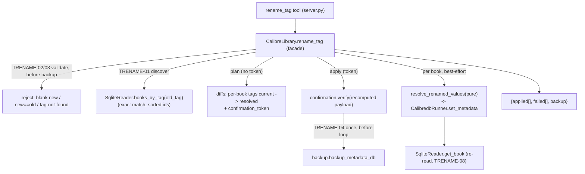

# Rename a Tag Across the Library (ORGN-02) Design

**Spec**: `.specs/features/tag-rename/spec.md`
**Status**: Proposed — ready for Tasks/Execute
**Precedent**: ORGN-01 (`author-rename`) Verified 2026-07-30 — this is its tag-scoped sibling.

---

## Architecture Overview

`rename_tag` is a compound orchestration over primitives already Verified, following the **AD-020
best-effort batch pattern** with the **AD-012 plan→confirm gate** — the exact shape of ORGN-01, not
a `BULK-01` broadcast. A rename produces a **per-book distinct** tag list (swap only `old_tag` for
`new_tag`, keep every other tag), which `update_metadata_bulk` cannot express (it broadcasts one
identical `fields` map). So ORGN-02 consumes the lower primitives directly:

1. **Discover** every book carrying `old_tag` — a new read-layer method `SqliteReader.books_by_tag(name)`
   (exact match, AD-001/AD-017 reader discipline), mirroring `books_by_author`.
2. **Resolve** each book's new tag list with the same pure rule ORGN-01 established (replace only
   `old`→`new`, order-preserving dedupe) — the single output feeds both the plan diff and the write
   (review == write).
3. **Gate** the batch with one deterministic `confirmation_token` over `(old_tag, new_tag, sorted
   discovered ids)` (AD-012 + AD-020 sentinel-id token).
4. **Apply** best-effort: one `metadata.db` backup before the loop (AD-011), then each book in
   `sorted` order via `calibredb set_metadata` → `applied`/`failed` buckets.

**Key delta from ORGN-01 — no prerequisite fix.** ORGN-01 was blocked by a serialization bug:
`set_metadata` comma-joined `authors`, mashing co-authors into one entity, so it had to introduce
the ` & ` separator (AD-022). Tags are *already* joined with `,` — the correct separator — so
`set_metadata` needs **no change** for ORGN-02. This feature is pure reuse of the corrected
primitive; the only genuinely new code is the reader lookup, the facade method, the tool, and a
one-line generalization of the pure resolver.



---

## Approaches Considered

| Approach | Summary | Verdict |
| --- | --- | --- |
| **A — Per-book resolve + AD-020 loop over `set_metadata`** (chosen) | New reader discovery + pure resolve fn; best-effort per-book `set_metadata` behind one batch token/backup. Same shape as ORGN-01. | ✅ Expresses the per-book distinct list; reuses the proven pattern; other-tag-safe; merge falls out of the dedupe. |
| **B — Reuse `update_metadata_bulk` twice (`remove old`, then `add new`)** | Two batch ops via BULK-01 list-modes. | ❌ Two tokens/two backups; ordering/merge dedupe not expressible; review wouldn't show the true final set; a single-tag book passes through an intermediate empty-tag state. |
| **C — Edit the `tags` table entity directly (SQL)** | Rename the tag record once. | ❌ Violates **AD-001** (writes never via SQLite). `calibredb` has no first-class tag-entity rename subcommand; SQL skips Calibre's integrity/prune recompute. |

---

## The one design decision: share the pure resolve rule (don't clone it)

ORGN-01's `resolve_renamed_authors(authors, old, new)` is a **generic list-of-strings set operation**
— replace `old` with `new`, order-preserving dedupe. The rule for tags is byte-for-byte identical.
AGENTS.md is explicit: *"Don't repeat a business rule — a rule that lives in two places will drift;
centralize it."* This is the same rule, not incidental similarity.

| Option | What | Verdict |
| --- | --- | --- |
| **A — Generalize to a shared `resolve_renamed_values(values, old, new)`** (chosen) | Introduce the generic in a shared pure module; both authors and tags consume it. `resolve_renamed_authors` stays as a thin re-export alias so ORGN-01's imports/tests are untouched and stay Verified. | ✅ One rule, one place; ORGN-01 unchanged behaviorally; new field renames (languages, custom columns) reuse it for free. Minimal churn. |
| **B — Clone into `tag_rename.py::resolve_renamed_tags`** | Copy the 6-line function. | ❌ Duplicates a business rule that will drift; exactly what AGENTS.md warns against. |
| **C — Call `resolve_renamed_authors` directly for tags** | Reuse as-is, no rename. | ❌ Works, but the name lies at the tag call site ("authors" applied to tags) — hurts the next reader. |

**Chosen: Option A.** Concrete shape (a MICRO refactor, no behavior change):

- New pure module `src/calibre_mcp/rename_resolve.py` exposing
  `resolve_renamed_values(values: list[str], old: str, new: str) -> list[str]` — the current body of
  `resolve_renamed_authors`, verbatim.
- `author_rename.py` becomes a one-line re-export: `resolve_renamed_authors = resolve_renamed_values`
  (keeps ORGN-01's `from .author_rename import resolve_renamed_authors` and its unit tests green —
  zero behavior change, so ORGN-01 stays Verified).
- `library.py` imports `resolve_renamed_values` for the tag path (and may migrate the author path to
  the generic name in the same edit — cosmetic, optional).

> This makes ORGN-02 almost entirely reuse: the resolver is shared, `set_metadata` is unchanged,
> and only `books_by_tag` + `rename_tag` (facade + tool) are new.

---

## Code Reuse Analysis

### Existing Components to Leverage

| Component | Location | How to Use |
| --- | --- | --- |
| AD-020 batch skeleton (validate → one backup → `sorted` best-effort loop → buckets) | `rename_author` `library.py:401`; `update_metadata_bulk` `library.py:334` | Same skeleton; `rename_tag` is the tag-scoped twin of `rename_author`. |
| AD-012 token (`plan_token`/`verify`, sentinel `_BULK_TOKEN_ID`) | `confirmation.py`, `library.py:78` | Batch token over `{old_tag, new_tag, book_ids}` — provably the reviewed rename. New op constant `_OP_RENAME_TAG`. |
| `backup_metadata_db(db_path, backup_root)` | `backup.py` | One backup before the loop (AD-011), same call the siblings make. |
| `CalibredbRunner.set_metadata(book_id, {"tags": [...]})` | `calibredb_runner.py:96` | Write each book's resolved tag list — **unchanged**; tags already join with `,` (AD-022). No prerequisite fix. |
| `SqliteReader.get_book` / the `_tags` join | `sqlite_reader.py:77,196` | Re-read applied books (TRENAME-08); `books_by_tag` reuses the same `tags`/`books_tags_link` join. |
| `resolve_renamed_authors` body | `author_rename.py:13` | Generalized to `resolve_renamed_values` (shared module) — the identical rule for tags. |
| `_build_diff(book, fields)` | `library.py:846` | Per-book `tags: current → proposed` plan row (proposed = resolved list). |
| `_rename_plan_entry` shape | `library.py:477` | Mirror for `_tag_rename_plan_entry` (or generalize; see Components). |
| `InvalidInputError` / `ConfirmationError` / `_map_errors` / `_jsonify` | `errors.py`, `server.py` | Validation rejects + token mismatch + tool wrapping, exactly like the siblings. |

### Integration Points

| System | Integration Method |
| --- | --- |
| Tool surface (FastMCP) | New `@mcp.tool() @_map_errors def rename_tag(old_tag, new_tag, confirmation_token=None)` returning `_jsonify(...)`. |
| Facade | New `CalibreLibrary.rename_tag`; validation helper; reuses `_build_diff`, token, backup, runner, reader. |
| Read layer | New `SqliteReader.books_by_tag(name) -> list[int]` (exact-match, sorted). |
| Pure logic | Shared `rename_resolve.resolve_renamed_values` (generalized from `author_rename`). |
| Write primitive | **No change** — `set_metadata` already serializes `tags` with `,`. |

---

## Components

### `SqliteReader.books_by_tag` (new read method)

- **Purpose**: Return the ids of every book carrying a tag, by **exact** name — the discovery step
  for ORGN-02 (TRENAME-01/02).
- **Location**: `src/calibre_mcp/sqlite_reader.py`
- **Interface**: `books_by_tag(self, name: str) -> list[int]` — ascending-sorted book ids whose
  `tags` include exactly `name`; empty list when no tag matches.
- **Mechanism**: `SELECT DISTINCT l.book FROM books_tags_link l JOIN tags t ON t.id = l.tag
  WHERE t.name = ? ORDER BY l.book` (parameterized; exact match, same join as `_tags`).
- **Reuses**: the read-only connection pattern + the tags join already in `_tags`; structural clone
  of `books_by_author` (`sqlite_reader.py:137`).

### `resolve_renamed_values` (generalized pure module `rename_resolve.py`)

- **Purpose**: Compute one book's post-rename value list — replace only `old` with `new`,
  order-preserving, in-book dedupe (TRENAME-07). No I/O; unit-testable without a scratch library.
- **Location**: `src/calibre_mcp/rename_resolve.py`
- **Interface**: `resolve_renamed_values(values: list[str], old: str, new: str) -> list[str]`
- **Behavior** (unchanged from ORGN-01's function — the same rule):
  ```python
  def resolve_renamed_values(values, old, new):
      result: list[str] = []
      for value in values:
          replacement = new if value == old else value
          if replacement not in result:   # order-preserving dedupe / merge
              result.append(replacement)
      return result
  ```
  Tag cases: `[old]→[new]`; `[a,old,b]→[a,new,b]`; `[old,new]→[new]`; `[new,old]→[new]`;
  `[old,old]→[new]`. A book carrying `old` always yields ≥1 tag (never an empty list, since we only
  replace, never remove).
- **Note (set vs order)**: `_tags` reads alphabetically (`ORDER BY t.name`), and Calibre re-reads
  tags alphabetically after the write. The resolver is order-preserving over the input, but because
  the effective semantics of tags is a **set**, tests assert set equality on the re-read, not
  positional order (spec TRENAME-08 note).
- **Back-compat**: `author_rename.resolve_renamed_authors` re-exports this — ORGN-01 untouched.

### `CalibreLibrary.rename_tag` (facade method)

- **Purpose**: Orchestrate the rename — validate, discover, plan→confirm, one backup, best-effort
  apply, honest `applied`/`failed`.
- **Location**: `src/calibre_mcp/library.py`
- **Interface**: `rename_tag(self, old_tag: str, new_tag: str, token: str | None = None) -> dict[str, Any]`
- **Behavior (maps 1:1 to ACs, structural twin of `rename_author` `library.py:401`)**:
  1. Validate **before** any backup: `new_tag` non-blank and `new_tag != old_tag` else
     `InvalidInputError` (TRENAME-03); `book_ids = self._reader.books_by_tag(old_tag)`; if empty →
     `InvalidInputError("tag not found: …")` (TRENAME-02).
  2. `payload = {"old_tag", "new_tag", "book_ids": book_ids}` (already sorted).
  3. **Plan** (`token is None`): return `{"status": "plan", "old_tag", "new_tag", "diffs":
     [{book_id, diff: tags current→resolved} …], "confirmation_token": plan_token(_OP_RENAME_TAG,
     _BULK_TOKEN_ID, payload)}` — writes nothing (TRENAME-01).
  4. **Apply** (`token`): `verify(_OP_RENAME_TAG, _BULK_TOKEN_ID, payload, token)` (TRENAME-05);
     `backup = backup_metadata_db(...)` once (TRENAME-04); then `for book_id in book_ids:`
     best-effort — `book = get_book(book_id)`; `resolved = resolve_renamed_values(book.tags,
     old_tag, new_tag)`; `set_metadata(book_id, {"tags": resolved})`; `reread = get_book(book_id)` →
     `applied.append({book_id, tags: reread.tags})`; `except CalibreMcpError` →
     `failed.append({book_id, error})` (TRENAME-06/08).
  5. return `{"status": "renamed", "old_tag", "new_tag", "applied": …, "failed": …, "backup": str(backup)}`.
- **Reuses**: AD-020 skeleton, token, backup, reader, `_build_diff`, `resolve_renamed_values`. A
  private `_tag_rename_plan_entry(book_id, old_tag, new_tag)` mirrors `_rename_plan_entry`
  (`library.py:477`).

### `rename_tag` tool (server)

- **Location**: `src/calibre_mcp/server.py`
- **Interface**: `@mcp.tool() @_map_errors def rename_tag(old_tag: str, new_tag: str,
  confirmation_token: str | None = None) -> dict:` →
  `_jsonify(_get_library().rename_tag(old_tag, new_tag, token=confirmation_token))`.
- **Docstring**: states exact-match, other-tag-safe (only the named tag changes), merge-onto-existing,
  the plan→confirm handshake, one backup, and honest `applied`/`failed`.

---

## Data Models

No persistent model. New op constant `_OP_RENAME_TAG = "rename_tag"` in `library.py` (bound into the
token, alongside `_OP_RENAME_AUTHOR`/`_OP_UPDATE_BULK`). Result shapes (TRENAME-01/04/06):

```python
# plan (no token)
{ "status": "plan", "old_tag": str, "new_tag": str,
  "diffs": [ {"book_id": int, "diff": {"tags": {"current": [...], "proposed": [...]}}} ],
  "confirmation_token": str }

# apply (token)
{ "status": "renamed", "old_tag": str, "new_tag": str,
  "applied": [ {"book_id": int, "tags": [...]} ],   # TRENAME-08 (re-read)
  "failed":  [ {"book_id": int, "error": str} ],      # TRENAME-06 (never aborts)
  "backup":  str }
# invariant: len(applied) + len(failed) == len(discovered book_ids)
```

Token: `plan_token("rename_tag", 0, {"old_tag", "new_tag", "book_ids": sorted})`.

---

## Error Handling Strategy

| Error Scenario | Handling | Host sees |
| --- | --- | --- |
| `new_tag` blank, or `new_tag == old_tag` | `InvalidInputError` before discovery/backup (TRENAME-03) | `ToolError`: invalid rename |
| `old_tag` matches no tag | `InvalidInputError("tag not found")` before backup (TRENAME-02) | `ToolError`: tag not found — never a silent empty success |
| Token mismatch (set changed since plan, or wrong token) | `ConfirmationError` via `verify`, writes nothing (TRENAME-05) | `ToolError`: re-plan and review |
| One book fails `set_metadata` (or vanished id) | Caught per-book → `failed[]`, batch continues (TRENAME-06) | Truthful `failed` entry; other books still renamed |
| `calibredb` binary missing | `CalibredbNotFoundError` (a `CalibreMcpError`) propagates on the first write | `ToolError` |
| Book carrying both `old_tag` and `new_tag` | Resolved to a single `new_tag` (merge, TRENAME-07) | One deduped tag in the re-read |

---

## Risks & Concerns

| Concern | Location | Impact | Mitigation |
| --- | --- | --- | --- |
| Re-export alias for `resolve_renamed_authors` must preserve behavior exactly. | `author_rename.py` → `rename_resolve.py` | An accidental behavior change would silently regress Verified ORGN-01. | Move the body verbatim; alias, don't reimplement; run the full ORGN-01 author-rename suite as a regression gate before commit. |
| Backup-before-write order (**L-001**). | `library.py` `rename_tag` apply | A post-hoc backup-file check wouldn't catch a wrong order. | Add a call-order test (spy/monkeypatch) asserting `backup` runs before the first `set_metadata` — mirrors the ORGN-01 test. |
| Token recompute must match the plan when nothing changed. | `library.py` apply | Nondeterministic id order → false mismatch. | `books_by_tag` returns **sorted** ids; payload uses the sorted list; `plan_token` normalizes JSON keys. |
| Plan `proposed` positional order vs Calibre's alphabetical re-read. | `_tag_rename_plan_entry` vs `applied[]` | A test asserting positional list equality on the re-read could flake. | Tags are a set: assert **set equality** on the re-read (spec TRENAME-08 note), not positional order. |
| Orphaned `old_tag` entity lingers until Calibre prunes it. | `tags` table | Cosmetic — an unused tag may briefly show in the Tag Browser. | Accepted; mirrors ORGN-01's stance on orphaned authors. AD-001 keeps us out of the tag table directly. Re-running the rename then reports "tag not found" (proof of full consumption). |
| No cap → N sequential `set_metadata` subprocesses for a very common tag. | facade loop | Slow batch for a heavily-used tag. | Accepted: a correct rename must cover **all** the tag's books; a cap would make it silently partial (spec decision). Mirrors ORGN-01. |

---

## Tech Decisions (only non-obvious ones)

| Decision | Choice | Rationale |
| --- | --- | --- |
| Reuse mechanism | AD-020 pattern + lower primitives, **not** `update_metadata_bulk` | Rename is a per-book *distinct* list; BULK-01 broadcasts identical fields. Approaches B/C rejected above. |
| Pure resolver | Generalize ORGN-01's function to shared `resolve_renamed_values`; `resolve_renamed_authors` re-exports it | Identical business rule for authors and tags → centralize, don't clone (AGENTS.md). ORGN-01 stays behaviorally untouched. |
| Serialization | **No change** to `set_metadata` | AD-022 already joins `tags` with `,`; the ORGN-01 ` & ` fix was author-only. ORGN-02 is pure reuse. |
| Where discovery lives | New `SqliteReader.books_by_tag` | Reads stay in the read layer (AD-001/AD-017); reuses the existing tags join. |
| Merge on rename | Allowed — in-book order-preserving dedupe | ORGN-01 precedent; merge is the usual intent of consolidating a variant tag. |
| `old_tag` not found | Reject before backup | ORGN-01 precedent; a rename of a non-existent tag is almost always a typo. |
| Gate | plan→confirm + one batch token + one backup | Rename overwrites existing metadata across N books → not additive; AD-012/AD-020 apply. |

> **No new project-level AD required.** ORGN-02 reuses AD-012/AD-020/AD-011/AD-022 unchanged. The
> resolver generalization is a code-structure refactor, not a new architectural invariant. (If the
> Verifier prefers, a lightweight note could record "the value-rename resolver is shared across
> ORGN-01/02" — but it does not rise to an AD.)

---

## Requirement Coverage (design → spec)

| Requirement | Covered by |
| --- | --- |
| TRENAME-01 (discover + plan diff + token, no write) | `books_by_tag` + `rename_tag` plan branch + `_build_diff` |
| TRENAME-02 (tag-not-found reject before backup) | `rename_tag` validation |
| TRENAME-03 (blank / no-op new_tag reject before backup) | `rename_tag` validation |
| TRENAME-04 (one backup before loop, apply via set_metadata) | `rename_tag` apply branch |
| TRENAME-05 (token mismatch → refuse, no write) | `verify` on recomputed payload |
| TRENAME-06 (per-book failure → `failed`, never aborts) | `rename_tag` loop `except` |
| TRENAME-07 (other-tag-safe replace + in-book dedupe/merge) | `resolve_renamed_values` |
| TRENAME-08 (applied → re-read real tags) | `rename_tag` loop `get_book` re-read |
