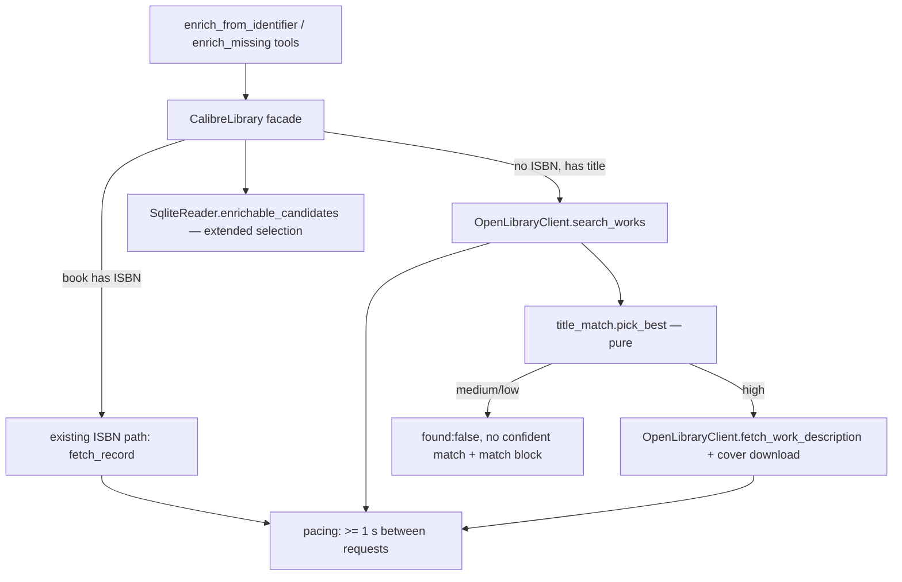

# Title/Author Search Enrichment Design (ENRICH-04)

**Spec**: `.specs/features/title-search-enrichment/spec.md` · **Context**: `context.md`
**Status**: Approved (agent; user reviews in PR — decisions A1/A2 were the user's)

Conforms to AD-026 (HTTP confined to `openlibrary_client.py`, bounded, injectable `http_get`),
AD-027 (bounded read-only sweep), AD-006 (no intelligence in the server — the matcher is
deterministic string similarity, not an LLM). Adds **AD-032** (search fallback + request pacing).

---

## Architecture Overview



The approach choice (fallback inside the existing tool vs. a new candidates tool) was made by the
user (A1). The only other viable shape for the matcher — asking the host LLM to judge the match —
is ruled out by AD-006 and would make the confidence non-reproducible.

---

## Code Reuse Analysis

| Component | Location | How to use |
| --- | --- | --- |
| `_fetch` (timeout + 1 retry) / `_parse_json` / `_flatten_description` | `openlibrary_client.py` | Search and work fetch go through them — no new transport code |
| `_fetch_work_description` edition→work hop | `openlibrary_client.py` | Split: its work-fetch half becomes public `fetch_work_description(work_key)` |
| `OpenLibraryRecord` + `_gap_proposal` + `_propose_cover` | `openlibrary_client.py` / `library.py` | A search match is turned into `OpenLibraryRecord(publisher=None, pubdate=None, description, cover_url)` so the gap/cover logic is reused unchanged (and structurally cannot propose publisher/pubdate) |
| `_classify_enrichment`, per-book error isolation, bounds validation | `library.py` (`enrich_missing`) | Gains one bucket; loop unchanged |
| `enrichable_candidates` SQL | `sqlite_reader.py` | WHERE extended with an `OR` branch for ISBN-less books |
| `_FakeEnricher` duck-typed seam (`facade._enricher`) | `tests/integration/test_library_enrich.py` | Extended with `search_works` / `fetch_work_description` |

## Components

### `title_match.py` (new, pure)
- **Purpose**: score Open Library candidates against a book and pick the best (TSEARCH-02, A4–A6).
- **Interfaces**:
  - `normalize_title(text: str) -> str`
  - `score(book_title: str, book_author: str | None, candidate: SearchCandidate) -> MatchScore`
  - `pick_best(book_title, book_author, candidates) -> MatchScore | None`
- **Dependencies**: stdlib only (`unicodedata`, `re`, `difflib`). No I/O — the "pure module" pattern
  of `rename_resolve.py` / `bulk_edit.py` / `folder_scan.py`.

### `OpenLibraryClient` (extended)
- `search_works(title: str, author: str | None) -> list[SearchCandidate]` — `GET /search.json?title=…
  [&author=…]&limit=5&fields=key,title,author_name,cover_i`; title-only retry when author was sent
  and nothing came back (A7). A non-object body → `EnrichmentSourceError` (TSEARCH-07).
- `fetch_work_description(work_key: str) -> str | None` — best-effort; any failure → `None`.
- **Pacing**: every request through `_fetch` waits until ≥ `min_interval` (default 1.0 s) has passed
  since the previous request of this client. `sleep`/`clock` are injectable (tests pass a fake clock
  → no real waiting).

### `CalibreLibrary` (modified)
- `enrich_from_identifier`: ISBN branch unchanged; otherwise `_enrich_by_search(book)`.
- `enrich_missing`: unchanged loop; `_classify_enrichment` maps `reason == "no confident match"` →
  `no_confident_match`.

### `SqliteReader.enrichable_candidates` (modified)
- Candidates = existing ISBN rule ∪ (no usable ISBN AND `trim(title) != ''` AND (no non-blank comments
  OR `has_cover = 0`)), `ORDER BY id`.

## Data Models

```python
@dataclass(frozen=True)
class SearchCandidate:          # openlibrary_client.py
    work_key: str               # "/works/OL123W"
    title: str
    authors: list[str]
    cover_url: str | None       # covers.openlibrary.org/b/id/<cover_i>-L.jpg (id form, not rate-limited)

@dataclass(frozen=True)
class MatchScore:               # title_match.py
    candidate: SearchCandidate
    title_similarity: float
    author_similarity: float | None
    confidence: Literal["high", "medium", "low"]
```

`match` block in tool output: `{method: "search", confidence, title, authors, work_key,
title_similarity, author_similarity}` (similarities rounded to 2 decimals).

## Testing Seams

| Seam | Existing or New | What a test asserts through it | Reuses |
| --- | --- | --- | --- |
| `title_match.score/pick_best` | New (pure module) | confidence boundaries, normalization, A5/A6 | unit harness like `test_rename_resolve.py` |
| `OpenLibraryClient(http_get=…)` | Existing | search URL/params, retry, parse errors, work description | `test_openlibrary_client.py` fakes |
| `OpenLibraryClient(sleep=…, clock=…)` | **New** — justified: the API's 1 req/s policy must be provable without slowing the suite | pacing waits only the remaining interval | — |
| `facade._enricher` duck-typed fake | Existing | full TSEARCH-01..09 payloads, digest unchanged | `_FakeEnricher` |
| FastMCP `call_tool` | Existing | tool payload + apply through `update_metadata` | `tests/e2e/test_server.py` |

## Error Handling Strategy

| Error scenario | Handling | User impact |
| --- | --- | --- |
| Search request fails (transport/HTTP/parse) | `EnrichmentSourceError` (after 1 retry) | Single book: tool error. Batch: that item `status:"error"`, sweep continues |
| Work description fetch fails | `None` → proposal without comments | `high` match may end as `no_new_data` |
| Cover download fails | existing best-effort (`cover.local_path: null` + error) | text proposal kept |
| No candidates | `found:false, "no record at source", match:null` | normal result |

## Risks & Concerns

| Concern | Location | Impact | Mitigation |
| --- | --- | --- | --- |
| **No request pacing vs. Open Library's documented 1 req/s** (pre-existing; ENRICH-04 multiplies calls) | `openlibrary_client.py:_fetch` | A batch could be throttled/blocked | Pacing in this feature (T3) → AD-032 |
| Pacing makes a batch slow (≈ 3–4 requests per search candidate → ~1.5 min for 25) | `enrich_missing` | A host with a short tool timeout could cut the call | Accepted; documented in the tool docstring + `limit` lets the host page smaller → TD in BACKLOG |
| Fuzzy match writes the wrong book's description | facade | Bad data behind a confirmed token | Only `high` proposes (A4/A5); `match` block shows exactly what matched before the user confirms |
| Revising LOOKUP-02 / ENRICH3-01 tests could look like weakening | tests | Reviewer trust | Revised to the new spec outcome, with the requirement ID in the test comment; nothing deleted |

## Tech Decisions

| Decision | Choice | Rationale |
| --- | --- | --- |
| Similarity metric | `difflib.SequenceMatcher` ratio | stdlib (no new dep, AD-023 single-dep install), deterministic |
| Search result fields | `key,title,author_name,cover_i` only | Docs: `fields` keeps responses cheap; nothing else is used |
| Pacing scope | per client instance (the facade holds one per process) | Single-user server; no global limiter needed |
