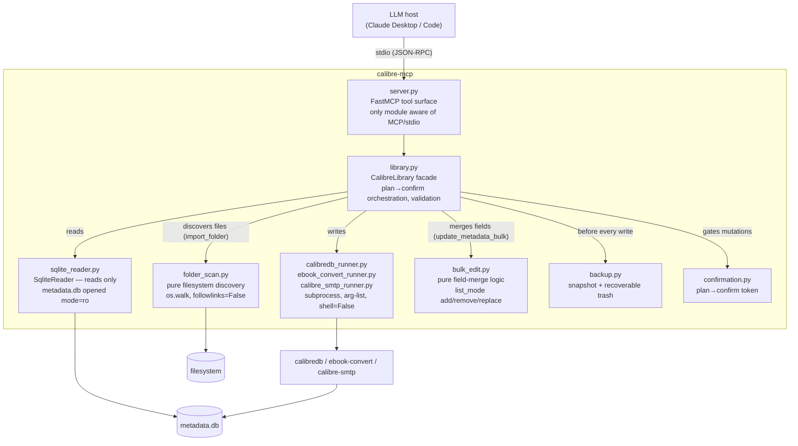
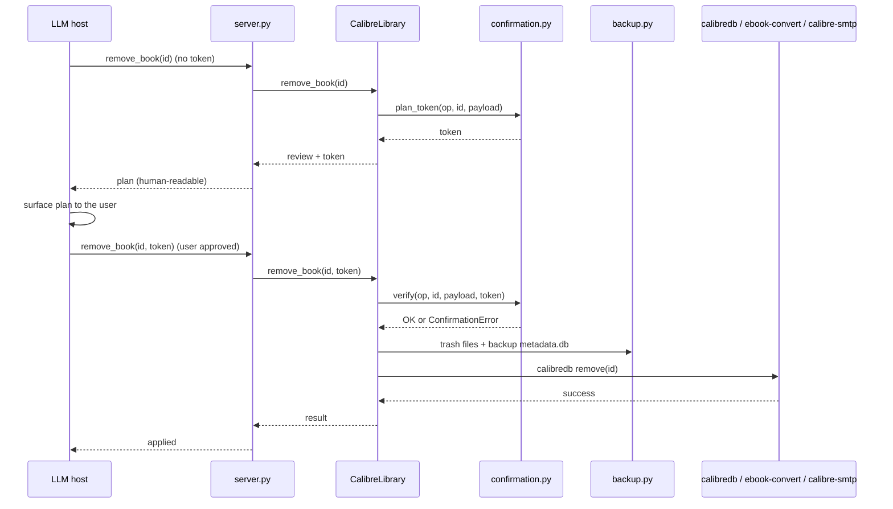
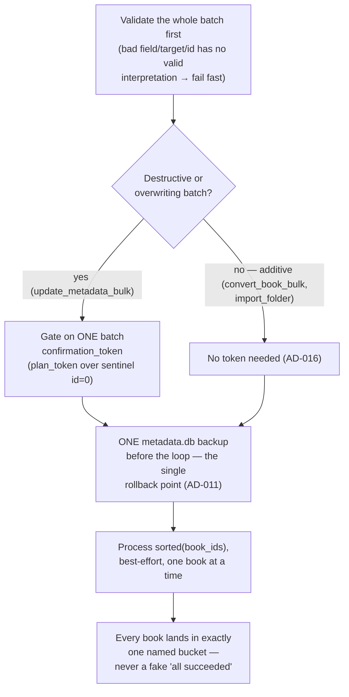

# Architecture

How calibre-mcp is built, and why. The interesting parts for a portfolio read are
[Safety mechanisms](#safety-mechanisms) and the [decision log](#decision-log) — they show the
trade-offs behind an MCP server that's allowed to delete and email a user's files. For what it does
and who it's for, see [PRODUCT.md](PRODUCT.md).

## System overview

**The one invariant a reviewer checks first**: the tool layer (`server.py`) and the facade
(`library.py`) never touch `sqlite3`, `subprocess`, or `os.walk` directly. Reads always go through
`SqliteReader`; writes always go through a runner; recursive filesystem discovery always goes
through `folder_scan.py` (AD-021 — a third named I/O kind alongside SQL and subprocess). Grep for
`import sqlite3` / `import subprocess` / `os.walk` outside `sqlite_reader.py`, the `*_runner.py`
files, and `folder_scan.py` as a quick audit.

## Why hybrid reads/writes

Direct SQLite reads win on speed and on **not caring whether the Calibre GUI holds a lock** —
`list_books`/`get_book` work even while Calibre itself is open. The trade-off: `metadata.db`'s
schema is Calibre's internal implementation, not a public contract, so `SqliteReader`'s JOINs were
verified by hand against a real library.

Writes flip the calculus: Calibre's own integrity logic (id assignment, format-file placement,
path renaming on metadata changes) is non-trivial, and reimplementing it against raw SQL would
mean tracking Calibre's internals forever. `calibredb`/`ebook-convert`/`calibre-smtp` already do
this correctly, so every mutation goes through them as a subprocess instead.

## Safety mechanisms

This server can delete and email a user's files on an LLM's say-so, so the safety net is the part
that earns trust.

**1. Auto-backup before every write** (`backup.py`, AD-011). Before any mutation, `metadata.db` is
copied to `backups/metadata-<timestamp>.db` with rolling retention (last 20 kept). If the backup
can't be written, an `OSError` aborts the operation *before* any `calibredb` call runs.

**2. Recoverable delete, never permanent** (AD-009). `remove_book` copies the book's files to
`backups/trash/<id>-<timestamp>/` *before* calling `calibredb remove` (no `--permanent`) — so it
also lands in Calibre's own recycle bin. Double safety net: even if the recycle bin is emptied, the
trashed files survive.

**3. Plan → confirm on every mutating or outward-facing tool** (`confirmation.py`, AD-012). See the
sequence below — the short version: nothing is written or sent until the host re-calls with a
token that provably matches what was reviewed. `add_book`/`convert_book` stay single-step: both
are purely additive, so the backup-before-write net is judged sufficient without adding friction.

**4. Subprocess safety** (every `*_runner.py`, AD-005). Every external command is invoked as an
**argument list with `shell=False`**, never a shell string — this structurally eliminates command
injection from a book title, tag, or file path. Each runner has exactly one call site, so this is
trivial to audit. The SMTP password is scrubbed from echoed stderr and never included in a tool's
plan/result payload.

**5. Stdout hygiene.** MCP's stdio transport uses stdout as the JSON-RPC framing channel. All
logging goes to **stderr only**; no module prints to stdout, checked by an end-to-end test across
all nine tools.

### The plan → confirm flow

The token is `sha256("{op}|{book_id}|{sorted-json-payload}")[:16]` — not a secret, but an
**integrity proof that the applied operation is exactly the one reviewed**. A payload that changed
between the plan and apply call recomputes to a different token and is refused
(`hmac.compare_digest`, constant-time).

## The bulk operation pattern

`update_metadata_bulk`, `convert_book_bulk`, and `import_folder` all broadcast one operation to N
books. Established by `BULK-01` and reused since (AD-020), the pattern always shapes the same way,
independent of how many bulk tools get added later:

Validating before backing up matters: a batch-level input error (an id that can never be valid, a
target format that doesn't exist) aborts with **zero** side effects, never a partial write followed
by a validation failure. Once past validation, a *per-book* failure is expected and handled —
`sorted(book_ids)` keeps ordering deterministic for tests and for reading the result back. The
bucket names are operation-specific (`applied`/`failed` for edits; `converted`/`skipped`/`failed`
for convert, where `skipped` marks a benign no-op like "already has this format"; `added`/
`duplicate`/`failed` for import) but the shape — every id accounted for, exactly once — never
changes.

## Error taxonomy

Every failure is a typed `CalibreMcpError` subclass (`errors.py`), mapped by `server.py`'s
`_map_errors` decorator to an explicit `ToolError` — never a silent wrong or empty result.

| Exception | Raised when |
| --- | --- |
| `ConfigError` | Startup config invalid (library path unset / no `metadata.db`). |
| `BookNotFoundError` | A referenced book id doesn't exist. |
| `InvalidInputError` | Untrusted input fails validation before touching the db/subprocess. |
| `LibraryLockedError` | Another process (typically the Calibre GUI) holds the library lock. |
| `CalibredbError` / `EbookConvertError` / `CalibreSmtpError` | The respective CLI exited non-zero; carries the command, exit code, stderr. |
| `*NotFoundError` (per CLI) | The binary isn't installed or isn't on `PATH`. |
| `ConfirmationError` | A plan→confirm token doesn't match the requested operation. |
| `SmtpNotConfiguredError` | A required `CALIBRE_MCP_SMTP_*` var is unset (raised lazily). |

## Testing strategy

Three pytest markers: **`unit`** (pure functions, temp dirs, no Calibre needed), **`integration`**
(real `sqlite3`/`calibredb`/`ebook-convert`/`calibre-smtp` against a scratch library),
**`e2e`** (drives the actual `FastMCP` tool surface).

**Non-negotiable rule**: write tests never touch the maintainer's real library — every mutating
test bootstraps a disposable scratch library first (`tests/conftest.py`) and seeds it with
**synthetic** sample books built by `ebook-convert` (`tests/sample_books.py`). CI installs Calibre so
the write-path tests run for real, not skipped; `pytest -rs` is on by default so a skip can never
hide behind a green run again (AD-029 — until then the samples were copied from a hard-coded
personal path, and ~180 tests skipped silently in CI and after the library moved).

Two layers sit on top of the per-tool contracts: `tests/e2e/test_curation_journey.py` chains every
write tool the way a host drives a session, and [`docs/live-smoke-test.md`](docs/live-smoke-test.md)
is the manual runbook for the same journey against a real library, with a snapshot and a
field-by-field before/after diff. A few read-only tests can also target a real library, opt-in via
`CALIBRE_MCP_TEST_REAL_LIBRARY`.

## Decision log

The full, dated decision record (`AD-001` … `AD-030`) lives in
[`.specs/STATE.md`](.specs/STATE.md). Highlights not covered above:

- **AD-002/003 — local stdio, no auth, no network surface.** The host launches the server
  directly; there's no port to secure by construction.
- **AD-006 — intelligence lives in the host, not the server.** No embedded LLM calls; calibre-mcp
  stays a deterministic, testable tool surface.
- **AD-010 — `search_books` resolves ids via `calibredb search`, then hydrates from SQLite.**
  Reuses Calibre's real query grammar, at the cost of `search_books` (unlike `list_books`) being
  able to fail under a GUI lock — a documented trade-off, not a silent gap.
- **AD-014 — one sibling runner per external CLI.** Adding a fourth external tool means adding a
  fourth small runner with the same shape (arg-list, `shell=False`, failure→taxonomy), not
  branching a shared one.
- **AD-020 — the bulk operation pattern** (validate → single backup → best-effort loop → bucketed
  result), detailed above under [The bulk operation pattern](#the-bulk-operation-pattern).
- **AD-021 — filesystem discovery is its own pure module** (`folder_scan.py`), naming recursive
  directory walking as a third I/O kind the facade orchestrates but never performs itself —
  alongside SQL reads and subprocess writes.

This file is the stable "how it's built and why" reference. `.specs/STATE.md` and
[`ROADMAP.md`](ROADMAP.md) (tactical) / [`ROADMAP-STRATEGY.md`](ROADMAP-STRATEGY.md) (strategic) /
[`BACKLOG.md`](BACKLOG.md) are the living planning documents, updated per feature.
