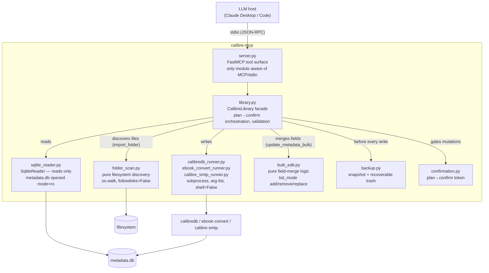
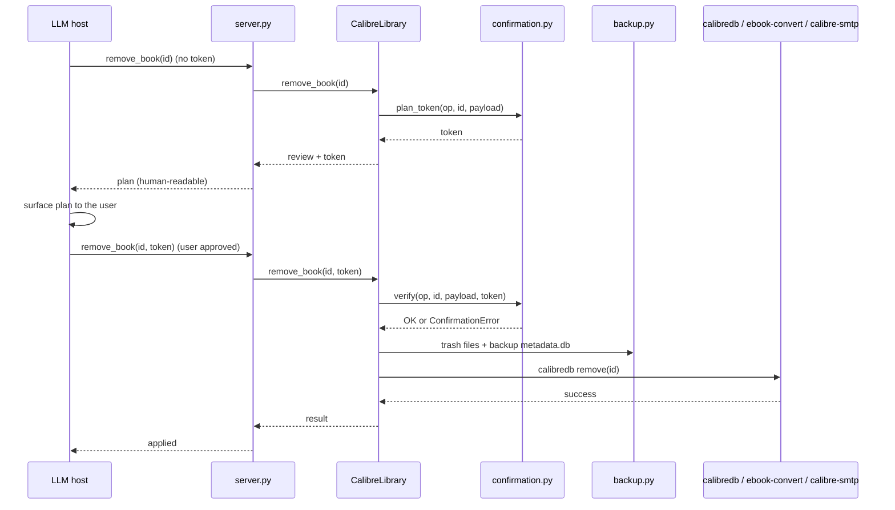
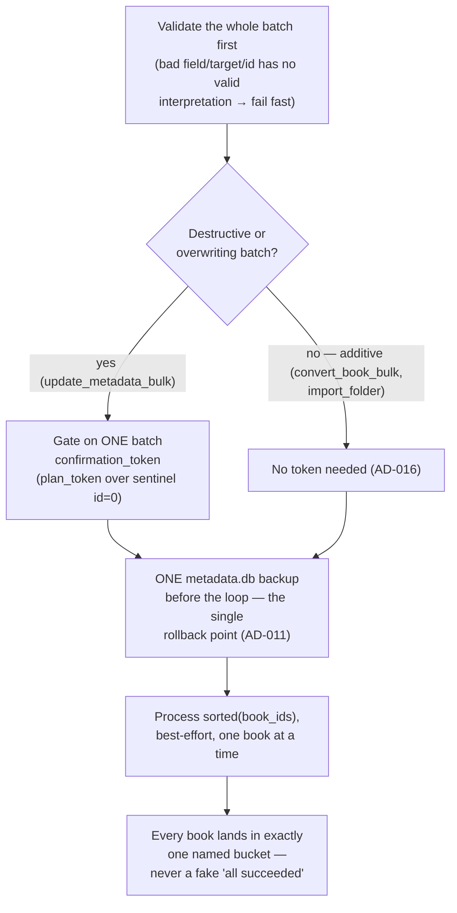

# Architecture

This page shows how calibre-mcp works, and why. For a portfolio read, start with
[Safety mechanisms](#safety-mechanisms) and the [decision log](#decision-log). They show the
trade-offs of an MCP server that can delete and email the files of a user. For what it does and who
it is for, read [PRODUCT.md](PRODUCT.md).

## System overview

**The first invariant to check in a review:** the tool layer (`server.py`) and the facade
(`library.py`) never touch `sqlite3`, `subprocess` or `os.walk` directly.

- Reads always go through `SqliteReader`.
- Writes always go through a runner.
- Recursive filesystem discovery always goes through `folder_scan.py`. AD-021 names it as a third
  I/O kind, next to SQL and subprocess.

For a quick audit, grep for `import sqlite3` / `import subprocess` / `os.walk` outside
`sqlite_reader.py`, the `*_runner.py` files and `folder_scan.py`.

## Why hybrid reads/writes

Direct SQLite reads are fast, and **a lock held by the Calibre GUI does not stop them**.
`list_books`/`get_book` work even while Calibre is open. The trade-off: the schema of `metadata.db`
is an internal detail of Calibre, not a public contract. So we verified the JOINs of `SqliteReader`
by hand against a real library.

For writes, the balance changes. The integrity logic of Calibre is complex: id assignment,
format-file placement, path renames on metadata changes. A copy of it in raw SQL means following
the internals of Calibre forever. `calibredb`/`ebook-convert`/`calibre-smtp` already do this
correctly. So each change goes through them as a subprocess.

## Safety mechanisms

This server can delete and email the files of a user when an LLM asks. So the safety net is the
part that earns trust.

**1. Auto-backup before each write** (`backup.py`, AD-011). Before each change, the server copies
`metadata.db` to `backups/metadata-<timestamp>.db`. Retention is rolling (the last 20 stay). If the
backup write fails, an `OSError` stops the operation *before* any `calibredb` call.

**2. Recoverable delete, never permanent** (AD-009). `remove_book` copies the files of the book to
`backups/trash/<id>-<timestamp>/`. *Then* it calls `calibredb remove` (no `--permanent`), so the book
also goes to the Calibre recycle bin. This is a double safety net: if someone empties the recycle
bin, the trashed files survive.

**3. Plan → confirm on each tool that changes data or sends data out** (`confirmation.py`, AD-012).
The sequence is below. In short: nothing is written or sent until the host calls again with a token
that matches what the user reviewed. `add_book`/`convert_book` stay single-step. Both only add
data, so the backup before the write is enough, with no extra friction.

**4. Subprocess safety** (each `*_runner.py`, AD-005). Each external command runs as an **argument
list with `shell=False`**, never a shell string. This structure removes command injection through a
book title, a tag or a file path. Each runner has exactly one call site, so the audit is easy. The
server removes the SMTP password from echoed stderr. The password never appears in the plan or
result payload of a tool.

**5. Stdout hygiene.** The MCP stdio transport uses stdout as the JSON-RPC framing channel. All
logging goes to **stderr only**. No module prints to stdout. An end-to-end test checks this across
all nine tools.

### The plan → confirm flow

The token is `sha256("{op}|{book_id}|{sorted-json-payload}")[:16]`. It is not a secret. It is an
**integrity proof: the applied operation is exactly the reviewed one**. If the payload changes
between the plan call and the apply call, the token changes too, and the server refuses it
(`hmac.compare_digest`, constant-time).

## The bulk operation pattern

`update_metadata_bulk`, `convert_book_bulk` and `import_folder` all apply one operation to N books.
`BULK-01` set the pattern, and later tools reuse it (AD-020). The shape stays the same for each new
bulk tool:

The validation comes before the backup for a reason. A batch-level input error (an id that can
never be valid, a target format that does not exist) stops with **zero** side effects. There is
never a partial write and then a validation failure. After the validation, a *per-book* failure is
normal, and the loop handles it. `sorted(book_ids)` keeps the order deterministic for tests and for
the result.

The bucket names depend on the operation:

- Edits: `applied`/`failed`.
- Convert: `converted`/`skipped`/`failed`. `skipped` marks a harmless no-op, for example "already
  has this format".
- Import: `added`/`duplicate`/`failed`.

The shape never changes: each id appears exactly once.

## Error taxonomy

Each failure is a typed `CalibreMcpError` subclass (`errors.py`). The `_map_errors` decorator of
`server.py` maps it to an explicit `ToolError`. A failure never becomes a silent wrong or empty
result.

| Exception | Raised when |
| --- | --- |
| `ConfigError` | Startup config invalid (library path unset / no `metadata.db`). |
| `BookNotFoundError` | A referenced book id doesn't exist. |
| `InvalidInputError` | Untrusted input fails validation before touching the db/subprocess. |
| `LibraryLockedError` | Another process (typically the Calibre GUI) holds the library lock. |
| `CalibredbError` / `EbookConvertError` / `CalibreSmtpError` | The respective CLI exited non-zero; carries the command, exit code, stderr. |
| `*NotFoundError` (per CLI) | The binary isn't installed or isn't on `PATH`. |
| `ConfirmationError` | A plan→confirm token doesn't match the requested operation. |
| `SmtpNotConfiguredError` | A required `CALIBRE_MCP_SMTP_*` var is unset (raised lazily). |

## Testing strategy

Three pytest markers:

- **`unit`** — pure functions and temp dirs. No Calibre needed.
- **`integration`** — real `sqlite3`/`calibredb`/`ebook-convert`/`calibre-smtp` against a scratch
  library.
- **`e2e`** — drives the real `FastMCP` tool surface.

**Rule with no exception:** write tests never touch the real library of the maintainer. Each test
that changes data first creates a disposable scratch library (`tests/conftest.py`). It fills the
library with **synthetic** sample books that `ebook-convert` builds (`tests/sample_books.py`). CI
installs Calibre, so the write-path tests run for real and do not skip. `pytest -rs` is on by
default, so a skip cannot hide behind a green run again. (AD-029: before it, the samples came from a
hard-coded personal path. About 180 tests skipped silently in CI and after the library moved.)

Two layers sit on top of the per-tool contracts:

- `tests/e2e/test_curation_journey.py` chains each write tool the way a host drives a session.
- [`docs/live-smoke-test.md`](docs/live-smoke-test.md) is the manual runbook for the same journey
  against a real library. It has a snapshot and a field-by-field before/after diff.

A few read-only tests can also target a real library. To opt in, set `CALIBRE_MCP_TEST_REAL_LIBRARY`.

## Decision log

The full, dated decision record (`AD-001` … `AD-032`) lives in
[`.specs/STATE.md`](.specs/STATE.md). Highlights not covered above:

- **AD-002/003 — local stdio, no auth, no network surface.** The host launches the server
  directly. By construction, there is no port to secure.
- **AD-006 — the intelligence lives in the host, not in the server.** No embedded LLM calls.
  calibre-mcp stays a deterministic, testable tool surface.
- **AD-010 — `search_books` resolves ids with `calibredb search`, then fills the data from SQLite.**
  It reuses the real query grammar of Calibre. The cost: unlike `list_books`, `search_books` can
  fail under a GUI lock. This trade-off is documented, not a silent gap.
- **AD-014 — one sibling runner per external CLI.** To add a fourth external tool, add a fourth
  small runner with the same shape (arg-list, `shell=False`, failure→taxonomy). Do not branch a
  shared one.
- **AD-020 — the bulk operation pattern** (validate → single backup → best-effort loop → bucketed
  result). The section [The bulk operation pattern](#the-bulk-operation-pattern) above has the
  detail.
- **AD-021 — filesystem discovery is its own pure module** (`folder_scan.py`). Recursive directory
  walking is a third I/O kind, next to SQL reads and subprocess writes. The facade orchestrates it
  but never does it itself.

This file is the stable "how it works and why" reference. The living planning documents change with
each feature: `.specs/STATE.md`, [`ROADMAP.md`](ROADMAP.md) (tactical),
[`ROADMAP-STRATEGY.md`](ROADMAP-STRATEGY.md) (strategic) and [`BACKLOG.md`](BACKLOG.md).
