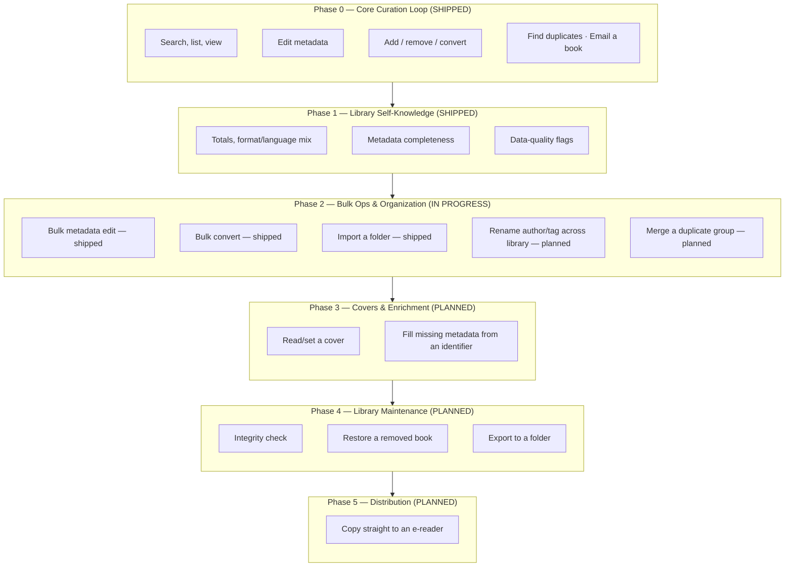
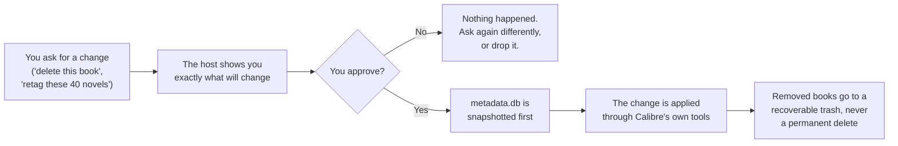

# Product

What calibre-mcp is *for*, who it serves, and what it does today. For how it's built, see
[ARCHITECTURE.md](ARCHITECTURE.md); for what's next and why, see
[`.specs/ROADMAP.md`](.specs/ROADMAP.md).

## The pitch

Managing an ebook library today means clicking around the Calibre desktop GUI: opening dialogs to
edit metadata, right-clicking to convert a format, hunting for duplicates by eye. calibre-mcp turns
that into a conversation. Point an MCP-compatible LLM host (Claude Desktop, Claude Code, or any
other MCP client) at your library, and it can search, edit, curate, organize, convert, and send
your books the way you'd ask a librarian to — while a human stays in the loop on anything that
changes or leaves the machine.

## Who it's for

One person, one library. calibre-mcp is a **personal tool, built to a professional bar** (AD-018):
no multi-tenant concerns, no packaging/distribution effort — but also no shortcuts on safety or
correctness, because it's trusted with the only copy of a library that took years to curate. It
doubles as a portfolio piece: a concrete answer to "how do you design a tool that's allowed to
delete a user's files," not just a toy integration.

## Product principles

| Principle | What it means in practice |
| --- | --- |
| **The GUI is the thing being replaced.** | Ambition (AD-019) is full coverage of what the Calibre GUI is used for day to day — not a narrow read-only integration. |
| **Trust is earned per action, not assumed.** | Every mutation is backed up first; every destructive or outward-facing action is reviewed before it happens. Speed never trades against safety. |
| **The host is the intelligence; the server is the tool.** | calibre-mcp makes no LLM calls of its own (AD-006) — it exposes clean, deterministic capabilities and lets the host (and the human behind it) decide what to do with them. |
| **Calibre stays authoritative.** | Every write goes through Calibre's own tools (`calibredb`, `ebook-convert`, `calibre-smtp`), never a raw database edit — the library never drifts from what Calibre itself considers valid. |

## Capability map

Each phase below is a slice of "things you currently need the Calibre GUI for." Phase 0 and 1 are
shipped; Phase 2 is in progress; Phases 3–5 are scoped but not yet built.

## What you can do today

**Discover & inspect** — read-only, never blocked by the Calibre GUI holding the library open:

| Capability | Tool |
| --- | --- |
| Search with Calibre's own query language (`author:asimov`, `tag:scifi`, `series:Dune`) | `search_books` |
| Browse the library page by page, sorted | `list_books` |
| Look up one book's full record | `get_book` |
| See totals, format/language mix, and what's incomplete without paging through books | `calibre://library/stats` resource |

**Curate a single book** — every change is reviewed before it happens:

| Capability | Tool | Reviewed first? |
| --- | --- | --- |
| Edit title, authors, tags, series, rating, comments, publisher, pubdate, languages | `update_metadata` | Yes |
| Add a book from a file on disk | `add_book` | Backed up |
| Convert to epub/azw3/mobi/pdf, keeping the original | `convert_book` | Backed up |
| Remove a book — recoverably, never a hard delete | `remove_book` | Yes |
| Email a book's best-matching format to someone | `email_book` | Yes |

**Curate at scale** — the same guarantees, applied to many books in one call:

| Capability | Tool |
| --- | --- |
| Broadcast a field change (retag, re-rate, re-series) across N books | `update_metadata_bulk` |
| Convert N books to one target format in one call | `convert_book_bulk` |
| Import every ebook found under a folder, recursively | `import_folder` |

**Stay honest about the data:**

| Capability | Tool |
| --- | --- |
| Flag likely-duplicate books by normalized title/author — advisory only, never auto-merges | `find_duplicates` |

## The trust model, in plain terms

An LLM host acting on your library needs guardrails a human would apply instinctively. calibre-mcp
makes each one explicit and mechanical rather than relying on the model "being careful":

Four guarantees back that flow, described in implementation depth in
[ARCHITECTURE.md#safety-mechanisms](ARCHITECTURE.md#safety-mechanisms):

1. **Nothing destructive or outward-facing happens without a review step.** Editing, removing, and
   emailing all show you a plan first; nothing is written or sent until you approve that exact plan.
2. **Every mutation is preceded by a backup**, so a wrong or regretted change (including a bulk one)
   always has a rollback point.
3. **Deleting a book is always recoverable** — the files are kept, not just moved to Calibre's own
   recycle bin.
4. **A partial failure is always reported honestly.** A bulk operation on 40 books where 3 fail
   never says "all succeeded," and never silently drops the 3 — every book lands in a named bucket
   (applied/failed, converted/skipped/failed, added/duplicate/failed) you can read.

## Roadmap at a glance

| Phase | Capability | Status |
| --- | --- | --- |
| 0 — Core Curation Loop | Search, edit, add, remove, convert, dedupe, email | Shipped |
| 1 — Library Self-Knowledge | Stats resource: completeness, mix, data-quality flags | Shipped |
| 2 — Bulk Ops & Organization | Bulk edit/convert/import shipped; author/tag rename + duplicate merge next | In progress |
| 3 — Covers & Enrichment | Cover read/write, identifier-based metadata lookup (first outbound network call) | Planned |
| 4 — Library Maintenance | Integrity check, restore, export | Planned |
| 5 — Distribution | Direct e-reader copy | Planned |

Full phase-gates, candidate features, and sequencing rationale live in
[`.specs/ROADMAP.md`](.specs/ROADMAP.md); the dated decision record behind each choice is in
[`.specs/STATE.md`](.specs/STATE.md).

## Deliberately out of scope

| Not doing | Why |
| --- | --- |
| PyPI packaging, install docs for other users, multi-library config | Personal-use horizon, confirmed (AD-018) — not an open-source distribution effort. |
| Any AI/LLM call inside the server itself | Intelligence lives in the host; calibre-mcp stays a deterministic, testable tool surface (AD-006). |
| The Calibre e-book viewer or in-place content editor | Reading/editing book *content* is outside an MCP metadata/orchestration tool's reach. |
| Calibre-Web / always-on content-server orchestration | A separate service most single-user setups don't run; revisit only if it becomes real friction. |
| News/periodical fetch ("recipes") | Not part of the ebook-curation loop this project targets. |
