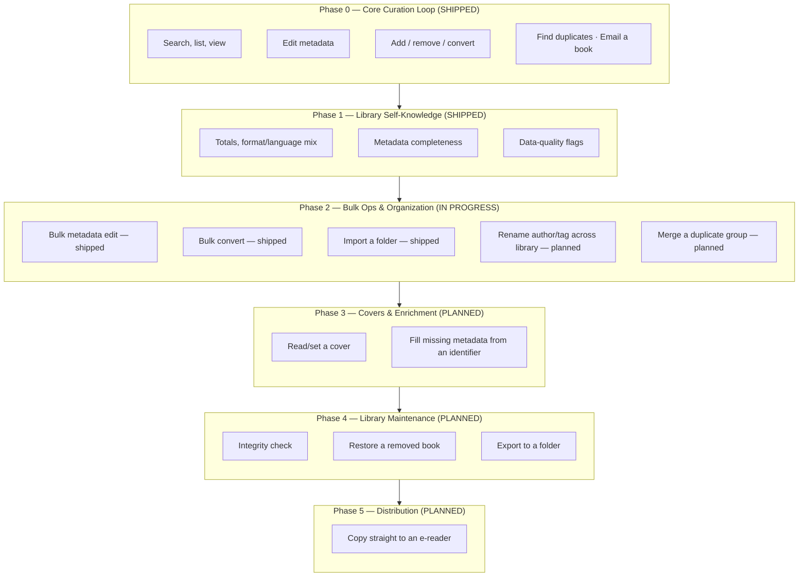
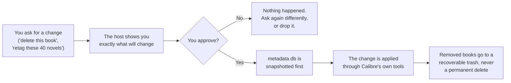

# Product

This page says what calibre-mcp is *for*, who it serves and what it does today. For how it works,
read [ARCHITECTURE.md](ARCHITECTURE.md). For what comes next and why, read [`ROADMAP.md`](ROADMAP.md).

## The pitch

Today, to manage an ebook library, you click around the Calibre desktop GUI. You open dialogs to
edit metadata, right-click to convert a format and look for duplicates by eye. calibre-mcp turns
that work into a conversation. Connect an MCP-compatible LLM host (Claude Desktop, Claude Code or any
other MCP client) to your library. The host can then search, edit, curate, organize, convert and send
your books, as you ask a librarian to. A human approves each action that changes data or sends data
off the machine.

## Who it's for

One person, one library. calibre-mcp is a **personal tool, built to a professional bar** (AD-018).
It has no multi-tenant concerns and no packaging or distribution effort. But it takes no shortcuts on
safety or correctness: it holds the only copy of a library that took years to curate. It is also a
portfolio piece. It gives a concrete answer to "how do you design a tool that can delete the files
of a user". It is not a toy integration.

## Product principles

| Principle | What it means in practice |
| --- | --- |
| **The GUI is the thing being replaced.** | Ambition (AD-019) is full coverage of what the Calibre GUI is used for day to day — not a narrow read-only integration. |
| **Trust is earned per action, not assumed.** | Every mutation is backed up first; every destructive or outward-facing action is reviewed before it happens. Speed never trades against safety. |
| **The host is the intelligence; the server is the tool.** | calibre-mcp makes no LLM calls of its own (AD-006) — it exposes clean, deterministic capabilities and lets the host (and the human behind it) decide what to do with them. |
| **Calibre stays authoritative.** | Every write goes through Calibre's own tools (`calibredb`, `ebook-convert`, `calibre-smtp`), never a raw database edit — the library never drifts from what Calibre itself considers valid. |

## Capability map

Each phase below is a slice of "things you need the Calibre GUI for today". The diagram shows the
original plan. The [roadmap table](#roadmap-at-a-glance) below has the current status.

## What you can do today

**Discover & inspect** — read-only. A library held open by the Calibre GUI never blocks it:

| Capability | Tool |
| --- | --- |
| Search with Calibre's own query language (`author:asimov`, `tag:scifi`, `series:Dune`) | `search_books` |
| Browse the library page by page, sorted | `list_books` |
| Look up one book's full record | `get_book` |
| See totals, format/language mix, and what's incomplete without paging through books | `calibre://library/stats` resource |

**Curate a single book** — you review each change before it happens:

| Capability | Tool | Reviewed first? |
| --- | --- | --- |
| Edit title, authors, tags, series, rating, comments, publisher, pubdate, languages | `update_metadata` | Yes |
| Add a book from a file on disk | `add_book` | Backed up |
| Convert to epub/azw3/mobi/pdf, keeping the original | `convert_book` | Backed up |
| Remove a book — recoverably, never a hard delete | `remove_book` | Yes |
| Email a book's best-matching format to someone | `email_book` | Yes |

**Curate at scale** — the same guarantees, for many books in one call:

| Capability | Tool |
| --- | --- |
| Broadcast a field change (retag, re-rate, re-series) across N books | `update_metadata_bulk` |
| Convert N books to one target format in one call | `convert_book_bulk` |
| Import every ebook found under a folder, recursively | `import_folder` |

**Stay honest about the data:**

| Capability | Tool |
| --- | --- |
| Flag likely-duplicate books by normalized title/author — advisory only, never auto-merges | `find_duplicates` |

## The trust model, in plain terms

An LLM host that acts on your library needs the guardrails that a human applies by instinct.
calibre-mcp makes each guardrail explicit and mechanical. It does not trust the model to "be
careful":

Four guarantees support that flow. [ARCHITECTURE.md#safety-mechanisms](ARCHITECTURE.md#safety-mechanisms)
describes the implementation:

1. **Nothing destructive or outward-facing happens without a review step.** Edit, remove and email
   all show you a plan first. Nothing is written or sent until you approve that exact plan.
2. **A backup comes before each change.** So a wrong change, or one you regret (bulk too), always
   has a rollback point.
3. **A deleted book is always recoverable.** The server keeps the files. It does not only move them
   to the Calibre recycle bin.
4. **The server always reports a partial failure honestly.** If 3 of 40 books fail in a bulk
   operation, it never says "all succeeded" and never drops the 3 in silence. Each book goes into a
   named bucket that you can read (applied/failed, converted/skipped/failed, added/duplicate/failed).

## Roadmap at a glance

| Phase | Capability | Status |
| --- | --- | --- |
| 0 — Core Curation Loop | Search, edit, add, remove, convert, dedupe, email | Shipped |
| 1 — Library Self-Knowledge | Stats resource: completeness, mix, data-quality flags | Shipped |
| 2 — Bulk Ops & Organization | Bulk edit/convert/import, author/tag/series rename, duplicate merge | Shipped |
| 3 — Covers & Enrichment | Cover read/write, ISBN-based metadata proposals (first outbound network call) | Shipped; phase gate open (books without an ISBN) |
| 4 — Library Maintenance | Metadata rollback, integrity check, restore, export | Next |
| 5 — Distribution | Direct e-reader copy | Planned |

The full phase gates, candidate features and sequence rationale live in [`ROADMAP.md`](ROADMAP.md).
The strategy lives in [`ROADMAP-STRATEGY.md`](ROADMAP-STRATEGY.md). The dated decision record behind
each choice is in [`.specs/STATE.md`](.specs/STATE.md).

## Deliberately out of scope

| Not doing | Why |
| --- | --- |
| PyPI packaging, install docs for other users, multi-library config | Personal-use horizon, confirmed (AD-018) — not an open-source distribution effort. |
| Any AI/LLM call inside the server itself | Intelligence lives in the host; calibre-mcp stays a deterministic, testable tool surface (AD-006). |
| The Calibre e-book viewer or in-place content editor | Reading/editing book *content* is outside an MCP metadata/orchestration tool's reach. |
| Calibre-Web / always-on content-server orchestration | A separate service most single-user setups don't run; revisit only if it becomes real friction. |
| News/periodical fetch ("recipes") | Not part of the ebook-curation loop this project targets. |
